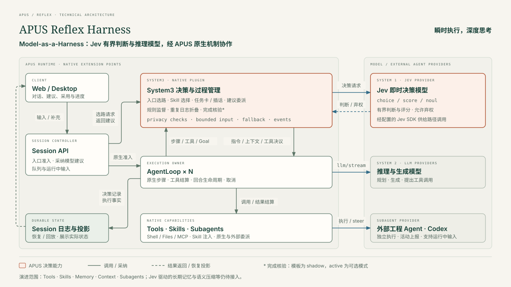

# APUS Reflex Harness

English | [中文](README.zh.md)

**瞬策 · 瞬时执行，深度思考。** Model-as-a-Harness: coordinate decision and reasoning models to manage an agent's work, with a local runtime that executes actions, enforces permissions, and records results.

APUS combines a desktop client, Web UI, and Harness runtime in one repository. Use it to research information, create documents, write code, and work with files in a selected workspace.

## Download the desktop app

Visit [Releases](https://github.com/APUS-AI-Lab/APUS-Reflex-Harness/releases) for published installers and supported platforms. The integrated preview is being prepared; no installer is promised until it appears there with validation results. GitHub's “Source code” archives are source files, not applications.

The desktop distribution bundles its runtime. Users do not need Git, Node.js, or a separate backend. Follow [installation](docs/feat-integrated-product/installation.md) and [model configuration](docs/feat-integrated-product/configuration.md); model access requires your own provider credentials. Preview builds can break compatibility. Read [SAFETY.md](SAFETY.md) before granting access to your files.

<a id="run"></a>

<a id="run-from-source"></a>

## Run from source

Install Git, Node.js 24, and pnpm 11.7.0. From a terminal:

```sh
git clone https://github.com/APUS-AI-Lab/APUS-Reflex-Harness.git
cd APUS-Reflex-Harness
pnpm run setup
pnpm run start:desktop
```

Setup installs both dependency sets, builds the Harness, and prepares the desktop runtime from this checkout. The initial download and build require network access and time. For Web development, run `pnpm run dev:web`. See [source development](docs/feat-integrated-product/development.md) for prerequisites and troubleshooting.

## Model-as-a-Harness

Jev provides bounded decisions; reasoning models handle planning, generation, and tool calls. DSH executes approved actions and preserves session facts. With explicit System3 configuration, APUS can suggest routing and skills, retain task requirements and additions, manage engineering delegation, and check configured completion evidence.

- **Divide work by task:** select from allowed model and skill candidates, subject to runtime policy.
- **Accept changing requirements:** keep task additions available to the active workflow and supported delegates.
- **Inspect the process:** distinguish recommendations, adopted decisions, model responses, and delegation progress.



Managing tools, skills, memory, context, and subagents through models is the product direction. Individual capabilities have different configuration and verification requirements; see [System3 capabilities and limits](packages/experimental/system3/README.md). A local application does not mean offline inference.

## Documentation and development

- [Install and update](docs/feat-integrated-product/installation.md) · [Configure models](docs/feat-integrated-product/configuration.md)
- [Develop from source](docs/feat-integrated-product/development.md) · [Release procedure](docs/feat-integrated-product/releases.md)
- [Architecture](docs/architecture.md) · [Contributing](CONTRIBUTING.md)
- [Report an issue](https://github.com/APUS-AI-Lab/APUS-Reflex-Harness/issues)

`frontend/` owns the Electron desktop host; `apps/web/` owns the Web entry; `packages/` owns the runtime and shared UI. Both product entry points use this repository's Harness.

## License and acknowledgments

APUS builds on DeepSeek Harness, DataElement's DSH Desktop, Cordis, and their contributors. The original MIT notices remain in [LICENSE](LICENSE) and [frontend/LICENSE](frontend/LICENSE); dependency terms remain in the [Harness notices](THIRD_PARTY_NOTICES.md) and [desktop notices](frontend/THIRD_PARTY_NOTICES.md). APUS branding does not imply upstream endorsement.
