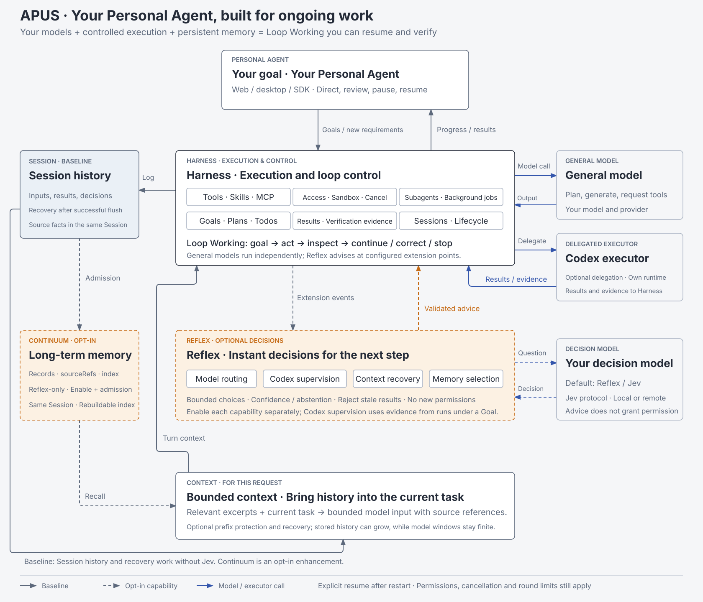
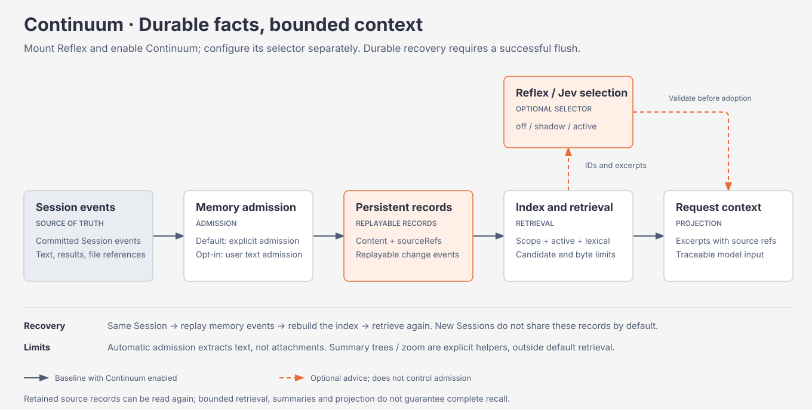

# APUS Reflex Harness


English | [中文](README.zh.md)

> **瞬策 · Instant action. Deep thinking. · Model-as-a-Harness.** Build a Personal Agent with your models, persistent task history and **Loop Working**.

APUS turns a sequence of model calls into work that can continue around a goal: understand the request, choose an action, execute, inspect the evidence, recover relevant context and continue. You choose the general model for planning and generation; optionally connect your own Reflex/Jev decision service for structured decisions along the way.

APUS separates model reasoning from execution, permissions and durable Session history. It is a **developer preview**. The [release readiness review](docs/dev-continuum-reflex-integration/release-readiness.md) records what has been tested and what still needs acceptance.

This integration merges frontend and backend delivery into the existing Harness repository: the desktop client lives in `frontend/`, with configuration, builds and packaging managed together. Desktop installers bundle the backend, so users do not start or install a separate service.

## Download the desktop app

The repository is currently private: Release downloads require repository access until an administrator makes it public.

Visit [Releases](https://github.com/APUS-AI-Lab/APUS-Reflex-Harness/releases) for installers, supported platforms and validation results. `0.1.0` (`v0.1.0`) targets macOS Apple Silicon (arm64), macOS Intel (x64), Windows x64, Ubuntu 24.04 x64 desktop and a complete Linux x64 Web archive from the same reviewed clean source commit. The macOS editions passed automated copying, direct process startup and restart checks; Finder/Gatekeeper installation acceptance remains incomplete, and an invalid bundle seal was found in a checked `0.1.0` DMG. Linux x64 Web passed extraction, startup and restart checks. Windows x64 and Ubuntu 24.04 x64 desktop are experimental downloads with incomplete installation acceptance; see the [platform status](docs/feat-integrated-product/installation.md). This is an unsigned preview; macOS is not notarized. The first task with a real model has not been validated; configure your own model using the guide. GitHub’s “Source code” archives contain source files, not installable applications. The Web archive bundles Node and the backend, listens on localhost, and needs no Electron; see the [Web guide](docs/release-web-runtime/README.md).

The desktop distribution bundles its runtime: users do not need Git, Node.js or a separate backend. Follow [installation](docs/feat-integrated-product/installation.md) and [model configuration](docs/feat-integrated-product/configuration.md) using your own provider credentials. Preview builds can break compatibility. Read [SAFETY.md](SAFETY.md) before granting file access.

Product builds provide Full and Lite editions: Full bundles the Office engine; Lite keeps the core Agent, Reflex, memory, Codex and PPT workbench while excluding that engine. `0.1.1` is not released or installation-qualified yet. See [edition selection](docs/feat-office-editions/README.md) for preview limitations and upgrade behavior.

## A Personal Agent for ongoing projects

Consider a personal project: build a small expense tracker. You specify CSV import, local storage and a rule that source files must remain untouched. The agent plans the change, edits code, runs tests and records the results. Later, you add a new requirement: handle refunds without double-counting them.

With the relevant integrations enabled, APUS can retain admitted requirements, retrieve related facts, compare work against the current Goal and use execution evidence when deciding the next step. After a restart, you can reopen the same Session and recover the existing task history. **Goal state restores with the Session; resuming automatic continuation requires an explicit resume.**

This is a scenario illustration, not a claim that every step has passed a single end-to-end product test. The [casebook](docs/dev-continuum-reflex-integration/classic-cases.html) separates reproducible cases from proposed demonstrations.

## Loop Working: a goal, actions and feedback

A long task needs both continuity and control. Loop Working connects them in a repeatable cycle:

1. **Establish the goal.** Keep the objective, current requirements and later corrections attributable to their source.
2. **Choose the next action.** Let the general model plan; use configured Reflex integrations for bounded routing, selection or supervision decisions.
3. **Execute through the Harness.** Run tools, skills and subagents under the configured permissions and cancellation rules.
4. **Inspect the evidence.** Record tool results, decision receipts and adopted interventions rather than treating a model’s completion statement as independent proof.
5. **Recover and continue.** Restore relevant history, reassess progress and continue within the configured execution limits, or pause for the user.

Memory supports this cycle; it does not replace goal management, verification or permission checks. Task success still needs task-specific evidence.

<a id="architecture"></a>

## The models decide; the Harness executes



[English overview](docs/dev-continuum-reflex-integration/apus-reflex-loop-working-architecture.en.html) · [中文架构](docs/dev-continuum-reflex-integration/apus-reflex-loop-working-architecture.html) · [Runtime architecture](docs/architecture.md)

The “large brain” is your configured general model: it reasons, plans, generates content and proposes tool calls. The “small brain” is an optional Reflex/Jev service: it answers structured choice, score or proposition questions within supplied candidates and constraints. The Harness owns execution and records the adopted results; it is not itself a model.

| Layer | What it contributes to ongoing work |
| --- | --- |
| Input facts | Accepted user messages and execution events enter the Session log; durability requires successful persistence and flush. |
| Reflex decisions | Configured integrations select routes or memory candidates, assess progress and propose bounded recovery actions. |
| Harness execution | Tools, skills and subagents perform work with permissions, cancellation and owned process lifecycles. |
| Persistent memory | Continuum restores admitted records from the same Session and rebuilds its retrieval index. |
| Context projection | Relevant excerpts form a bounded model request; Reflex control context projection protects submitted history prefixes. |
| Outcome feedback | Recorded actions, results and decision receipts inform subsequent work and independent review. |

The decision service is configurable. A replacement must implement the supported Jev/System One protocol; an arbitrary chat-completions endpoint is not automatically a replacement for every Reflex integration. See the [Jev provider guide](packages/experimental/apus-dsh-jev-plugin/README.md).

## Persistent memory, finite context



[English memory flow](docs/dev-continuum-reflex-integration/apus-reflex-loop-working-architecture.en.html#memory) · [中文记忆流程](docs/dev-continuum-reflex-integration/apus-reflex-loop-working-architecture.html#memory) · [Continuum semantics](packages/context/continuum/README.md) · [Optional Jev selector](packages/experimental/continuum-jev/README.md)

**Continuum** separates task history from the limited context of a single inference request. A fact can remain in persisted history even when it is absent from the current prompt. Retrieval and optional Reflex selection bring a bounded working set back into the next request.

- **Keep source references.** Admitted records cite Session events. Corrections create successors, and deactivation stops a record from participating in recall while retaining its history.
- **Control admission and scope.** Admission is explicit by default. An opt-in policy can admit committed human text; scope filtering controls which records a read can use.
- **Restore the same task.** The current lifecycle restores memory from the same Session across turns and process restarts. A new Session does not automatically gain a global personal memory store.
- **Bound each request.** Retrieval limits candidate counts and excerpt bytes. Jev selects among supplied candidates and falls back according to its configured mode and failure policy.

“Infinite context” and “infinite memory” name the product direction: continue useful work beyond one model window by retaining history and recovering relevant context. Storage and context remain finite, lexical retrieval can miss relevant facts, and summaries or excerpts omit information.

“Lossless” needs a precise scope. Accepted text events can remain available in the Session after successful flush; this is not a guarantee of lossless recall or preservation of every uploaded byte. Automatic memory admission extracts text, attachments have separate storage rules, and images may be normalized or resized. A successful in-memory append is not proof that a disk write succeeded.

Summary-tree and zoom helpers are available through explicit APIs; automatic lifecycle retrieval currently uses the record index. Local stable-prefix measurements are not provider cache-hit or billing measurements. Reflex control’s live context integration separately protects frozen/submitted prefixes. See the [architecture follow-ups](docs/dev-continuum-reflex-integration/architecture-followups.md).

## Continuity with control

| Capability | Current behavior and limits |
| --- | --- |
| Goal management | Durable objective and revision state, pause/resume and a cap on continuation rounds. Goal state restores with the Session; automatic continuation requires explicit resume. |
| Supervision | Configured Reflex supervision can assess Goal progress, record an intervention and inspect later feedback; stale decisions are rejected. |
| Recovery | Bounded Codex recovery checks inactivity, pending approval and active side effects before interrupting and reconciling existing work. |
| Completion review | Active mode can reject unsupported completion within its refusal allowance; the deployment example defaults to shadow review. Independent acceptance remains necessary. |
| Execution limits | Goal rounds, decision deadlines, intervention counts and recovery counts bound work. They are not a promise of a universal monetary budget. |
| Permissions and data | Tool permissions, process confinement, Reflex control route policies and Continuum scopes have separate owners. A model decision does not grant additional authority. |

Choose where generation and decision requests run. Reflex control data-class settings are not a global network firewall; explicitly enabled memory selection sends its query and candidate excerpts to the configured Jev service. The [public provider guide](docs/dev-continuum-reflex-integration/public-provider-configuration.md) explains configuration, credentials and the default general-model path.

## Use Reflex, or start with a general model

| Configuration | Available behavior |
| --- | --- |
| General model, no Jev | General-model generation, tool execution and Session persistence. The Reflex-only Continuum feature remains inactive. |
| Reflex/Jev configured | Structured decision capabilities can be enabled individually; mounting the provider alone does not activate every integration. |
| Continuum enabled | Requires Reflex plus memory admission/scope settings. The selector’s off/shadow/active modes distinguish baseline selection, recorded advice and validated advice adoption. |
| Reflex control deployment without data classification | Reflex control is explicitly disabled, including its local process supervision. Ordinary generation continues using the configured provider. |

This preserves a useful general-model runtime while allowing Reflex to participate at explicit decision points. Configuration and deployment remain part of enabling a capability.

## Evidence, not a release claim

The [shipped-profile memory tests](apps/cli/tests/profiles/headless/tests/continuum-memory.e2e.ts) start source/built profiles in separate processes. They inspect the first process’s persisted fact and source references, then require that fact in the resumed process’s separate model-request log. Disabled/no-Jev and new-Session controls check activation and isolation.

The [public bundle tests](packages/experimental/apus-dsh-jev-plugin/tests/public-bundle.spec.ts) exercise actual Loader configuration and local HTTP dispatch, including anonymous/authenticated providers, invalid configuration and existing profile overrides. [Reflex control context tests](packages/experimental/system3/tests/reflex-context.spec.ts) cover projection and protected constraints. Recording providers establish integration behavior, not real-model decision or recall quality.

The [acceptance review](docs/feat-reflex-control/apus-reflex-harness-acceptance-review.html) records real-provider examples and their limits. Healthy long tasks, mid-run Goal changes, large-history performance, remote quality/fallback measurements, full regression and signed desktop packaging need their own evidence. A merge is not a release certificate.

## Run from source

Install Git, Node.js 24 and the pnpm version declared by the root `packageManager`, then run:

<a id="run"></a>

<a id="run-from-source"></a>

```sh
git clone https://github.com/APUS-AI-Lab/APUS-Reflex-Harness.git
cd APUS-Reflex-Harness
pnpm run setup
pnpm run start:desktop
```

`setup` installs both dependency sets, builds the Harness and prepares the desktop runtime from this checkout. The initial download and build require network access and time. Configure a provider in Settings → Models, then select a model in the conversation. For Web development, run `pnpm run dev:web`. See [source development](docs/feat-integrated-product/development.md) for prerequisites and troubleshooting.

Configure an optional Reflex service in Settings → Reflex model configuration. A successful connection does not automatically enable routing, supervision or Continuum: each capability needs its own configuration, permissions and validation. See [configuration](docs/feat-integrated-product/configuration.md), the [public provider guide](docs/dev-continuum-reflex-integration/public-provider-configuration.md), [Reflex control guide](packages/experimental/system3/README.md) and [Continuum guide](packages/context/continuum/README.md).

## Integrated repository and releases

`frontend/` owns the Electron desktop client, `apps/web/` owns the Web entry and `packages/` owns the runtime and shared UI. Desktop installers assemble frontend and runtime from the same commit; no separate frontend clone is needed. Installed clients retain their packaged runtime. Source updates do not change an installed app; use an installer from the corresponding Release to upgrade.

The [development guide](docs/feat-integrated-product/development.md) covers the local workflow. The [release procedure](docs/feat-integrated-product/releases.md) covers packaging, validation and publication.

## Contribute and get support

- Start with [CONTRIBUTING.md](CONTRIBUTING.md) and the [development guide](docs/development.md).
- New contributors can use the [architecture task list](docs/dev-continuum-reflex-integration/architecture-followups.md), with focused tasks and acceptance criteria.
- Report bugs through [GitHub Issues](https://github.com/APUS-AI-Lab/APUS-Reflex-Harness/issues).
- Read [SAFETY.md](SAFETY.md) before running the project; report vulnerabilities through [SECURITY.md](SECURITY.md), never a public issue.
- Agent contributors should follow [AGENTS.md](AGENTS.md). Public APIs remain pre-stable and may change incompatibly.

## License and attribution

APUS builds on [DeepSeek Harness](https://github.com/deepseek-ai/deepseek-harness), DataElement’s DSH Desktop, [Cordis](https://github.com/cordiverse/cordis) and their contributors. Original MIT notices remain in [LICENSE](LICENSE) and [frontend/LICENSE](frontend/LICENSE); dependency terms remain in the [Harness notices](THIRD_PARTY_NOTICES.md) and [desktop notices](frontend/THIRD_PARTY_NOTICES.md). APUS branding does not replace upstream authorship or imply endorsement. See [brand and assembly](docs/feat-apus-brand/branding.md).
