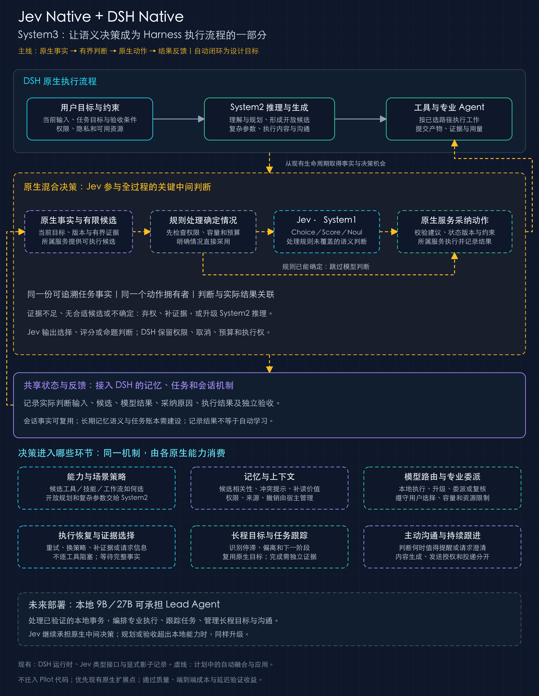

# xDAN System3 Harness

[English](README.md) | 中文

> **Jev Native + DSH Native。** System3 将 System1（Jev-like 有界语义决策）与 System2（高性能推理与生成）结合，由 DSH 原生状态和执行机制统一协调。当前仓库提供类型化 Jev provider 与可回放的显式影子决策；自动混合调度是设计目标。从[集成指南](docs/feat-independent-harness/README.zh.md)开始。

## 架构

核心特点是原生中间决策：DSH 提供执行事实与合法候选，Jev 判断有界语义问题，所属原生服务校验并采纳，实际结果供后续决策与评估使用。规则处理确定情况，System2 承担开放推理与生成。图中虚线自动融合部分为规划，挂载现有 provider 不会启用它。



[SVG 源文件](docs/feat-independent-harness/architecture.svg) · [Jev Native + DSH Native 专项方案](docs/feat-independent-harness/jev-native-dsh-native-plan.html)

记忆、模型与专业路由、执行恢复、长程目标和主动沟通沿原生决策主线展开，每类 Jev 应用分别验证价值。未来本地 9B／27B 可作为 Lead Agent 处理本地事务、持续编排与跟踪，复杂执行、规划或验收交由专业能力承接。优先使用现有 DSH 机制；Pilot 仅作为实验参考，不作为代码依赖。

DeepSeek Harness（`dsh`）是由 [DeepSeek AI](https://deepseek.com) 开发的开源 agent harness（智能体框架）。

它构建于**一切皆插件**的架构之上，由 [Cordis](https://github.com/cordiverse/cordis) 驱动，其设计参见论文 [_A Programming Paradigm for Spatiotemporal Composability_](https://arxiv.org/abs/2608.25512)。

文档：[https://deepseek-harness.github.io/deepseek-harness/](https://deepseek-harness.github.io/deepseek-harness/)

## 开发者预览

DeepSeek Harness 处于 _开发者预览_ 阶段，正在快速迭代。**未来将出现破坏兼容性的变更。**

运行本项目前，请阅读[安全说明](SAFETY.zh.md)。

<a id="run"></a>

## 运行

### 通过 `npm` 运行上游发行版

下面的 npm 包是上游发行版，不包含本 fork 的 Jev 扩展。安装 `Node.js`，然后运行：

```sh
npx @deepseek-ai/dsh web
```

该命令默认会在 `http://127.0.0.1:3080` 启动 Web UI，本机启动时还会用默认浏览器打开页面。通过 SSH 启动时只打印宿主机 URL，因为本地转发地址由 SSH 客户端或编辑器持有。传入 `--no-open` 可仅运行服务器而不打开浏览器。详见 [Web UI 指南](docs/user/guide/index.zh.md)。

<a id="run-from-source"></a>

<a id="run-from-source"></a>
### 从源码运行

如需从仓库源码运行：

```sh
git clone https://github.com/cryptoSUN2049/xDAN-System3-Harness.git
cd xDAN-System3-Harness
pnpm install
pnpm run build
pnpm dsh web
```

`pnpm run build` 会准备仓库产物。`pnpm dsh web` 会直接使用这些已构建产物，不会重新构建。

## 社区与支持

- 通过 [GitHub Discussions](https://github.com/deepseek-ai/deepseek-harness/discussions) 提交反馈或 bug 报告。
- 为你的插件仓库添加 [`dsh-plugin`](https://github.com/topics/dsh-plugin) 话题，便于被发现。
- 欢迎加入 DeepSeek Harness 企微群：扫码添加企微小助手并填写入群问卷，完成后小助手会邀请你入群。

<table>
  <thead>
    <tr>
      <th align="center">企微小助手</th>
      <th align="center">入群问卷</th>
      <th align="center">微信公众号</th>
    </tr>
  </thead>
  <tbody>
    <tr>
      <td align="center"></td>
      <td align="center"><a href="https://trtgsjkv6r.feishu.cn/share/base/form/shrcnIt5twSVdLGD52KJBckGCgg"></a></td>
      <td align="center"></td>
    </tr>
  </tbody>
</table>

## 参与贡献

参见 [CONTRIBUTING.md](CONTRIBUTING.zh.md)。

## 开发

请先阅读[开发指南](docs/development.zh.md)与[架构文档](docs/architecture.zh.md)。

`pnpm run dev:web` 会在一个终端里完成构建、启动，并在源码修改时重建 client bundle；`make help` 列出 Web 与 Desktop 对应的 Make target。完整表格见开发指南的「应用命令」一节。

面向 agent：请遵循 [AGENTS.md](AGENTS.md)。

## 引用

```bibtex
@misc{deepseek-harness2026,
  title={DeepSeek Harness: Everything is a Plugin},
  author={DeepSeek-AI},
  year={2026},
  publisher={GitHub},
  howpublished={\url{https://github.com/deepseek-ai/deepseek-harness}},
}
```

## 许可证

[MIT](LICENSE)

第三方依赖及其许可证见 [THIRD_PARTY_NOTICES.md](THIRD_PARTY_NOTICES.md)。
