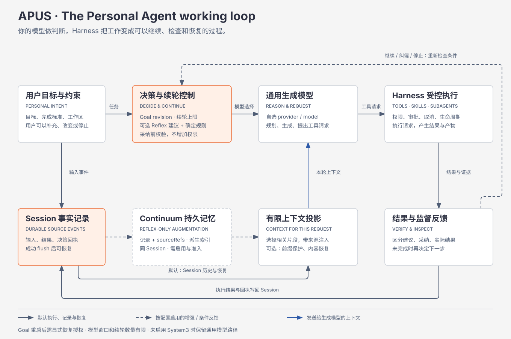
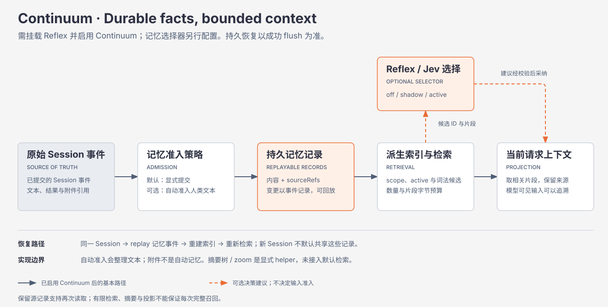

# APUS Reflex Harness

[English](README.md) | 中文

> **瞬策 · Instant action. Deep thinking.** 用自己的模型、持久任务历史与 **Loop Working（循环工程）**，构建 Personal Agent。

APUS 将连续的模型调用组织成围绕目标持续推进的工作：理解需求、选择行动、执行、检查证据、恢复相关上下文，再继续。你选择通用模型负责规划与生成，也可以接入自己的 Reflex/Jev 决策服务，在关键节点进行结构化判断。

APUS 基于 DeepSeek Harness，将模型推理与执行、权限及持久 Session 历史分开管理。项目处于 **开发者预览阶段**。[发布准备评审](docs/dev-continuum-reflex-integration/release-readiness.zh.md) 记录了已验证行为和仍需完成的验收。

## 为持续的个人项目打造 Personal Agent

设想一个个人项目：做一款小型记账工具。你要求支持 CSV 导入、本地存储，并明确不能改动源文件。Agent 制订计划、修改代码、运行测试并记录结果。之后，你又补充要求：退款不能被重复计入支出。

启用对应能力后，APUS 可以保留已准入的需求、检索相关事实、对照当前 Goal 检查工作，并依据执行证据判断下一步。进程重启后，你可以重新打开同一 Session，恢复已有任务历史。**Goal 状态随 Session 恢复；重新开始自动续轮需要显式 resume。**

这是场景说明，不代表其中每一步都已通过同一次端到端产品测试。[案例集](docs/dev-continuum-reflex-integration/classic-cases.html) 区分可复现案例与待验证的演示构想。

## Loop Working：目标、行动与反馈

长任务既需要连续性，也需要控制。Loop Working 将两者连接为可重复的工作循环：

1. **建立目标。** 保留目标、当前要求及后续修正，并能追溯其来源。
2. **选择下一步。** 通用模型负责规划；已配置的 Reflex 能力负责有界的路由、选择或监督判断。
3. **通过 Harness 执行。** 工具、skills 与子 Agent 按配置的权限和取消规则完成工作。
4. **检查执行证据。** 记录工具结果、决策记录和已采纳的干预，模型声称“完成”本身不能作为独立证明。
5. **恢复并继续。** 恢复相关历史，重新判断进展，在执行额度内推进，或暂停等待用户。

记忆为这个循环提供连续性，目标管理、验证和权限检查同样不可缺少。任务成功仍需具体的验收证据。

<a id="architecture"></a>

## 模型负责判断，Harness 负责执行



[架构说明](docs/dev-continuum-reflex-integration/apus-reflex-loop-working-architecture.html) · [运行时架构](docs/architecture.zh.md)

“大脑”是你配置的通用模型：负责推理、规划、内容生成和工具调用请求。“小脑”是可选的 Reflex/Jev 服务：在给定候选和约束内回答选择、评分或命题判断问题。Harness 管理执行并记录已采纳的结果；它本身不是一个模型。

| 分层 | 如何支撑持续工作 |
| --- | --- |
| 输入事实层 | 已接纳的用户消息和执行事件进入 Session 日志；持久保存需要存储成功并完成 flush。 |
| Reflex 决策层 | 已配置能力选择路由或记忆候选、判断进展，并提出有界恢复建议。 |
| Harness 执行层 | 工具、skills 与子 Agent 执行工作，遵守权限、取消规则和进程生命周期管理。 |
| 持久记忆层 | Continuum 从同一 Session 恢复已准入的记录，并重建检索索引。 |
| 上下文投影层 | 用相关片段组成有界模型请求；System3 上下文投影保护已提交的历史前缀。 |
| 结果反馈层 | 已记录的行动、结果与决策记录，为后续工作和独立检查提供依据。 |

决策服务可以自行配置。替换服务需要实现受支持的 Jev/System One 协议；任意 chat-completions 端点并不会自动成为所有 Reflex 能力的替代品。参见 [Jev provider 指南](packages/experimental/apus-dsh-jev-plugin/README.zh.md)。

## 持久记忆，有限上下文



[记忆流程说明](docs/dev-continuum-reflex-integration/apus-reflex-loop-working-architecture.html#memory) · [Continuum 语义](packages/context/continuum/README.zh.md) · [可选 Jev 选择器](packages/experimental/continuum-jev/README.zh.md)

**Continuum** 将任务历史与单次推理请求的有限上下文分开。一个事实即使不在当前 prompt 中，仍可保留在持久历史里。检索和可选的 Reflex 选择将有界的工作信息重新带入下一次请求。

- **保留来源。** 已准入记录引用 Session 事件；修正会创建后继记录，停用让记录退出召回，同时保留历史。
- **控制准入与范围。** 默认显式准入；选择自动策略后，可记录已提交的人类文本。scope 过滤控制一次读取可使用哪些记录。
- **恢复同一任务。** 当前生命周期支持同一 Session 跨轮次、跨进程重启恢复记忆；新 Session 不会自动获得全局个人记忆库。
- **限制单次请求。** 检索限制候选数和片段字节数。Jev 在给定候选中选择，并依据模式和失败策略回退。

“无限上下文”和“无限记忆”表达产品方向：通过保留历史和恢复相关上下文，让有用的工作持续超越单个模型窗口。存储与上下文仍然有限，词法检索可能漏掉相关事实，摘要和片段也会省略信息。

“无损”需要限定范围。成功 flush 后，已接纳的文本事件可以继续保留在 Session 中；这不保证无损召回，也不保证所有上传内容的每个原始字节均被保留。自动记忆准入提取文本，附件遵循独立存储规则，图片可能归一化或缩放。一次内存 append 成功不能证明磁盘写入已成功。

摘要树和 zoom 辅助能力提供显式 API；自动生命周期检索目前使用记录索引。本地稳定前缀测量不等于 provider 缓存命中或计费测量。System3 的实时上下文集成另行保护冻结或已提交前缀。参见 [架构后续任务](docs/dev-continuum-reflex-integration/architecture-followups.zh.md)。

## 持续工作，也保留控制

| 能力 | 当前行为与边界 |
| --- | --- |
| Goal 管理 | 持久化目标与修订状态，支持暂停、恢复及继续轮次上限。Goal 状态随 Session 恢复；自动续轮需要显式 resume。 |
| 监督 | 已配置的 Reflex 监督可以检查 Goal 进展、记录干预并检查后续反馈；过期决策会被拒绝。 |
| 恢复 | 有界 Codex 恢复在中断并核对已有工作前，检查无活动时长、待审批状态和仍在执行的副作用。 |
| 完成审查 | active 模式可在拒绝额度内拦截缺乏支持的完成声明；部署示例默认 shadow 审查。独立验收仍然必要。 |
| 执行额度 | Goal 轮次、决策超时、干预次数与恢复次数限制持续工作，不代表已实现统一的金额预算。 |
| 权限与数据 | 工具权限、进程隔离、System3 路由策略和 Continuum scope 分别管理。模型判断不会授予额外权限。 |

你决定生成与决策请求在哪里运行。System3 数据类别配置不是全局网络防火墙；显式启用记忆选择器后，它会向配置的 Jev 服务发送查询及候选片段。[公共 provider 指南](docs/dev-continuum-reflex-integration/public-provider-configuration.zh.md) 说明了配置、凭据和默认通用模型路径。

## 使用 Reflex，也可以先用通用模型

| 配置 | 可用行为 |
| --- | --- |
| 通用模型，不接 Jev | 原版 DSH 的生成、工具与 Session 持久化。Reflex 专属 Continuum 功能保持关闭。 |
| 已配置 Reflex/Jev | 可分别启用结构化决策能力；仅挂载 provider 不会自动激活所有集成。 |
| 已启用 Continuum | 需要 Reflex，以及记忆准入和 scope 设置。选择器的 off/shadow/active 分别对应基线选择、记录建议和采纳验证后的建议。 |
| System3 部署未配置数据类别 | System3 显式关闭，包括本地过程监督；普通生成继续使用已配置的 provider。 |

这样既保留独立可用的通用模型运行时，也让 Reflex 在明确的决策节点参与工作。启用能力包含对应的配置与部署工作。

## 验证证据，不等于发布认证

[正式 profile 记忆测试](apps/cli/tests/profiles/headless/tests/continuum-memory.e2e.ts) 在独立进程中启动源码和构建后的 profile：检查第一个进程持久化的事实与来源引用，再要求事实出现在恢复进程自己的模型请求日志里。关闭开关、无 Jev 及新 Session 对照用例检查启用条件与隔离行为。

[公开 bundle 测试](packages/experimental/apus-dsh-jev-plugin/tests/public-bundle.spec.ts) 验证实际 Loader 配置与本地 HTTP 请求，包括匿名或认证 provider、非法配置和已有 profile 覆盖。[System3 上下文测试](packages/experimental/system3/tests/reflex-context.spec.ts) 覆盖投影及受保护约束。录制型 provider 能证明集成行为，不能证明真实模型的决策或召回质量。

[验收评审](docs/feat-reflex-control/apus-reflex-harness-acceptance-review.html) 记录真实 provider 示例及其边界。健康长任务、中途修改 Goal、大规模历史性能、远程质量与回退测量、完整回归及签名桌面打包，都需要各自的证据。一次合并不是发布认证。

## 从源码运行

需要 Node.js `^22.19 || >=24`，以及 `packageManager` 声明的 pnpm 版本。

<a id="run"></a>

<a id="run-from-source"></a>

```sh
git clone https://github.com/APUS-AI-Lab/APUS-Reflex-Harness.git
cd APUS-Reflex-Harness
pnpm install
pnpm run build
pnpm dsh web
```

`pnpm run build` 准备仓库构建产物；`pnpm dsh web` 直接启动这些产物，不会重新构建。在 Web 设置中配置生成模型和凭据。需要开发时自动重建，可使用 `pnpm run dev:web`。

可选的 Reflex、System3 与记忆需要对应的 profile 配置。请参阅 [公共 provider 指南](docs/dev-continuum-reflex-integration/public-provider-configuration.zh.md)、[System3 指南](packages/experimental/system3/README.zh.md) 和 [Continuum 指南](packages/context/continuum/README.zh.md)。上面的启动命令不会自动开启所有能力。

### 上游 npm 发行版

```sh
npx @deepseek-ai/dsh web
```

此命令安装上游 DeepSeek Harness，不安装 APUS 或此分支的 Jev 扩展。其 Web UI 默认地址为 `http://127.0.0.1:3080`；使用 `--no-open` 可避免打开本地浏览器。参见 [Web UI 指南](docs/user/guide/index.zh.md)。

## 两个独立仓库

[APUS Reflex Harness](https://github.com/APUS-AI-Lab/APUS-Reflex-Harness) 管理运行时及其 Web/client 组件。[APUS Reflex Frontend](https://github.com/APUS-AI-Lab/APUS-Reflex-Frontend) 管理独立桌面组装，并固定一个 Harness revision。更新 Harness `main` 不会更新已经打包的桌面运行时；需要准备并验证目标 pin。

## 贡献与支持

- 先阅读 [CONTRIBUTING.zh.md](CONTRIBUTING.zh.md) 和 [开发指南](docs/development.zh.md)。
- 新贡献者可从 [架构任务清单](docs/dev-continuum-reflex-integration/architecture-followups.zh.md) 选择有明确验收标准的小任务。
- 通过 [GitHub Issues](https://github.com/APUS-AI-Lab/APUS-Reflex-Harness/issues) 反馈缺陷。
- 运行前阅读 [SAFETY.zh.md](SAFETY.zh.md)；安全漏洞请通过 [SECURITY.md](SECURITY.md) 报告，不要提交公开 issue。
- Agent 贡献者应遵循 [AGENTS.md](AGENTS.md)。公共 API 尚未稳定，可能出现不兼容变更。

## 上游与许可证

APUS 扩展了 [DeepSeek Harness](https://github.com/deepseek-ai/deepseek-harness)，上游由 [DeepSeek AI](https://deepseek.com) 开发。其插件架构采用 [Cordis](https://github.com/cordiverse/cordis)，设计说明见 [A Programming Paradigm for Spatiotemporal Composability](https://arxiv.org/abs/2608.25512)。[上游文档](https://deepseek-harness.github.io/deepseek-harness/) 描述上游发行版，APUS 配置以本仓库说明为准。

[MIT](LICENSE)。完整保留 DeepSeek 原版权与许可声明。[THIRD_PARTY_NOTICES.md](THIRD_PARTY_NOTICES.md) 记录第三方依赖及许可证。APUS 品牌不替代上游作者归属，也不表示获得其背书。参见 [品牌与组装说明](docs/feat-apus-brand/branding.zh.md)。

```bibtex
@misc{deepseek-harness2026,
  title={DeepSeek Harness: Everything is a Plugin},
  author={DeepSeek-AI},
  year={2026},
  publisher={GitHub},
  howpublished={\url{https://github.com/deepseek-ai/deepseek-harness}},
}
```
