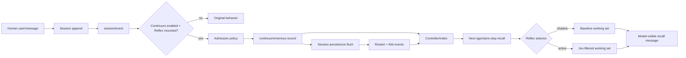

# Continuum user-message admission design

English | [中文](memory-admission-design.zh.md)

## Goal

Complete the opt-in product path from a committed human `user/message` to a Session-backed Continuum record, while preserving the original profile when Continuum is disabled or Reflex is absent.

## Architecture

## Admission contract

- Admission observes only committed `user/message` events, never pending messages or model-generated recall.
- The source reference is the exact `(sessionId, eventSeq)` of the user message.
- Empty text is ignored; non-user sources are ignored.
- The record id is deterministic within a Session (`sessionId:eventSeq`), so duplicate event delivery cannot create a second record.
- The configured scope is explicit. If no scope is configured, automatic admission is disabled.
- `admission: explicit` preserves the current caller-owned API. `admission: user-message` is opt-in and only effective when the resolved Continuum switch is enabled.
- Admission is synchronous and local; it performs no model call and does not block the user event. Persistence remains owned by the existing Session backend and `ctx.sessions.flush(session)`.

## Files

- `packages/context/continuum/src/service.ts`: add admission configuration and the session event consumer.
- `packages/context/continuum/tests/service.spec.ts`: cover opt-in admission, source identity, disabled/no-Reflex behavior, duplicate delivery, and restart folding.
- `packages/context/continuum/README.md` / `.zh.md`: document the production caller and limits.
- `deploy/system3/runtime.patch.yml`: expose the opt-in deployment setting without embedding credentials.
- `docs/dev-continuum-reflex-integration/integration-plan.md`: update acceptance matrix.

## Verification

1. Focused service tests prove the event and record invariants.
2. Agent-loop integration proves the first user input is admitted and the next request receives a bounded recall message.
3. Persistence replay proves restart restores the same record id and source reference.
4. Browser regression proves the default profile remains unchanged and the Reflex-only switch controls the feature.
5. Build, typecheck, lint, Cordis config/catalog, persistence, docs, and targeted bilateral regression are rerun.
6. Real Jev and DeepSeek evaluation is rerun without storing credentials.
