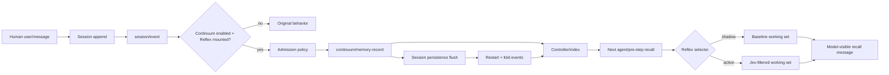

# Continuum 用户消息准入设计

[English](memory-admission-design.md) | 中文

## 目标

在保持 Continuum 关闭或 Reflex 缺失时原版 profile 不变的前提下，打通从已提交人类 `user/message` 到 Session 支持的 Continuum 记录的 opt-in 产品链路。

## 架构

## 准入约定

- Admission observes only committed `user/message` events, never pending messages or model-generated recall.
- 来源引用精确使用用户消息的 `(sessionId, eventSeq)`。
- 空文本和非 user 来源都会被忽略。
- 记录 ID 在 Session 内确定为 `sessionId:eventSeq`，重复事件不会创建第二条记录。
- 作用域必须显式配置；未配置作用域时自动准入关闭。
- `admission: explicit` 保留当前由调用方负责的 API；`admission: user-message` 需要 opt-in，且只有解析后的 Continuum 开关启用时才生效。
- 准入是同步本地操作，不调用模型，也不阻塞用户事件；持久化仍由现有 Session backend 和 `ctx.sessions.flush(session)` 负责。

## 文件

- `packages/context/continuum/src/service.ts`: add admission configuration and the session event consumer.
- `packages/context/continuum/tests/service.spec.ts`: cover opt-in admission, source identity, disabled/no-Reflex behavior, duplicate delivery, and restart folding.
- `packages/context/continuum/README.md` / `.zh.md`: document the production caller and limits.
- `deploy/system3/runtime.patch.yml`: expose the opt-in deployment setting without embedding credentials.
- `docs/dev-continuum-reflex-integration/integration-plan.md`: update acceptance matrix.

## 验证

1. 服务定向测试证明事件和记录不变量。
2. Agent-loop 集成测试证明首条用户输入被准入，下一次请求收到有界 recall 消息。
3. 持久化回放证明重启后恢复相同记录 ID 和来源引用。
4. 浏览器回归证明默认 profile 不变，且 Reflex 专属开关控制该功能。
5. 重新运行 build、typecheck、lint、Cordis 配置/目录、persistence、文档和双边定向回归。
6. 重新运行真实 Jev 和 DeepSeek 评估，且不保存凭据。
