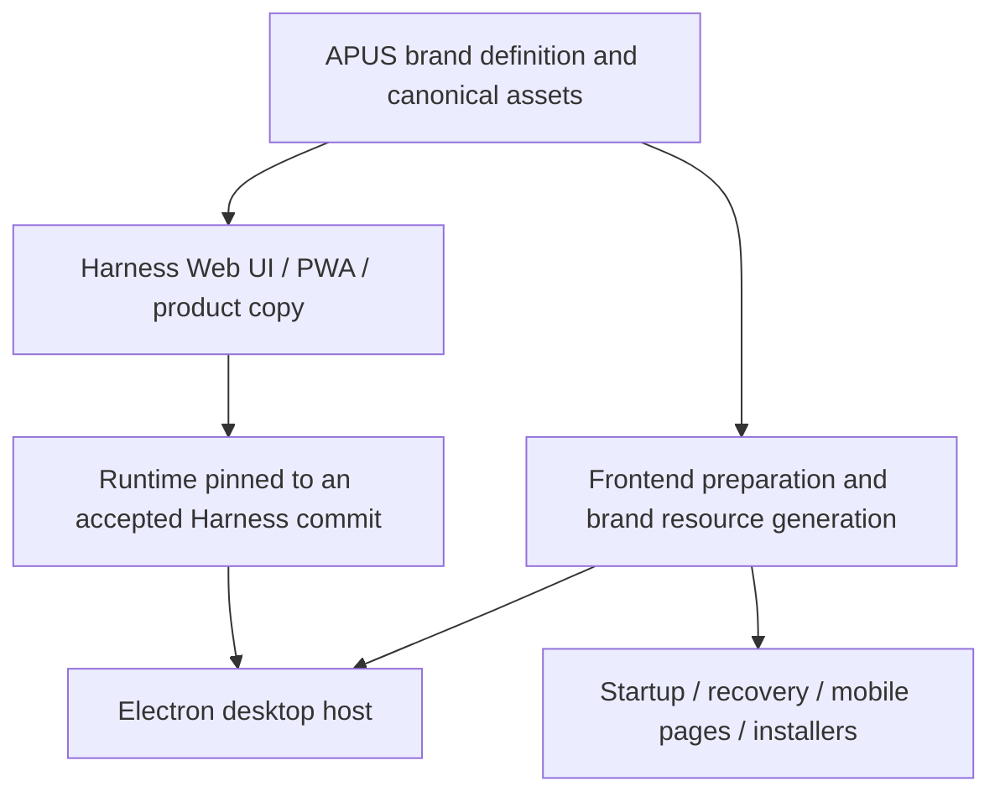

# APUS Reflex Harness brand unification design

English | [中文](design.zh.md)

Status: approved by the user for implementation. Scope: first-party product branding in APUS-Reflex-Harness and APUS-Reflex-Frontend. Basis: the user-specified internal-presentation (privately archived) and the static inspection of both repositories in this session.

## Brand definition

| Item | Unified value |
| --- | --- |
| English product and Harness name | APUS Reflex Harness |
| Chinese name | 瞬策 |
| Wordmark | APUS / REFLEX |
| Slogan | 瞬时执行，深度思考 |
| Product positioning | Model as Harness · hybrid decision and reasoning models |

Window titles, application names, installer product names, and About pages use the full English name; Chinese introductions also include “瞬策”. Welcome and About pages show the slogan. Narrow spaces use the report’s APUS / REFLEX wordmark, with the full name retained for accessibility. The report has no standalone graphic logo, so the first version derives consistent icon assets from this wordmark without introducing an unapproved animal mark. Strategic objectives are not presented as accepted capabilities.

## Integration architecture

Frontend is an Electron host that assembles the Harness Runtime and shared Web UI and overrides some brand slots. The Harness product layer owns shared brand definitions and canonical vector assets. Frontend reads them during runtime preparation and generates its native resources; build-time checks verify that the names match, without a runtime branding service.

## File scope

The following entry points are confirmed. Implementation traces their consumers and covers equivalent product copy. Generated resources derive from the canonical inputs.

| Repository | Files or directories | Change |
| --- | --- | --- |
| Harness | README.md, README.zh.md | Product definition and APUS repository paths; preserve upstream facts |
| Harness | apps/web/index.html, apps/web/public/manifest.webmanifest, favicons and icons | Full name, PWA and browser assets |
| Harness | Brand components, shared primitives and user-visible locales in packages/client/ | Sidebar, hero, welcome, settings, previews and notices; distinguish upstream service names by actual product assembly |
| Harness | packages/experimental/client-ui-system3/src/client/locales.ts | Unify product-visible System3 labels |
| Harness | First-party product presentation in apps/desktop/ and apps/cli/ | Match shipped entry points; retain internal dsh commands |
| Harness | deploy/system3/ and maintained first-party product documentation | Brand plugin assembly and product descriptions; preserve previous acceptance records |
| Frontend | package.json, electron-builder.dev.cjs, src/main/system3-identity.ts | Product name, development suffix and installation artifacts |
| Frontend | packages/dsh-desktop-client-ui/client.js, build/dsh-desktop.patch.yml | Consume shared branding and replace the whale override |
| Frontend | src/main/index.ts, windows-menu.ts, version-info.ts | Menus, tray, About, windows and mobile assets |
| Frontend | src/preload/index.ts, update-view.ts | About and update views |
| Frontend | build/splash.html, web-import.html, safe-mode.html, plugin-recovery.html, src/main/safe-mode.ts | Startup, import, safe mode, recovery and failures |
| Frontend | src/main/mobile/lan-mobile-pages.ts, src/main/repair-agent.ts | Mobile pages and repair assistant identity |
| Frontend | build/brand-mark.svg, native icons, scripts/install-brand-assets.mjs | Generate the complete icon set from shared canonical assets |
| Frontend | src/main/desktop-service/index.ts, src/main/update/update-manager.ts | Remove policy decisions based on app.name.startsWith('xDAN System3') |
| Frontend | scripts/prepare-system3-runtime.mjs, .github/workflows/release.yml | Brand validation, accepted Harness SHA and release assembly |
| Frontend | README.md, README.zh.md, corresponding tests | Current product description and regression evidence |

## API and compatibility requirements

Branding changes presentation and build inputs, not HTTP/WebSocket routes, SDK fields, Session events, plugin IDs, package scopes, or model IDs. Keep the dsh CLI, SYSTEM3_* settings, and existing data directories. Retain appId, system protocols, and internal runtime product identifiers for compatibility while updating display names separately. DeepSeek model names, actual upstream account services, licenses, and third-party attribution stay accurate.

Frontend’s policy disabling upstream updates and diagnostics must use explicit product configuration rather than infer behavior from the display name. Preserve the existing disabled behavior and verify that it survives renaming.

Shared brand inputs include at least the full product name, Chinese name, wordmark, slogan, and canonical asset reference. Preparation validates required fields and artifact consistency and fails explicitly when they are missing. After approval, choose export locations that follow existing package dependencies and resource generation, avoiding a new runtime service solely for branding.

## Worktrees and release order

Both main branches were clean when inspection began. The Harness feat-reflex-experience worktree contains substantial uncommitted feature changes, including Web/PWA titles partly changed to Reflex Harness; do not overwrite them or include them wholesale in the branding commit. Implementation uses isolated feat-apus-brand worktrees and records integration points shared with the experience branch. Recheck the Frontend worktree before writing.

Frontend releases pin an older Harness commit; changing Harness main does not automatically update installers. Complete Harness brand acceptance and commit first, then update Frontend’s pinned revision, prepare again, package, and verify. Publishing, replacing the user’s installed application, and pushing to remotes are not default actions for this task.

## Acceptance plan

- Scan first-party products for xDAN System3, DSH Desktop, DeepSeek Harness, and Reflex Harness; classify each occurrence as presentation, a compatibility identifier, or an actual upstream fact instead of replacing blindly.
- Harness: relevant branding, locale and browser tests, client-copy validation, affected types and builds; update corresponding keyless session snapshots if model-visible identity changes.
- Frontend: system3-identity, branding-patch, update and diagnostic policy regressions, runtime preparation and actual packaging; check readability of existing profiles and historical sessions.
- Actual interfaces: Web and Electron sidebars, hero, welcome, menus, About, updates, startup failures, safe mode, recovery, and mobile pages; names, icons, and accessible names match in light/dark themes and narrow screens.
- Run applicable documentation gates and git diff --check; before pushing, run repository-required lint, formatting and pre-push checks.

At the design stage, only static inspection and design were complete. Product builds and functional tests had not run, and no acceptance claim was made for existing model services or experience features.
