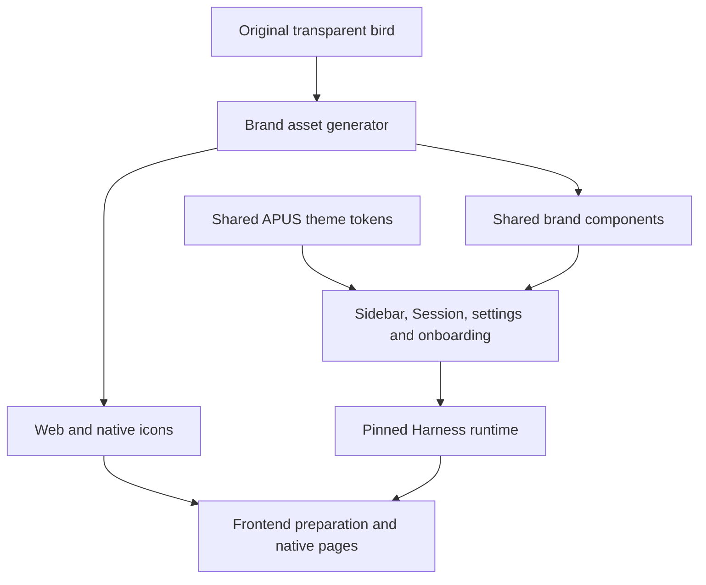

# APUS Reflex bird identity and shared theme

English | [中文](design.zh.md)

## Scope

The approved product identity uses the supplied transparent 140 × 140 cyan, blue, and purple bird, the APUS / REFLEX wordmark, and the existing Model as Harness positioning. Preserve the supplied pixels; do not redraw the mark. Frontend hosts the Harness runtime and shared UI rather than maintaining another business frontend.

## Architecture

## Ownership and compatibility

`apps/web/public/brand-source.webp` owns the artwork. `apps/desktop/scripts/generate-brand-assets.ts` writes the embedded PNG module, SVG wrappers, application icons, and installer assets. `packages/client/ui-primitives` owns shared brand rendering, and `packages/client/ui-theme` owns light/dark colours and the first-paint canvas. Account and model onboarding dictionaries describe the actual provider and configuration choices.

Keep package identifiers, application IDs, protocols, data directories, API fields, and Session persistence unchanged. Preserve licenses and actual provider names. Frontend updates its pinned Harness revision and prepares resources before packaging; changing source alone cannot update an installed application.

## Acceptance

Check original-versus-embedded decoded pixels, ICO dimensions, accessible names, light/dark contrast, first-run copy, keyboard focus, and narrow layouts. Validate the shared components and the packaged application separately. Use temporary Profiles without real credentials or Session imports. macOS checks do not establish Windows acceptance; high-resolution output dimensions do not increase the source artwork detail.
