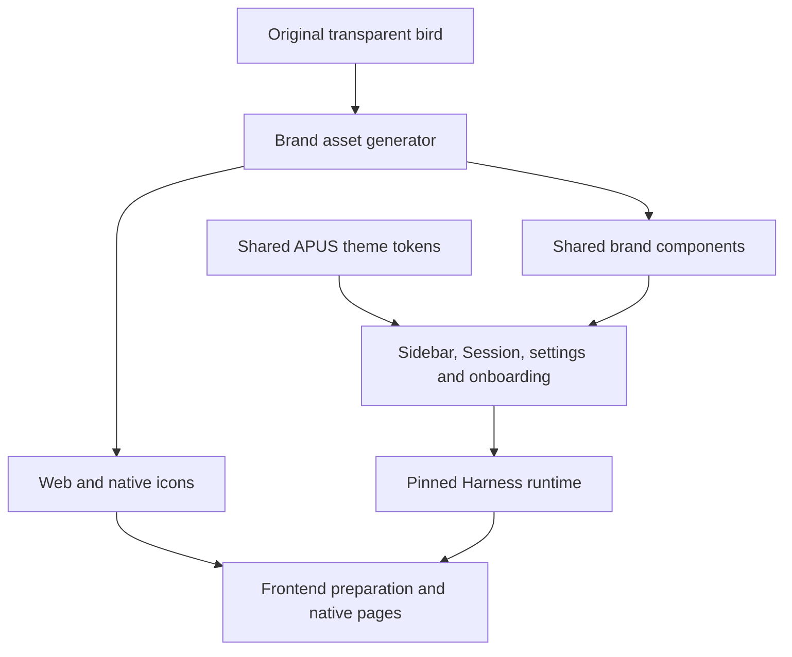

# APUS Reflex 飞鸟标识与共享主题

[English](design.md) | 中文

## 范围

已批准的产品标识采用用户提供的透明 140 × 140 青蓝紫飞鸟、APUS / REFLEX 字标及既有 Model as Harness 定位。保留原始像素，不重绘标记。Frontend 承载 Harness 运行时及共享 UI，不另建业务前端。

## 架构

## 归属与兼容

`apps/web/public/brand-logo.webp` 是图像权威输入。`apps/desktop/scripts/generate-brand-assets.ts` 生成嵌入 PNG 的模块、SVG 包装、应用图标及安装器资产。`packages/client/ui-primitives` 负责共享品牌渲染，`packages/client/ui-theme` 负责深浅配色及首屏背景。账号和模型引导词典说明真实提供方与配置选择。

包标识、应用 ID、协议、数据目录、API 字段及 Session 持久化保持不变。保留许可证与真实提供方名称。Frontend 在打包前更新固定 Harness 版本并准备资源；单独修改源码不会更新已安装应用。

## 验收

检查原图与嵌入图解码像素、ICO 尺寸、无障碍名称、深浅色对比度、首次使用文案、键盘焦点及窄屏布局。分别验证共享组件与安装应用。使用不含真实凭据和历史导入的临时 Profile。macOS 检查不能替代 Windows 验收；高分辨率输出尺寸不增加原始图像细节。
