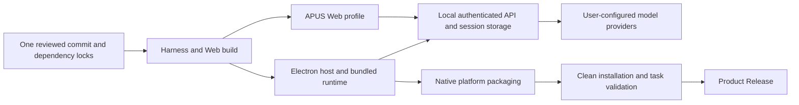

# Integrated APUS repository and release design

English | [中文](design.zh.md)

This approved design combines the desktop host and Harness in the existing repository. It defines implementation and acceptance requirements; [installation](installation.md) states actual release availability. The user authorized publication after review. Repository visibility still requires the appropriate administrator permissions.

## Goal

A source user clones one repository and uses one setup command. An application user downloads an installer and configures a model in the UI without installing developer tools or starting a backend. The product positioning is **Model-as-a-Harness**. The [README value proposal](readme-value-proposal.html) and [architecture diagram](readme-architecture.html) describe its capabilities and limits.

Keep the existing repository, history, CI, and Issues. Import the desktop host under `frontend/`; do not move the existing Harness into a new backend directory or duplicate the shared UI. Preserve the previous frontend repository until migration is accepted.

## Architecture

Desktop and Web each start their own runtime; the diagram does not promise a shared process. Local execution does not imply offline inference. Model requests follow the configured providers and privacy policy.

| Path | Responsibility |
| --- | --- |
| `frontend/` | Electron host, native integration, desktop extensions, and packaging inputs |
| `apps/web/` | Existing Web entry |
| `apps/desktop/` | Existing Harness desktop host, with a separate maintenance command |
| `packages/` | Harness capabilities, API, shared UI, and System3 |
| `deploy/` | Explicit deployment configuration |
| `scripts/product*.mjs` | Setup, launch, packaging, and release checks |
| `release/manifest.json` | Product version, channel, repository, and qualified targets |
| `docs/feat-integrated-product/` | Product installation, configuration, development, and release guides |
| `tasks/feat-integrated-product/` | Local-only plan, assessment, validation evidence and handoff; ignored by Git and not distributed |

Keep the existing pnpm lock and frontend npm lock for the initial integration. Root scripts coordinate both installations; a lockfile migration is not part of this change. Preserve application IDs, user-data paths, and session formats.

## User paths

The default desktop profile supports ordinary model tasks with user-configured providers. It must not silently connect to private Jev, Fidoo, or other deployment endpoints. New users configure a provider, API protocol and address, credentials, and a model, then select a workspace and run a small task. Saved settings and a reachable HTTP endpoint do not demonstrate successful inference.

The Reflex decision service uses the shared client’s existing Settings → Reflex model configuration page; do not add a separate desktop System3 settings plugin. The page reports connection tests and capability status independently. Saving an endpoint does not enable routing, supervision or Continuum. Candidates, data classification, remote authorization and memory admission remain owned by the relevant profile configuration; missing required settings fail visibly. Reuse the existing credential service; do not save secrets in source, examples, release artifacts or logs.

The root setup command checks Node and platform build prerequisites, installs both locked dependency sets, builds the Harness, and prepares the desktop runtime and brand resources from this checkout. Report the failing stage and allow a corrected rerun. Keep the full product build out of implicit installation hooks. Verify the clean-clone path before describing it as accepted; source ZIP support requires separate verification because build metadata can depend on Git.

The desktop installer must include the host, runtime, Web resources, and required plugins. Optional tools can have separate prerequisites. Source setup requires Git, a supported Node version, pnpm 11.7.0, network access, and platform-native build tools. The root manifest currently accepts Node 22.19+ in the 22.x line or Node 24+.

## APIs and compatibility

Runtime startup continues through `dsh` profiles and patches. Keep Harness RPC, session events, permission enforcement, and the restricted preload IPC. Preserve loopback authentication, process ownership, shutdown cleanup, and user-data isolation. New persisted settings require typed validation and migration review at their owning service.

Runtime preparation resolves the same repository automatically and never falls back to upstream npm artifacts. Keep necessary desktop compatibility patches reproducible; do not apply every inherited patch again to shared source. Do not rewrite AgentLoop, session formats, or unrelated UI styling as part of repository integration.

## Version and distribution

The user-defined first APUS product version is `0.1.0`, with release tag `v0.1.0`; it does not inherit the upstream product version sequence. GitHub prerelease status is independent of the version string, and this first release remains an unsigned preview subject to acceptance. Product versioning is distinct from Harness package versions and session-format versions; do not bulk-rename workspace package versions. Release tags, desktop metadata, and the product manifest must agree.

Build metadata records product and Harness versions, the complete source revision, platform, architecture, and dependency-lock digests. Release sources must be clean; a locally dirty development build cannot establish a reproducible release. Generate metadata after source selection rather than embedding a commit's own hash into that commit.

The first target is macOS Apple Silicon. Qualify other platforms independently before advertising them. Unsigned previews disclose the absence of signing and notarization; signing credentials and native checks are required before claiming a signed distribution. Signing readiness is separate from permission to publish.

Each release includes validated installers, SHA-256 checksums, build information, changes, platform and signing status, known limitations, and configuration instructions. Build a draft first, publish after acceptance, then verify anonymous download. A private repository release is not an anonymous download channel. Failed required targets block publication; unavailable optional targets have no download button.

Updates remain manual until an APUS update feed is configured and accepted. Keep user data outside the installation directory. Old installers do not imply backward compatibility with newer session or SQLite data; state migration and downgrade limits in release notes.

## README and licenses

The root README owns product value, download, source startup, configuration, development links, and concise acknowledgments. Frontend language pages link back to that entry. Keep essential preview and configuration conditions; move detailed features and procedures to their guides. APUS Issues is the default feedback channel.

Preserve both original MIT licenses, dependency-specific terms, generated third-party notices, and the installed application's full-license entry. Check dependencies that store license text in README files before packaging filters remove them. A short acknowledgment cannot replace the required texts. Update notice generators and tests together instead of hand-editing generated tables.

## Acceptance plan

1. Preserve existing changes, import frontend from its reviewed baseline in the isolated worktree, and retain an auditable import record.
2. Test clean-clone setup, paths containing spaces and non-ASCII characters, dependency failures, reruns, and both package-manager invocations.
3. Verify desktop and Web launch, real model responses, a file task, invalid credentials, connection failures, shutdown, restart, and retained settings. Verify System3 separately before claiming collaboration works.
4. Run focused build, type, lint, unit, regression, and visible-output snapshot checks. Inspect actual packaged modules and license texts.
5. Install each release asset in a clean target environment without system Node or source code. Test supported upgrades and confirm upstream update services remain disabled.
6. Review source, history, and artifacts before publication; synchronize tested commands and availability in the guides, run documentation checks, and record the handoff.

A completed import or successful build alone does not complete this design. Acceptance requires both a reproducible source path and a downloadable, installed application with a verified first task.
