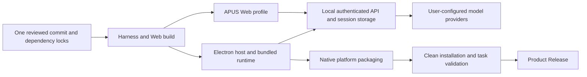

# APUS 一体化仓库与发行设计

[English](design.md) | 中文

本设计已获批准，将桌面宿主与 Harness 合入现有仓库。本文规定实施与验收要求，实际发行可用性以[安装教程](installation.zh.md)为准。用户已授权审查后公开，仓库可见性仍需要相应管理员权限。

## 目标

源码用户只 clone 一个仓库，通过一个准备命令完成安装；客户端用户下载安装包，在界面配置模型后使用，无需安装开发工具或启动后端。产品定位为 **Model-as-a-Harness**。[README 价值提案](readme-value-proposal.html)与[架构图](readme-architecture.html)说明能力与限制。

沿用现有仓库、历史、CI 与 Issues，将桌面宿主导入 `frontend/`，不把现有 Harness 搬入新 backend 目录，也不复制共享 UI。迁移验收完成前保留原前端仓库。

## 架构

Desktop 和 Web 分别启动自己的运行时；图中不承诺共享进程。本机执行不代表离线推理，模型请求遵循配置的服务商和隐私策略。

| 路径 | 职责 |
| --- | --- |
| `frontend/` | Electron 宿主、原生集成、桌面扩展与打包输入 |
| `apps/web/` | 现有 Web 入口 |
| `apps/desktop/` | 现有 Harness 桌面宿主，使用独立维护命令 |
| `packages/` | Harness 能力、API、共享 UI 和 System3 |
| `deploy/` | 显式部署配置 |
| `scripts/product*.mjs` | 准备、启动、打包与发行检查 |
| `release/manifest.json` | 产品版本、渠道、仓库与通过验收的目标 |
| `docs/feat-integrated-product/` | 产品安装、配置、开发与发行教程 |
| `tasks/feat-integrated-product/` | 仅本地保留的计划、评估、验证证据与交接；由 Git 忽略，不随仓库分发 |

首次集成保留现有 pnpm 锁文件和前端 npm 锁文件，由根脚本协调安装；迁移锁文件不在本次范围内。保留应用 ID、用户数据路径和会话格式。

## 用户路径

默认桌面 Profile 支持用户自行配置服务商的普通模型任务，不得静默连接私有 Jev、Fidoo 或其他部署端点。新用户配置服务商、API 协议及地址、凭证与模型，再选择工作区完成小任务。保存设置或 HTTP 端点可访问，不能证明推理成功。

Reflex 决策服务使用共享客户端已有的“设置 → Reflex 模型配置”页面，不另建桌面 System3 设置插件。页面分别显示连接测试与能力状态；保存服务地址不会自动启用路由、监督或 Continuum。候选、数据分类、远程授权与记忆准入仍由对应 profile 管理，缺少必要配置时明确报错。复用现有凭证服务，不将密钥写入源码、示例、发行产物或日志。

根准备命令检查 Node 与平台构建前提，按两套锁文件安装依赖、构建 Harness，并从当前工作树准备桌面运行时和品牌资源。失败时报告阶段，修正后可重新执行。不在隐式安装钩子中执行完整产品构建。干净 clone 验证通过后才能宣称该路径已验收；源码 ZIP 需要单独验证，因为构建信息可能依赖 Git。

桌面安装包必须包含宿主、运行时、Web 资源和必要插件；可选工具可以有独立前提。源码准备需要 Git、受支持的 Node 版本、pnpm 11.7.0、网络及平台原生构建工具。根 manifest 当前接受 22.x 中的 Node 22.19+ 或 Node 24+。

## API 与兼容性

运行时继续通过 `dsh` Profile 与 patch 启动，保留 Harness RPC、会话事件、权限执行和受限 preload IPC。保持 loopback 鉴权、进程归属、退出清理与用户数据隔离。新增持久化设置需要在所属服务完成类型、验证和迁移审查。

运行时准备自动定位同一个仓库，不能回退到上游 npm 产物。必要桌面兼容补丁保持可重放，不将全部继承补丁再次叠加到共享源码。本次仓库集成不顺带重写 AgentLoop、会话格式或无关 UI 样式。

## 版本与分发

用户指定首个 APUS 产品版本为 `0.1.0`，Release tag 为 `v0.1.0`；不继承上游产品的版本序列。GitHub 预发布状态独立于版本字符串，首版仍按未签名预览版验收和标注。产品版本独立于 Harness 包版本和会话格式版本，不批量修改工作区包版本。Release tag、桌面元数据与产品 manifest 必须一致。

构建信息记录产品及 Harness 版本、完整源码版本、平台、架构和依赖锁摘要。发行源码必须干净，本地带未提交修改的开发构建不能证明发行可重现。源码确定后再生成元数据，不将提交自身的 hash 写入该提交。

首个目标为 macOS Apple Silicon，其他平台独立验收后再宣传支持。未签名预览必须披露缺少签名与公证；声明签名发行前，必须具备签名凭证并完成原生检查。签名就绪与发布授权分别判断。

每个发行版包含通过验收的安装包、SHA-256 校验值、构建信息、变更、平台及签名状态、已知限制和配置教程。先创建草稿，验收后发布，再验证匿名下载。私有仓库的 Release 不是匿名下载渠道。必需平台失败则阻止发布；不可用的可选平台不展示下载按钮。

APUS 更新服务完成配置与验收前采用手动更新，用户数据保留在安装目录外。旧安装包不代表兼容新版会话或 SQLite 数据，发行说明须写明迁移与降级限制。

## README 与许可

根 README 集中说明产品价值、下载、源码启动、配置、开发入口与简洁致谢，前端各语言页面链接回该入口。保留必要预览状态和配置前提，详细功能与操作移入教程。APUS Issues 为默认反馈渠道。

保留两份原始 MIT 许可、依赖独立条款、生成的第三方通知和安装应用中的完整许可入口。打包过滤 README 前，检查以 README 存放许可全文的依赖。简短致谢不能替代必要文本。通知生成器与测试同步更新，不手工修改生成表。

## 验收计划

1. 保留已有修改，在隔离工作树从已审查基线导入前端，并保留可核查的导入记录。
2. 测试干净 clone 准备、带空格和非 ASCII 字符的路径、依赖失败、重新运行与两种包管理器调用。
3. 验证桌面及 Web 启动、真实模型响应、文件任务、错误凭证、连接失败、退出、重启与配置保留。声明协同可用之前独立验证 System3。
4. 运行相关构建、类型、lint、单元、回归与可见输出快照检查，检查实际安装包中的模块与许可全文。
5. 在没有系统 Node 和源码的干净目标环境安装每个发行附件，验证受支持的升级，并确认上游更新服务保持禁用。
6. 公开前审查源码、历史和产物；同步教程中的实测命令与可用性，执行文档检查并记录交接。

源码导入完成或构建成功，都不足以完成本设计。验收需要可重现的源码路径，以及可以下载、安装并完成首个真实任务的客户端。
