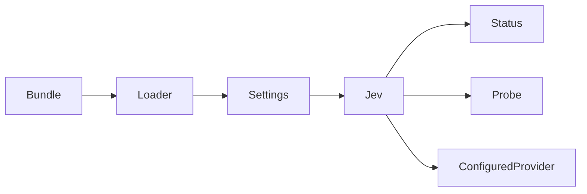

# Reflex first-run configuration

English | [中文](reflex-first-run-plan.zh.md)

The native Reflex page needs an active Loader entry before Settings can expose its form. The Jev bundle therefore keeps the service active without an endpoint or model; this state performs no network requests.

`ReflexStatus.provider` is `null` until both fields are configured. Default-provider resolution rejects missing configuration. Explicit connection probes accept an unsaved candidate. Partial or malformed configuration remains invalid; explicit plugin disabling still removes the service.

Changes belong to the Jev service, status type, bundle, package tests and README pair. The native page consumes the nullable provider status. No session format or release configuration changes.

Verification covers a fresh real Loader profile, Settings discovery, rejected decisions without HTTP, explicit probe access, durable first save, restart, invalid updates and disposal. Focused tests run without rebuilding artifacts.
