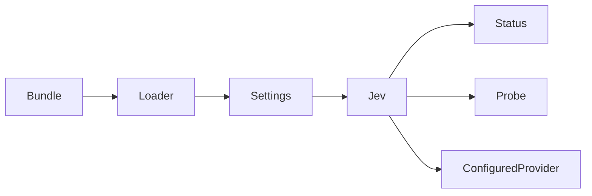

# Reflex 首次配置

[English](reflex-first-run-plan.md) | 中文

原生 Reflex 页面需要处于运行状态的 Loader 条目，Settings 才能提供表单。因此，Jev bundle 在未填写服务地址与模型时仍保留服务；此状态不会发送网络请求。

两个字段配置完成前，`ReflexStatus.provider` 为 `null`。默认 provider 解析会拒绝缺失配置。显式连接测试接受未保存的候选配置。部分配置或格式错误仍会被拒绝；显式禁用插件仍会移除服务。

变更归属 Jev 服务、状态类型、bundle、包测试与 README 文档对。原生页面消费可为空的 provider 状态。不修改会话格式或发布配置。

验证覆盖全新的真实 Loader profile、Settings 发现、无 HTTP 的决策拒绝、显式连接测试、首次保存持久化、重启、非法更新与销毁。定向测试不重建产物。
