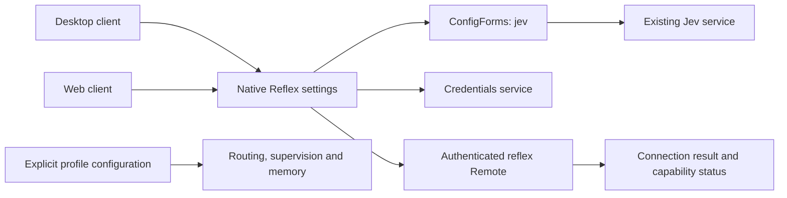

# Native Reflex settings integration

English | [中文](system3-settings-plan.zh.md)

The integrated desktop uses the shared client's native Reflex settings page. This plan supersedes the separate desktop System3 settings plugin; the file name remains stable for existing links. The [configuration guide](configuration.md) owns user instructions.

## Goal and structure

Users configure generation providers in Models and an optional decision service in Settings → Reflex model configuration. Both desktop and Web reuse the same settings and credentials services. The default product profile contains no private endpoints or shared keys. Ordinary model tasks remain independently available.

## Configuration and lifecycle

The native page stages endpoint, model, effort, timeout and credential reference. API keys use the existing credentials service and are never read back as plaintext. New key saves first check the reference: an already configured reference is rejected without changing settings or credentials. Rotation requires a new dedicated reference; deployment environment credentials remain read-only.

The connection test uses the current draft without saving it. Editing the draft invalidates its previous result. Saved settings apply to new requests, while in-flight requests retain their configuration. If a combined settings and credential save cannot confirm completion, the page reports failure or partial application; separate services do not provide cross-service atomicity. Reopening reads accepted settings.

Connection results and task capability states remain separate. Saving a decision service does not enable entry routing, Codex Goal supervision or Continuum. Their candidates, permissions, data classification and memory admission are configured through the existing profile owners. The settings page reports module presence, activation and execution verification independently; a successful decision probe does not establish task acceptance.

## Files and tests

- `packages/experimental/client-ui-system3/`: native Reflex page, controller, localized copy and UI regression tests.
- `packages/experimental/apus-dsh-jev-plugin/`: decision service, connection probe and capability status.
- `frontend/build/dsh-desktop.patch.yml`: integrated desktop composition, without a second settings owner.
- Focused tests cover existing-reference rejection before any mutation, saved/draft configuration isolation, credential failure, stale probe results and independently reported capability states.

The integrated build and installed desktop still require first-run provider configuration, an actual model response, restart and retained-setting acceptance. Unit tests and decision probes do not establish that all optional capabilities or a user's real task work.
