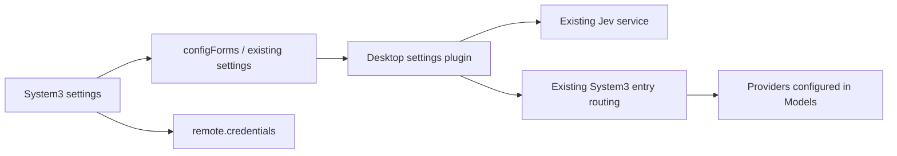

# Desktop System3 settings

English | [中文](system3-settings-plan.zh.md)

This change is part of the approved integrated first-run configuration. Add a small desktop settings plugin that reuses Settings, credentials, Jev, and System3; do not maintain another model-provider registry or credential file.

## Goal and structure

Users enter the Jev endpoint, protocol, model, credential reference, and API key in Settings → System3. Candidates reference Provider IDs and Model IDs already configured in Models. Users explicitly approve the data classes before enabling collaboration. The default is enabled=false, with no production endpoints or shared keys. Ordinary model tasks remain independently available.

## Configuration and lifecycle

The settings namespace is `dsh-desktop-system3-settings`. Non-secret fields are saved atomically to the existing Profile configuration. The credentials API writes an API key only to a new dedicated reference and does not return its plaintext. The page refuses to overwrite an already configured reference; key rotation requires a new reference so an active service keeps its existing credential. A credential save can succeed before a configuration conflict; retain the draft and offer an explicit discard-and-reload action. Ordinary Config fields are enabled, endpoint, protocol, model, credentialRef, candidates, dataClasses, remoteApproved, timeoutMs, minConfidence, and maxInputBytes. An empty credentialRef supports unauthenticated local services. URLs cannot contain user information, a query, or a fragment.

Before enabling collaboration, validate complete fields, unique candidate IDs excluding reserved routes such as `baseline`, explicit approval for Jev, candidate providers and the current conversation provider, and data classes. Treat all routes conservatively as network routes so a local tunnel cannot be mistaken for local computation. Explain invalid input before saving; the Host also validates it. Dynamic child plugins unload with their parent. Configuration persists in the profile overlay as one settings object; volatile enables live updates, and the existing Loader volatile-update serially rebuilds child plugins after changes. Disabled collaboration makes no Jev requests. The settings page reads local activation state through the authenticated `/api/desktop-system3.status` endpoint and offers a refresh action. It distinguishes disabled, starting, ready, and failed services. A failed activation leaves the settings page available for repair or disabling, and configuration changes require no Electron restart. The settings page does not request a user model or Jev response. Real tasks and recorded System3 events verify actual connectivity; saving configuration does not claim a successful connection.

## Files and tests

- `frontend/packages/dsh-desktop-system3-settings/`: Host schema and composition, client settings page, shared pure validation, and package documentation.
- `frontend/build/dsh-desktop.patch.yml`: mount the settings plugin with enabled=false.
- The parent agent maintains frontend dependencies and the lockfile.
- Focused tests cover startup without remote defaults, schema rejection of incomplete enabled configuration, real Cordis child-plugin disposal and reconfiguration, credential-write failure preventing enablement, retained drafts after configuration-save failure, and routing/data-approval mapping. Network fixtures, if needed, bind only random loopback ports.

Run focused tests that do not require a build first. The parent agent then runs the integrated build, actual Desktop configuration, and short-task acceptance. Unit tests do not establish that the user's real model API works.
