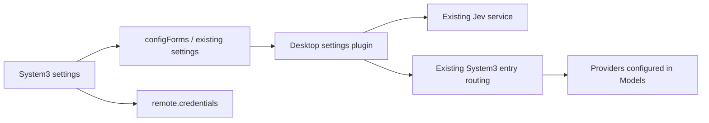

# 桌面 System3 设置

[English](system3-settings-plan.md) | 中文

本变更属于已批准的一体化首次配置范围。新增桌面设置薄插件，复用 Settings、credentials、Jev 和 System3；不维护第二套模型提供商或密钥文件。

## 目标与结构

用户在 Settings → System3 填写 Jev endpoint、protocol、model、credential reference 和 API Key，引用 Models 页已配置的 Provider ID / Model ID 作为候选，并明确授权数据类别后启用。默认 enabled=false，不含任何生产地址或共享密钥。普通模型任务独立可用。

## 配置与生命周期

设置命名空间为 `dsh-desktop-system3-settings`。非密钥字段整体原子保存到已有 Profile 配置；API Key 只经 credentials API 写入新的专用 reference，不回读原文。页面拒绝覆盖已有凭证引用，轮换密钥须使用新引用，确保运行中的服务继续使用原凭证。凭证可能先保存成功、随后配置写入冲突；此时保留草稿并提供明确的丢弃后重载操作。enabled、endpoint、protocol、model、credentialRef、candidates、dataClasses、remoteApproved、timeoutMs、minConfidence、maxInputBytes 属于普通 Config。credentialRef 允许为空以支持无认证本地服务；地址禁止用户信息、query 和 fragment。

启用前验证完整字段、唯一且不使用 `baseline` 等保留选路名的候选 ID、向 Jev、候选服务商和当前对话模型提供商发送数据的显式授权及数据类别。所有路由保守视作 network，避免本地隧道被误当作本地计算。输入不合法在保存前说明，Host 同样校验。动态子插件随父插件生命周期卸载；配置以单个 settings 对象持久化到 Profile overlay，volatile 支持实时更新，修改通过既有 Loader volatile-update 串行重建子插件。关闭后不调用 Jev。配置页通过受认证的 `/api/desktop-system3.status` 端点读取本地挂载状态，并提供刷新操作，区分关闭、启动中、就绪与失败。挂载失败仍保留配置页供修复或关闭，配置修改无需重启 Electron。配置页不会请求用户模型或 Jev；真实任务和已记录的 System3 事件用于验证实际联通性，保存配置本身不宣称连接成功。

## 文件与测试

- `frontend/packages/dsh-desktop-system3-settings/`：Host schema/装配、client 设置页、共享纯校验、包说明。
- `frontend/build/dsh-desktop.patch.yml`：挂载配置插件，enabled=false。
- 根 frontend 依赖及锁由主代理统一维护。
- 聚焦测试覆盖：默认无远端启动、schema 拒绝不完整启用、真实 Cordis 子插件卸载/重配置、密钥写入失败不启用、配置保存失败保留草稿、路由配置与数据授权映射。网络 fixture 如需使用，仅绑定随机 loopback 端口。

先运行不依赖构建的聚焦测试，再由主代理执行统一构建、实际 Desktop 配置及简短任务验收。单元测试不等于已完成用户模型的真实 API 验证。
