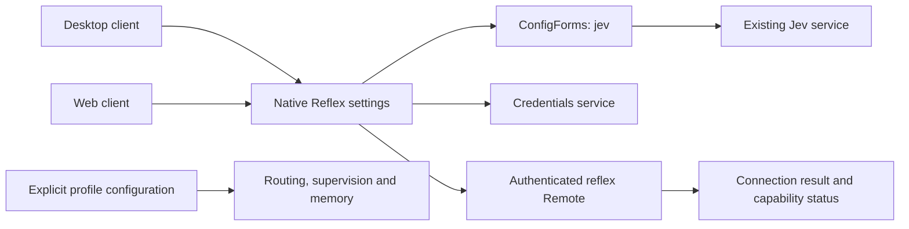

# 原生 Reflex 设置集成

[English](system3-settings-plan.md) | 中文

一体化桌面复用共享客户端的原生 Reflex 设置页。本方案替代独立桌面 System3 设置插件，保留文件名以兼容已有链接。用户操作以[配置教程](configuration.zh.md)为准。

## 目标与结构

用户在“模型”页配置生成服务商，在“设置 → Reflex 模型配置”接入可选的决策服务。桌面与 Web 复用相同的设置和凭证服务。产品默认 profile 不含私有端点或共享密钥，普通模型任务独立可用。

## 配置与生命周期

原生页暂存 endpoint、model、effort、timeout 和凭证引用。API Key 通过现有凭证服务管理，不回读原文。保存新密钥前先检查引用：已有配置的引用会被拒绝，设置与凭证均不修改。轮换密钥需新的专用引用名；部署环境凭证保持只读。

连接测试使用当前草稿，不保存配置；修改草稿后旧结果失效。保存后对新请求生效，正在执行的请求保留原配置。组合保存设置和凭证时，若无法确认完成，页面报告失败或部分生效；两个独立服务不提供跨服务原子性。重新打开页面读取已接受的设置。

连接结果与任务能力状态分别呈现。保存决策服务不会启用入口路由、Codex Goal 监督或 Continuum；候选、权限、数据分类和记忆准入仍由现有 profile 所属模块配置。设置页分别报告模块是否加载、是否启用和执行验收情况；决策探测成功不代表任务已通过验收。

## 文件与测试

- `packages/experimental/client-ui-system3/`：原生 Reflex 页面、controller、本地化文案与 UI 回归测试。
- `packages/experimental/apus-dsh-jev-plugin/`：决策服务、连接探测与能力状态。
- `frontend/build/dsh-desktop.patch.yml`：一体化桌面装配，不另设一套设置管理模块。
- 定向测试覆盖写入前拒绝已有引用、已存配置与草稿隔离、凭证失败、过期探测结果及能力状态独立呈现。

一体化构建与实际安装的桌面仍须完成首次服务商配置、真实模型响应、重启与设置保留验收。单元测试和决策探测不能证明全部可选能力或用户真实任务均可用。
