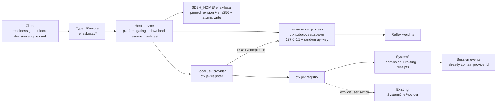

# Local decision engine and inference configuration guidance

English | [中文](local-jev-mlx-design.zh.md)

Companion experience design (wireframes, state machine, copy table, failure matrix): [local-inference-experience.html](local-inference-experience.html). This document is a design deliverable and does not change runtime code; implementation starts after product confirmation.

## Summary

Harness currently has only cloud Jev decisions. APUS Reflex 4B/9B can run locally, but it is a **decision model**: it takes "state + instructions + 2–16 candidates" and outputs a probability distribution over the candidates; it is not a chat model. This plan therefore connects the local model to the provider registration point of `ctx.jev` instead of disguising it as an ordinary chat provider.

The evaluation criterion is convenience and ease of use. The runtime is a **bundled llama.cpp `llama-server`**: the user installs nothing, clicks "Download and enable" once in settings, and everything else happens automatically. On 2026-10-14 it ran successfully on an Apple M5 (24 GB) with `b11118`, the same version the model author validated: Hardened Runtime does not need the JIT entitlement, the 16-candidate distribution is complete, and later questions in the same request that share the state prefix hit the cache.

Separately, the client conflates "account logged in" with "a usable provider exists", so the desktop shows no prompt when generation capability is actually missing. This plan splits readiness into two independent axes: **generation** and **decision**.

## Final choices

| Dimension | Final choice | Basis |
| --- | --- | --- |
| Weight format | GGUF, official repositories `apus-ailab/APUS-Reflex-4B-GGUF` / `-9B-GGUF` | The family's GGUF downloads are 10,096 / 17,178 / 16,142, while each MLX variant has 138–251; the repositories include `SHA256SUMS` and llama.cpp evaluations |
| Runtime | llama.cpp `llama-server` **b11118** (`e6ab7c1a4`), pre-signed and shipped in the desktop installer | The version the model author validated on Mac; runtime files are 24 MB; zero installation for the user |
| Process | Host starts it with `ctx.subprocess.spawn`: `--host 127.0.0.1 --port 0 --api-key <random per start> -c 9216 -np 1`, and reads the port from the `listening on` log line | Measured: `--port 0` gets a system-assigned port; requests without the key return 401 |
| Call method | `POST /completion`: `n_predict: 1`, `n_probs: 1024`, `temperature: 0`, `cache_prompt: true`; the prompt is rendered per the training contract with the no-thinking wrapper | Matches the llama-server path in the model repository's `examples/openjev_local.py`; the measured extra cost of `n_probs: 1024` is negligible |
| Weight download | Pinned revision URL + sha256 + **HTTP Range resume** + atomic write, reusing the download infrastructure of `speech-to-text-sensevoice` | Measured: HF returns 206 for Range, and the sha256 after resuming matches `SHA256SUMS` |
| Launch platform | mac-arm64 only | Value concentrates on Apple Silicon; the platform package mechanism is open to win-x64 but not enabled at launch |
| Default model | Reflex 4B | The author measured 4B Q8_0 on Mac at 80/80 agreement with the reference; 9B is an option for 16 GB or more memory |
| Quantization | Chosen automatically by memory: Q8_0 (4.48 GB) at ≥16 GB, otherwise Q4_K_M (2.71 GB) | Users need not understand quantization; the UI notes the agreement-rate difference of Q4_K_M |
| Not adopted | Ollama; MLX + CPython | Reasons in [Runtime selection](#runtime-selection) |

The user has only one action: **click "Download and enable"**. The download is about 2.7–4.5 GB; keeping weights out of the installer is an explicit non-goal.

## First-principle constraints

These three constraints determine all state names and copy; violating any of them creates user expectations that cannot be met.

1. **A decision model is not a chat model.** The feature name is "local decision engine". "Local model" and "offline mode" must not be used because answers still need a generation model.
2. **No download on the first-value path.** No multi-GB download appears between a new user and their first successful conversation. The local decision engine is a deepening step after the user is already productive; it is offered through progressive disclosure, not as a blocking gate.
3. **Local failures never fall back to the network automatically.** `ctx.jev.decide()` is already fail-open: when a provider throws, it returns `{ kind: 'unknown', spec, failure }` (`packages/experimental/apus-dsh-jev-plugin/src/index.ts:161`), and each decision point falls back to its own deterministic baseline. Local failures follow this path; switching to the cloud must be an explicit action by the user for that occasion.

## Current state

### Decision extension point

| Fact | Evidence | Impact |
| --- | --- | --- |
| `ctx.jev` is registered by `apus-dsh-jev-plugin`; the provider registry is keyed by `provider.info.id`, and `register()` returns a disposer that removes only its own entry | `src/index.ts:73`, `:100` | The local provider can join as a second provider without changing the agent loop |
| `JevProvider` has only `info: { id, model, endpoint }` + `decide()` + optional `warm?()`, and **no `executionDomain`** | `src/types.ts:75-100` | `endpoint` is required, and a loopback URL fits naturally; System3 declares the execution domain |
| One scope cannot mount two Jev plugin instances | `vendor/cordis/src/reflect.ts:290` | The local provider must be **a separate plugin** that calls `ctx.jev.register(...)` under `ctx.inject(['jev'])` |
| Provider selection looks only at `JevRequest.providerId ?? Config.providerId` (default `'system-one'`) | `src/index.ts:121-127`, `:38-39` | Switching to local = changing one configuration field |
| **No System3 decision point sets `providerId`** | `entry-routing.ts:327`, `skill-selection.ts:112`, `handoff-pack.ts:113`, `decisions.ts:105` | Currently everything uses the default provider as a whole, with no per-decision-point selection |
| Routes with `executionDomain === 'local'` **pass privacy admission unconditionally** and are not constrained by the remote allowlist | `packages/experimental/system3-policy/src/index.ts:111-114` | Under `privacyMode: local-only`, local decisions are allowed and cloud ones are rejected; this is real incremental value |
| Decision receipts already record `providerId` and `requestedModel`; other receipts store the whole `JevSpec` as `request`, which contains `providerId` | `decisions.ts:39-40`, `decision-kernel.ts:144` | Provider identity is **already replayable**; no new session event is needed |
| Adding a `JevErrorCode` requires syncing 6 places, including the zod enumeration in `decision-projection.ts` | `decision-projection.ts:63-64` | Local failures map to the existing `transport` / `timeout` / `invalid-response` without new codes |
| **The Jev plugin is not in any shipped profile** | `README.md:28`, zero hits in `packages/bundle/*/cordis.patch.yml` | Enabling Jev in the desktop profile is itself part of this work |

### Protocol gap (the most underestimated part)

Harness `JevRequest` does not map one to one onto the model's training contract; there are three substantive differences:

| Dimension | Harness `JevRequest` | Model contract | Consequence |
| --- | --- | --- | --- |
| Questions per request | `questions: Record<string, JevQuestion>`, at most 16 (`protocol.ts:17`) | One `primitive` + one candidate set per call | **One request runs N model calls**, and latency scales with the question count |
| Candidates per question | `MAX_JEV_CHOICES = 255`, the validator accepts 1–255 (`protocol.ts:19`, `:73`) | `LABELS` has only A–P, **16** | Questions with more than 16 candidates **cannot be expressed locally** and must be rejected explicitly and fail open to the baseline; batching or knockout rounds are not allowed because they are outside the training contract |
| `score` semantics | `criteria: string[]` ordered levels (≥2), answer `score = Σ i·pᵢ` (`protocol.ts:144`) | `score_level` **requires the canonical yes/no candidate set** and returns `yes_probability` | Cannot be mapped directly; the ordered levels must be rendered as `choice` (A–P), and `score` and `legend` are reconstructed locally by `Σ i·pᵢ` |
| `noul` | Optional `criteria { true, false }`, answer `noul: number` | `noul` also requires the canonical yes/no candidate set | Maps directly to `yes_probability` |

The N questions in one request **share the same `state` prefix**; the contract puts the shared state in the prompt prefix and the task JSON in the suffix, so the prefix cache makes calls 2..N very cheap. The `timings.cache_n` field in the `llama-server` response gives the number of hit tokens directly; in the smoke test, questions 2..N hit 3,405 tokens.

### Client readiness checks

| Fact | Evidence | Impact |
| --- | --- | --- |
| The native welcome window condition is `!loggedIn && !hasApiKey` | `apps/desktop/src/welcome-api.ts:53-66` | **After a successful login, keys are no longer checked**; this is exactly the gap users reported |
| `providerUsable()` counts a logged-in `deepseek-account` as a usable provider; `onboardingReadiness()` returns `provider-ready` as soon as one row is usable | `packages/client/ui-settings-models/src/client/store.ts:277-282`, `:310` | A successful login usually **already provides** a usable generation route; asking for a key at that point is a defect |
| The desktop explicitly disables the automatic missing-key dialog | `ui-settings-models/src/client/index.ts:81` (`&& !('dshDesktop' in globalThis)`) | The real defect is that "the desktop shows no prompt even when there truly is no usable provider" |
| Desktop onboarding checks keys only when logged out | `ui-settings-account/src/client/onboarding-state.ts:228` | The logged-in path performs no readiness check at all |
| Directly reusable: `OnboardingModal` (`#root` inert, not implicitly dismissible), `DeepSeekOnboardingDialog` (contains `ProviderEditor` with `credentialOnly credentialRequired autoFocusCredential`), the ordered `settings.onboarding` step slot, the explicit `openOnboarding(id)` entry, the `shell.overlay` slot, `Toast` (with `tone`/`actions`), and the chained in-place `shell.quota-notice` notice | See the experience design | No new provider form is needed |
| **There is no general progress bar component**; existing download progress is text only (`t('desktop.update.progress', { percent })`) | `ui-settings-general/src/client/DesktopUpdateIndicator.tsx:19` | A new `Progress` primitive is needed and requires design review under the UI standard |

### Distribution infrastructure

| Fact | Evidence | Impact |
| --- | --- | --- |
| The app enables Hardened Runtime; every Mach-O in the runtime directory is signed individually, and only `node` and `libreoffice-kit` carry the JIT entitlement | `electron-builder-config.mjs:158-163`; `apps/desktop/scripts/macos-runtime.ts:30-65`, `:43-45` | New native files placed in the runtime directory are signed by the same process, and **no new entitlement is needed** |
| The runtime directory must not contain symlinks | The `root` parameter convention of `macos-runtime.ts:24` | The official archive has 18 symlinks, which packaging must materialize as regular files by soname |
| Native binaries have an npm platform package precedent (`os`/`cpu` fields + `optionalDependencies`) | `native/system/packages/darwin-arm64/package.json:10-16`; `libreoffice-kit-${platform}-${arch}` | The runner ships as the `@deepseek-ai/llama-server-darwin-arm64` platform package |
| The artifact matrix has only `mac-arm64` / `mac-x64` / `win-x64`, with no linux | `desktop-build-paths.mjs:7` | Launch enables it only on mac-arm64 |
| The authoritative data directory implementation is `resolveDshHome()`; the local model precedent is `$DSH_HOME/speech-to-text/sensevoice/` | `packages/util/home-paths/src/index.ts:87`; `voice-input-bundle/cordis.patch.yml:9` | Weights go to `dshHomePath('reflex-local', …)` |
| **The repository has no resume implementation**; the existing downloader restarts the whole package after an interruption | `speech-to-text-sensevoice` README: "partial downloads restart" | Resume is the only download capability this plan must write from scratch |

### Existing implementation template

`packages/experimental/speech-to-text-sensevoice` + `voice-input-bundle` is the direct template for this feature:

- `runtime/assets.json`: HF URL with a **pinned commit revision** + `bytes` + `sha256`, published with the npm package.
- `downloadAsset()` (`src/runtime.ts:104-148`): unique `.part` name, exclusive creation with `open(..., 'wx', 0o600)`, streaming sha256, atomic publication with `rename()`. Resume changes exactly this: keep the `.part`, recompute the sha256 state of the existing part on restart, then resume with `Range: bytes=<existing length>-`, requiring 206 and otherwise downloading from scratch.
- `orderModelSources()` (`src/model-sources.ts:13`): concurrent HEAD probing of multiple sources, preferring the first available one.
- Failure categories `'http' | 'integrity' | 'timeout' | 'storage' | 'unknown'` (`src/download-error.ts:20`).
- Progress reporting phases `checking | downloading | loading | waking | ready | standby`, throttled by `progressIntervalMs`.
- Process management: `ctx.subprocess.spawn` + port from an output handshake + `Bearer` authentication + idle reclamation through `idleTimeoutMs` (`src/process-server.ts:14-55`); the local Reflex runner makes idle release opt-in through `idleReleaseMs`. llama-server has its own `--api-key` and `--port 0`, so no extra Node service layer is needed.
- The teardown order (`recognizer.ts:320-326`) and "the inference path never triggers a download" carry over unchanged.
- Declarative bundle: `cordis.patch.yml` + `icon.svg` + `locale/{en,zh}.json`.

### Model facts

Read from Hugging Face on 2026-10-14; all are the model author's measurements on an Apple M5 (24 GB, Metal):

| Release | File size | Agreement with reference | Correct | Max Δp | Notes |
| --- | --- | --- | --- | --- | --- |
| 4B Q8_0 · `llama.cpp` b11118 | 4,482,403,168 B | 80/80 | 66/80 (reference 66/80) | 0.132 | Mean Δp 0.0065 |
| 4B Q4_K_M | 2,708,804,768 B | 77/80 (model card) | — | 0.888 (model card) | 8 GB memory tier |

Pinned `SHA256SUMS` values: 4B Q8_0 `5e57075a169a76de5150f5c5defd805525ce4df86ae8865f70f128e15e57416c`, 4B Q4_K_M `3e77f041b48a6b28081071dc4dca8b047c10acf0a4b9b9b48603cef6b06ee186`, 9B Q8_0 `6b1de49865bf467b4b33b9f0d1e5df8c1aa0130d5be4732e75102dfc70f69a8f`, 9B Q4_K_M `337c1a8bdaf88e7f8e46f6551e35c63e4f4e97d0309147999e4a8002a928b08c`.

The license is Apache-2.0. Probabilities are **uncalibrated**. Quality figures always cite model card measurements and are never converted into an "accuracy".

### Local smoke measurements

2026-10-14, Apple M5, 24 GB, macOS 26, `b11118` + 4B Q8_0. One machine, one run, synthetic state; this is not P0 and has no cloud comparison. The raw record is in [tasks/notes.md](tasks/notes.md).

| Item | Measurement |
| --- | --- |
| Runtime files | Executable + 10 `@rpath` dylibs, 24 MB |
| Hardened Runtime | Loading is rejected under ad-hoc signing ("different Team IDs"), confirming that everything must be signed with the same Team ID; Metal works **without `allow-jit`** |
| Start to `/health` 200 | 4.0 s |
| Prefill | Metal about 1,000 tokens/s; CPU only about 100 tokens/s |
| First question of a new conversation (full prefill of 3,921 tokens) | 3.86 s |
| Questions 2..4 of the same request (state prefix hit) | 0.58 / 0.59 / 0.84 s |
| Each question in later turns | About 0.43 s |
| 16 candidates | Complete distribution, candidate mass 0.98 |
| Cost of `n_probs` 1024 | Negligible |
| Resume | HF returns 206, and the sha256 matches after completion |

**Latency structure**: the training contract puts the state first and the task last, so every question recomputes the task segment and the state delta; about 0.4–0.6 s per question is the floor of this structure; the cold first question takes about 1 s / 1k tokens (base M5), and older chips will be slower.

## Goals and non-goals

Goals:

1. On supported devices, users download, verify, self-test, enable, disable, and delete the local decision engine inside the client; the whole process is explainable, pausable, and resumable, and needs no other software installed.
2. Local decisions keep the existing `JevRequest` / `JevResponse`, probabilities, confidence, and session receipts; the UI never calls the model directly.
3. When generation capability is truly unavailable, give one recoverable guidance flow that takes the user to configure a key or connect a local generation endpoint.
4. While running, users can see where a decision happened and where the data went.

Non-goals:

- Do not treat Reflex 4B/9B as a chat generation model.
- Do not bundle weights into the installer.
- Do not support external inference runtimes (Ollama, LM Studio) as local decision backends.
- Do not describe "local decision engine enabled" as "the whole app works offline".
- Do not add a `JevErrorCode` or a new session event type.

## Readiness model

Two unrelated axes:

| Axis | Question | Values | Consequence when missing |
| --- | --- | --- | --- |
| Generation | Who writes the answer | Account / official key / third party / local endpoint | **The app is unusable**; this is the only trigger for the dialog |
| Decision | Who makes the judgment | Cloud Jev / local Reflex | The app remains usable and falls back to the deterministic baseline |

The dialog condition is the edge of "no usable provider at all", not "no API key". The code already provides the right criterion: `onboardingReadiness()` returns `credential-missing` or `unavailable`. The fix is not a new set of checks but **stopping the desktop from unconditionally disabling this prompt** (`ui-settings-models/src/client/index.ts:81`) and also checking on the logged-in path (`onboarding-state.ts:228`).

Three tiers meaningful to users, presented in this order on the settings page:

| Tier | Generation | Decision | What the user gets | Cost |
| --- | --- | --- | --- | --- |
| Cloud (default) | Account or key | Cloud Jev | Usable in about 30 seconds, no disk use | Both depend on the network |
| Hybrid (recommended) | Account or key | Local Reflex | Decisions do not depend on Jev service availability; decisions are not billed; decisions still work under the `local-only` privacy policy | 4B needs about 2.7–4.5 GB of disk and resident memory |
| Fully local (advanced) | Local OpenAI-compatible endpoint, connected through the existing custom model API | Local Reflex | Fully offline | The user runs a generation model themselves |

The hybrid tier's privacy claim must stay narrow: conversation content still goes to the cloud generation model; the real change is that decisions no longer go to a second service and that local decisions pass admission under `privacyMode: local-only`. Describing the hybrid tier as a privacy solution is not valid; only the fully local tier is.

## Proposed architecture



The package layout follows the four-part set of `speech-to-text`: Service Definition + provider + api + client-ui, plus a runner platform package and a declarative bundle. The Host service owns the process and downloads; the Jev provider depends only on `decide()` / `warm()`.

### Runner integration spec

**Packaging.** Add the `@deepseek-ai/llama-server-darwin-arm64` platform package, containing `llama-server` from the official `b11118` macOS arm64 archive and the 10 dylibs it depends on, materialized by soname, with no symlinks. The build verifies the archive sha256 (`ca0ea3156257b21eeb11d0628f2baecd3928013a3d060e2e192042276e5b1f35`). The existing `signMacOSRuntime()` signs it, with no entitlement added.

**Startup.** Host starts it the first time it is needed, with fixed arguments:

```text
llama-server -m <weights> --host 127.0.0.1 --port 0 --api-key <randomBytes(32)> -c 9216 -np 1
```

The port comes from `listening on http://127.0.0.1:<port>` in the output; Host then polls `GET /health` until 200 before publishing readiness. `-c 9216` matches the model repository's `params`; `-np 1` makes the N questions of one request run serially and reuse the same prefix cache.

**Calls.** The provider makes one `POST /completion` per question:

```json
{ "prompt": "<full prompt rendered per the training contract, including the no-thinking chat wrapper>", "n_predict": 1, "n_probs": 1024, "temperature": 0, "cache_prompt": true }
```

It takes the log probabilities of the 16 candidate letters from `completion_probabilities[0].top_logprobs` and normalizes over the candidate set. The no-thinking wrapper follows `CHAT` in the model repository's `examples/openjev_local.py`, fixed byte for byte by golden samples.

**Required rules:**

1. Requests to the same provider are **serialized** and sent in question order, so questions 2..N hit the prefix cache.
2. More than 16 candidates are rejected directly; when any candidate is not among the 1,024 returned entries, report `invalid-response` instead of filling in 0. Measurements show all 16 candidates are included; this rule is defensive.
3. `warm()` starts the process and loads the model at session start, moving the 4-second load out of the first decision.
4. While local decisions are enabled, the process stays resident (about 4.5 GB for 4B Q8_0): it starts at Host launch, on `enable()` before routing changes, and after a model switch. Only a configured `Config.idleReleaseMs` ends an idle process to free that memory; the next decision then waits for the load.
5. Both the weight file and the runner version are pinned. A runner upgrade is a change that requires rerunning the distribution agreement re-verification and is not approved automatically by CI.

<a id="preparation-flow"></a>
### Preparation flow

The card has only one primary button, and the state advances automatically:

| State | Primary button | After pressing |
| --- | --- | --- |
| Device not supported | (None, show the reason) | — |
| Not downloaded | Download and enable · 4.5 GB | Disk check → download → sha256 → self-test → automatic enablement |
| Downloading | Pause | Keep the `.part` and resume from the breakpoint when continuing |
| Self-testing | (None, show progress) | — |
| Enabled | Disable / delete model | — |
| Self-test failed | Retry | Keep the weights and the reason |

Unified memory determines the quantization automatically, and the button states the download size directly. 9B appears as a secondary link only when memory is ≥16 GB.

The **self-test** runs a set of golden samples committed with the repository: choices match the samples, distribution differences from the recorded samples stay within tolerance, and the machine's prefill speed is measured. When the speed is clearly below the design target, the engine is not enabled automatically; the card says "This Mac makes decisions slowly; keeping the cloud is recommended", and the user decides.

### Decision protocol implementation

The provider converts typed requests into the training contract:

- It calls the model per question in `JevRequest.questions`, sharing the same `state` prefix; question order within a request is stable, and answers are assembled back into `JevResponse.answers` by their original keys.
- `choice`: the keys of `criteria` map to letters A–P, and the descriptions become candidate descriptions.
- `score`: the ordered levels render as `choice`, and `score` is reconstructed locally by `Σ i·pᵢ`, with `legend` filled in. **The contract's `score_level` is not used** because it requires the canonical yes/no candidate set.
- `noul`: maps to the contract's yes/no candidate set and takes `yes_probability`.
- Verify that each letter **is a single token at the answer position** (the contract's `compile()` in `openjev_mlx.py` asserts this explicitly), confirmed by the golden-sample self-test; otherwise fail with `invalid-response` instead of guessing.
- Take the log probabilities of the candidate tokens, normalize over the candidates, and then validate with rules equivalent to the existing `parseJevResponse` (probabilities sum to 1±0.001, exact key-set match, `confidence ∈ [0,1]`, score equals `Σ i·pᵢ`±0.001).

**The easiest place to get wrong: byte-for-byte identical prompt rendering.** The contract renders the task segment with Python `json.dumps(task, ensure_ascii=False, sort_keys=True)`; a literal TypeScript translation with `JSON.stringify` produces a different string, because Python's default separators are `", "` and `": "` while `JSON.stringify` adds no spaces:

```text
Python contract:     {"criteria": [{"description": "Close…", "label": "A"}], "instructions": …}
Literal stringify:   {"criteria":[{"description":"Close…","label":"A"}],"instructions":…}
```

Different characters mean different tokens, and the model receives a prompt it was never trained on. It reports no error and only produces a shifted distribution, and functional tests cannot reveal this kind of defect. Prompt rendering therefore needs a set of golden samples generated by the Python contract and committed with the repository, covering Chinese, quotes, newlines, emoji, and control characters, compared byte for byte.

Completeness: with `n_probs: 1024`, measurements show all 16 candidates among the returned entries. When any candidate is missing, report `invalid-response` instead of filling in 0 and pretending the distribution is complete.

<a id="runtime-selection"></a>
### Runtime selection

Comparison of the three candidates against the "convenience and ease of use" criterion:

| Dimension | Bundled `llama-server` | Ollama | MLX + CPython |
| --- | --- | --- | --- |
| User action | **One download click** | Install a third-party app, then click download | One download click |
| Leaves the client | No | Yes | No |
| 16-candidate distribution | **Complete** (`n_probs` 1024) | Truncated (`top_logprobs` capped at 20; the author's data shows 16/16 incomplete) | Complete |
| Pinned weight version | Pinned revision + sha256 | `hf.co` pulls take the main branch; the digest can only be checked afterward | Pinned revision |
| Runtime behavior drift | We pin the version | Changes as users upgrade Ollama | We pin the version |
| Evicted from memory by other models / pointed at a remote host by `OLLAMA_HOST` | No | Yes | No |
| Installer size increase | 24 MB | 0 | Hundreds of MB (`mlx-lm` depends on `transformers` and native `tokenizers`) |
| JIT entitlement | Measured as not needed | Not applicable | Not verified |

Ollama's only advantages are that we write 1–2 fewer weeks of code and the installer contains no native code we distribute; its measurements are not bad (the author's `raw` mode choices agree 80/80), but the extra installation step and the truncation both land directly on the user experience. MLX covers only one published target, and its dependency size and JIT questions are heavier.

Ollama truncation data (derived from the author's per-question files): questions with 2 and 3 candidates are 64/64 complete, questions with 16 candidates are 0/16 complete, the truncated probability mass has a median of 0.0010 and a maximum of 0.0129, and the choice itself is unaffected. If external runtimes are supported later, the provider must use `/api/generate` + `raw: true` (the default template has 2 fewer tokens than the training contract, and choice agreement is only 49/80), and must handle truncation with a bounded per-request error.

### Execution domain and provider selection

- Set System3's `jevExecutionDomain` to `'local'` so it passes admission under `privacyMode: local-only` (`system3-policy/src/index.ts:111-114` already supports this, and tests cover it).
- Because no System3 decision point sets `providerId`, switching to local can only change the Jev plugin's `Config.providerId`. Per-decision-point selection needs a new field on the System3 side; **this plan does not include it**, and it is listed as an optional follow-up.
- The runner binds only `127.0.0.1` and gets a new key on every start; the process Host starts itself guarantees the `local` identity, and externally configured endpoints are not accepted.

### Failure mapping

Local failures always map to existing `JevErrorCode` values; no new error code is added, which avoids syncing 6 enumerations:

| Situation | Error code | What the user sees |
| --- | --- | --- |
| Runner not ready, crashed, or terminated by the system | `transport` | The dock shows "Local decision did not complete; this turn uses the default handling"; Host restarts it automatically before the next decision, and after consecutive failures disables it and explains on the card |
| Timeout | `timeout` | Reuses the existing `fallbackTimeout` |
| More than 16 candidates, candidate missing from returned entries, validation failure | `invalid-response` | The execution rationale states the reason |

## Experience design

Wireframes, the preparation state machine, the full copy table, and the failure recovery matrix are in [local-inference-experience.html](local-inference-experience.html). Key points:

- The **readiness dialog** reuses `OnboardingModal` + `DeepSeekOnboardingDialog`, hosted in the `settings.onboarding` slot; it appears at most once per session; both gates point to the generation axis (configure a key / connect a local generation endpoint). The local decision engine does not appear here because it does not satisfy the generation axis.
- The real change is **removing the desktop's unconditional disabling** and also checking readiness on the logged-in path; the criterion stays `onboardingReadiness()` without a new implementation.
- Choosing "Configure later" closes the dialog and keeps a dismissible in-place notice above the input box (chained claiming in the style of `shell.quota-notice`), checked again on the next launch; no second dialog interrupts before sending.
- The **local decision engine** is added as a new section on the "Models" page after the provider list, without a new page. The card always has exactly one primary button and advances through the [preparation flow](#preparation-flow); after the self-test passes it enables automatically and shows a Toast with "Decisions now run on this machine" and "Undo".
- **Progressive disclosure of the entry**: see "Guidance and prompt rules" below. It is not recommended on the first-value path.
- **While running**, a source marker is added to the existing System3 dock decision row, and the execution rationale adds where the decision happened, the model, and the data scope. The dock's existing `decisionTime`, `details` (view execution rationale), and `fallbackTimeout` / `fallbackUnavailable` copy can be reused.
- Every failure state needs a named state, one sentence users can understand, and one clickable recovery action.
- A new `Progress` primitive is needed (the repository has none) and requires design review under the UI standard.

### Guidance and prompt rules

Clickable prototype: [prototype.html](prototype.html). The principle is **at the exact moment the user needs it, in the place they are looking, offer an action that takes effect with one click**; never interrupt users mid-work, and never make them search the settings page.

**One entry, four moments:**

| Moment | Trigger | Where it appears | Primary action | Frequency |
| --- | --- | --- | --- | --- |
| Privacy policy blocks a cloud decision | `privacyMode: local-only` and this turn's cloud decision was rejected | Dock decision row | Decide locally | Shown every time it is blocked; this is a functional problem, not a recommendation |
| Unstable cloud decisions | The second `fallbackTimeout` / `fallbackUnavailable` within the same session | End of the dock decision row | Switch to local decisions | At most once per session |
| After enough use | At least 20 decisions completed, and the current turn has ended | One-time invitation card above the input box | One-click enable | Hidden for 14 days after "Later"; never shown again after "Don't remind me" |
| User-initiated viewing | The user opens the execution rationale or settings | One line at the bottom of the execution rationale; the local decision engine section of the "Models" page | One-click enable | Always present, not counted as a prompt |

All prompts share three preconditions: the device passes gating (Apple Silicon, memory, disk), the generation axis is usable, and no turn is currently running. If any one is missing, nothing is shown, so users are never invited to do something that cannot succeed.

**The full one-click enable process; the user clicks only once:**

1. The click immediately starts a background download, and the invitation card collapses into a progress label on the right side of the dock ("Preparing local decisions 38%"). The user keeps chatting, and decisions continue to use the cloud meanwhile.
2. Opening the progress label shows a small menu: Pause, View details, Cancel. After the app quits and reopens, an unfinished download resumes automatically without another click.
3. After the download passes verification, the self-test runs automatically; if it passes and the speed meets the bar, the engine is enabled automatically and a Toast "Decisions now run on this machine" appears with "Undo".
4. The next decision shows a "Local" marker with a one-time notice: "From now on, decisions are made on this Mac; click here to see the rationale".
5. When the self-test speed is too slow, the engine is not enabled automatically; the progress label becomes "This Mac makes decisions slowly", and opening it offers "Enable anyway" and "Keep cloud".

**State the cost before the click**: the invitation card and the button state the download size directly; when disk space is insufficient, the button becomes "Needs 4.5 GB, {free} available" and offers "Use the compact version · 2.7 GB"; on metered networks the client asks before downloading.

All copy goes through the existing locale dictionaries: a single `src/client/locales.ts` file exports both `zh`/`en`, with flat camelCase keys and `{name}` interpolation, registered through `ctx.locale.register(NS, { zh, en })` with declaration merging in `LocaleNamespaceMap`. Short notices conventionally omit the trailing period. `verify-client-ui-i18n` rejects inline product copy; properties ending in `Key` are exempt.

## Change scope

| Layer | Change | Phase |
| --- | --- | --- |
| Local provider plugin | New package: contract rendering + golden samples, per-question calls and answer assembly, score→choice mapping, normalization and completeness, failure mapping, `warm()`, serialization, `ctx.jev.register` integration | P1 |
| System3 configuration | Enable the Jev plugin in the desktop profile; `jevExecutionDomain: local`; `Config.providerId` points to local | P1 |
| Runner platform package | `@deepseek-ai/llama-server-darwin-arm64`: pinned `b11118`, archive sha256 check, symlink materialization, payload smoke test | P2 |
| Host preparation service | `platform-arch` allowlist, pinned-revision download, **new Range resume**, sha256 check, atomic write, disk check, process start and handshake, idle reclamation, self-test, deletion cleanup | P2 |
| Typert Remote | `reflexLocal/*`: status, start download, pause, self-test, enable, disable, delete | P2 |
| Client readiness gate | Remove the desktop disabling branch in `ui-settings-models`; add a readiness check to the logged-in path in `onboarding-state.ts`; reuse the existing modal and `ProviderEditor` | P2 |
| Local decision engine card | New section on the "Models" page: single-primary-button state machine, download progress, self-test result, enable toggle, delete | P2 |
| UI primitive | New `Progress` (design review) | P2 |
| Decision display | `client-ui-system3`: source marker, extended execution rationale, local failure copy | P2 |
| bundle | Declarative `cordis.patch.yml` + `icon.svg` + `locale/{en,zh}.json`, modeled on `voice-input-bundle` | P2 |
| Documentation | Desktop README, provider README, and `docs/user/guide` add the local decision engine and privacy notes, following the existing bilingual pairing | P1/P2 |

The session layer needs no change: `providerId` and `requestedModel` are already in the receipts.

## Phases and acceptance gates

| Phase | Deliverable | Pass condition |
| --- | --- | --- |
| P0 qualification | Scripts call `llama-server` directly, without product code: prompts from **real Harness decision points**, measuring 4B/9B cold start, first question, questions 2..N of the same request, and the next turn on M1/M2/M5 with 8/16/24 GB; compared with **the measured latency and choice distribution of cloud decisions** | Warm p95 meets the target; the distribution comparison is recorded; the self-test speed threshold is derived |
| P1 contract and provider | Byte-for-byte golden-sample comparison, three primitives, normalization and completeness, failure mapping, serialization and cancellation | Full coverage of all three primitives; tests for both the >16 candidates path and the missing candidate path |
| P2 distribution and preparation flow | Runner platform package and signing, download resume verification, process management, self-test, single-primary-button card, readiness dialog, dock source marker | Network loss, insufficient disk, quitting midway, and runner crashes all land in named states with recovery actions; weights are never deleted by mistake |
| P3 session and replay | Replay does not call the model again; the baseline of local failures is replayable | Snapshots cover local decisions, local failure fallback, and explicit cloud switching |
| P4 real-hardware acceptance | Developer ID signed and notarized installer: first download, resume, startup without network, delete and reinstall, upgrade | When no generation model is configured, decision data truly stays on the machine; local failures never fall back to the network automatically |

**Latency is the go/no-go gate for this feature, not an optimization item.** Smoke measurements show a 4-question request takes about 2 s warm and about 6 s cold (M5). Whether this is acceptable depends on the measured range of cloud decisions, and P0 must obtain that comparison; if warm p95 is not better than the cloud, the local decision engine is off by default and offered only as an advanced option.

The test matrix copies `speech-to-text-sensevoice/tests`: `installer` / `download-error` / `model-sources` / `runtime` / `process-server` / `provider` / `provider-queue` / `protocol` / `local.e2e`, plus `resume`.

## Risks

| Risk | Description | Mitigation |
| --- | --- | --- |
| Local is slower than the cloud | The task segment comes after the state, so about 0.4–0.6 s per question is the structural floor; cold runs take about 1 s / 1k tokens; older chips are slower | P0 hard gate; `warm()` warm-up; self-test measures speed and slow machines are not enabled automatically; P0 evaluates parallel N questions across multiple slots |
| Prompt rendering drift | A literal `JSON.stringify` translation produces different tokens; the model reports no error and only gives a shifted distribution | Byte-for-byte golden-sample comparison, committed with the repository |
| `score` semantic mismatch | The contract's `score_level` is not Harness's ordered-level score | Render as `choice`, reconstruct locally, and add assertions |
| Runner maintenance responsibility | Security updates, upstream tracking, and distribution re-verification for every version upgrade are all ours | Pin the version; bind only to loopback + random key; upgrades go through the re-verification process |
| Signing and notarization | Local measurements used only ad-hoc signing to simulate the same Team | P4 acceptance with real Developer ID and notarization |
| Memory use | 4B Q8_0 stays resident at about 4.5 GB | Idle reclamation; Q4_K_M on 8 GB machines |
| Download reachability | Direct HF access is unreachable on some networks | Reuse multi-source probing (`huggingface.co` + mirror); product decides whether to move to an own CDN or ModelScope |
| User misunderstanding | Reading "local decisions" as "full local conversation" | Feature name, description line, and execution rationale all state the limit |

## Pending product confirmation

The format (GGUF) and runtime (bundled `llama-server`) are final. Remaining:

1. Whether launch covers mac-arm64 only.
2. If account login already provides a usable generation route, whether configuring an official key is still required. This plan defaults to not requiring it.
3. Whether weight downloads use direct Hugging Face access with mirrors, or move to an own CDN or ModelScope.
4. Whether users may explicitly switch to the cloud within the current task when a local decision fails; whether the default privacy policy stays `local-only`.
5. Whether to enable automatically after the self-test passes (this plan defaults to yes, with a Toast to undo).
6. Whether to accept long-term maintenance responsibility for the runner (see the risk table).
