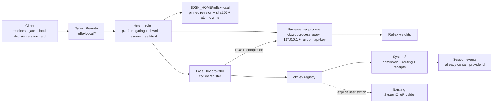

# 本机决策引擎与推理配置引导方案

[English](local-jev-mlx-design.md) | 中文

配套体验设计稿（线框、状态机、文案表、失败矩阵）：[local-inference-experience.html](local-inference-experience.html)。本文是设计交付，不修改运行代码；实现需要产品确认后再开始。

## Summary

Harness 当前只有云端 Jev 决策。APUS Reflex 4B/9B 可以在本机运行，但它是**决策模型**——收「状态 + 指令 + 2–16 个候选」，输出候选上的概率分布，不是聊天模型。因此本方案把本机模型接到 `ctx.jev` 的 provider 注册点上，而不是把它伪装成一个普通聊天提供商。

评判标准是便利与易用。运行时定为**随包分发的 llama.cpp `llama-server`**：用户不安装任何东西，在设置里点一次「下载并启用」，其余全部自动完成。2026-10-14 已在 Apple M5（24 GB）上用模型作者验证过的同一版本 `b11118` 跑通：Hardened Runtime 下不需要 JIT entitlement，16 个候选的分布完整，同一请求里共享状态前缀的后续问题命中缓存。

同时，客户端把「账号已登录」和「存在可用提供商」混在一起判断，导致桌面端在真正缺少生成能力时没有任何提示。本方案把就绪状态拆成**生成**与**决策**两条独立的轴。

## 定稿选择

| 维度 | 定稿 | 依据 |
| --- | --- | --- |
| 权重格式 | GGUF，官方仓库 `apus-ailab/APUS-Reflex-4B-GGUF` / `-9B-GGUF` | 该家族 GGUF 下载量 10,096 / 17,178 / 16,142 次，MLX 各档 138–251 次；仓库自带 `SHA256SUMS` 与 llama.cpp 评测 |
| 运行时 | llama.cpp `llama-server` **b11118**（`e6ab7c1a4`），随桌面安装包预签名分发 | 模型作者在 Mac 上验证的版本；运行所需文件 24 MB；用户零安装 |
| 进程 | Host 用 `ctx.subprocess.spawn` 启动：`--host 127.0.0.1 --port 0 --api-key <每次随机> -c 9216 -np 1`，从日志 `listening on` 行取端口 | 已实测 `--port 0` 由系统分配端口；无 key 请求返回 401 |
| 调用方式 | `POST /completion`：`n_predict: 1`、`n_probs: 1024`、`temperature: 0`、`cache_prompt: true`，prompt 按训练契约渲染并带无思考包装 | 与模型仓库 `examples/openjev_local.py` 的 llama-server 路径一致；`n_probs: 1024` 的额外开销实测可忽略 |
| 权重下载 | 固定 revision URL + sha256 + **HTTP Range 续传** + 原子落盘，复用 `speech-to-text-sensevoice` 的下载设施 | 实测 HF 对 Range 返回 206，续传后 sha256 与 `SHA256SUMS` 一致 |
| 首发平台 | 仅 mac-arm64 | 价值集中在 Apple Silicon；平台包机制对 win-x64 开放但首发不启用 |
| 默认模型 | Reflex 4B | 作者实测 4B Q8_0 在 Mac 上与参考一致 80/80；9B 作为 16 GB 以上内存的可选项 |
| 量化档 | 按内存自动选：≥16 GB 用 Q8_0（4.48 GB），否则 Q4_K_M（2.71 GB） | 用户不需要理解量化；Q4_K_M 的一致率差异在界面注明 |
| 不采用 | Ollama；MLX + CPython | 理由见[运行时选型](#runtime-selection) |

用户动作只有一个：**点「下载并启用」**。下载约 2.7–4.5 GB，权重不进安装包是明确的非目标。

## 第一性约束

这三条决定全部状态命名与文案写法；违反任一条都会产生无法兑现的用户预期。

1. **决策模型不是聊天模型。** 功能名为「本机决策引擎」。不得使用「本地模型」「离线模式」，因为回答仍需要一个生成模型。
2. **首次价值路径上不放下载。** 新用户到第一次成功对话之间不出现数 GB 下载。本机决策引擎是用起来之后的加深项，用渐进披露邀请，不做阻塞门。
3. **本机失败不自动外发。** `ctx.jev.decide()` 已经是 fail-open：provider 抛错返回 `{ kind: 'unknown', spec, failure }`（`packages/experimental/apus-dsh-jev-plugin/src/index.ts:161`），各决策点各自退回确定性 baseline。本机失败沿用这条路径，切云端必须是用户当次的显式动作。

## 现状

### 决策扩展点

| 事实 | 证据 | 影响 |
| --- | --- | --- |
| `ctx.jev` 由 `apus-dsh-jev-plugin` 注册，provider 注册表以 `provider.info.id` 为键，`register()` 返回只删自身的 disposer | `src/index.ts:73`、`:100` | 本机 provider 可作为第二个 provider 接入，不改 agent loop |
| `JevProvider` 只有 `info: { id, model, endpoint }` + `decide()` + 可选 `warm?()`，**没有 `executionDomain`** | `src/types.ts:75-100` | `endpoint` 是必填字段，回环 URL 天然合适；执行域在 System3 侧声明 |
| 同一 scope 不能挂载两个 Jev 插件实例 | `vendor/cordis/src/reflect.ts:290` | 本机 provider 必须是**另一个插件**，在 `ctx.inject(['jev'])` 下调用 `ctx.jev.register(...)` |
| provider 选择只看 `JevRequest.providerId ?? Config.providerId`（默认 `'system-one'`） | `src/index.ts:121-127`、`:38-39` | 切换本机 = 改一个配置字段 |
| **System3 的所有决策点都不设置 `providerId`** | `entry-routing.ts:327`、`skill-selection.ts:112`、`handoff-pack.ts:113`、`decisions.ts:105` | 当前只能整体走默认 provider，没有逐决策点选择能力 |
| `executionDomain === 'local'` 的路线**无条件通过隐私准入**，不受远端白名单约束 | `packages/experimental/system3-policy/src/index.ts:111-114` | `privacyMode: local-only` 下本机可判断、云端会被拒；这是真实增量价值 |
| 决策回执已记录 `providerId` 与 `requestedModel`；其余回执把 `JevSpec` 整体存为 `request`，其中含 `providerId` | `decisions.ts:39-40`、`decision-kernel.ts:144` | provider 身份**已经可回放**，不需要新增会话事件 |
| 新增 `JevErrorCode` 需同步 6 处，含 `decision-projection.ts` 的 zod 枚举 | `decision-projection.ts:63-64` | 本机失败映射到既有 `transport` / `timeout` / `invalid-response`，不新增码 |
| **Jev 插件不在任何 shipped profile 里** | `README.md:28`，`packages/bundle/*/cordis.patch.yml` 零命中 | 在桌面 profile 里启用 Jev 本身就是这次工作的一部分 |

### 协议落差（最被低估的一处）

Harness 的 `JevRequest` 与模型训练契约不是一一对应，有三处实质差异：

| 维度 | Harness `JevRequest` | 模型契约 | 后果 |
| --- | --- | --- | --- |
| 每次请求的问题数 | `questions: Record<string, JevQuestion>`，上限 16（`protocol.ts:17`） | 一次一个 `primitive` + 一组候选 | **一个请求要跑 N 次模型调用**，延迟按问题数放大 |
| 每题候选数 | `MAX_JEV_CHOICES = 255`，校验器放行 1–255（`protocol.ts:19`、`:73`） | `LABELS` 只有 A–P，**16 个** | 超过 16 个候选的问题**本机无法表达**，必须显式拒绝并 fail-open 到 baseline；不得分批或做淘汰赛，那不在训练契约内 |
| `score` 语义 | `criteria: string[]` 有序档位（≥2），答案 `score = Σ i·pᵢ`（`protocol.ts:144`） | `score_level` **要求规范的是非候选集**，返回 `yes_probability` | 不能直接映射；需把有序档位渲染成 `choice`（A–P），再在本机按 `Σ i·pᵢ` 还原 `score` 与 `legend` |
| `noul` | 可选 `criteria { true, false }`，答案 `noul: number` | `noul` 同样要求规范是非候选集 | 可直接映射到 `yes_probability` |

同一请求里 N 个问题**共享同一 `state` 前缀**，契约把共享状态放 prompt 前缀、任务 JSON 放后缀，所以前缀缓存会把第 2..N 次调用的成本压到很低。`llama-server` 响应的 `timings.cache_n` 直接给出命中的 token 数，冒烟实测第 2..N 问命中 3,405 token。

### 客户端就绪判断

| 事实 | 证据 | 影响 |
| --- | --- | --- |
| 原生 welcome 窗口的判定是 `!loggedIn && !hasApiKey` | `apps/desktop/src/welcome-api.ts:53-66` | **登录成功后就不再看密钥**，这正是用户反馈的缺口 |
| `providerUsable()` 把已登录的 `deepseek-account` 算作可用提供商；`onboardingReadiness()` 只要有一行可用就返回 `provider-ready` | `packages/client/ui-settings-models/src/client/store.ts:277-282`、`:310` | 登录成功通常**本来就有**可用生成线路，此时索要密钥是缺陷 |
| 桌面端的自动缺密钥弹窗被显式关闭 | `ui-settings-models/src/client/index.ts:81`（`&& !('dshDesktop' in globalThis)`） | 真正的缺陷是「桌面端在确实没有可用提供商时也不提示」 |
| 桌面引导只在未登录时检查密钥 | `ui-settings-account/src/client/onboarding-state.ts:228` | 已登录路径完全不做就绪检查 |
| 可直接复用：`OnboardingModal`（`#root` inert、不可隐式关闭）、`DeepSeekOnboardingDialog`（内含 `ProviderEditor` 的 `credentialOnly credentialRequired autoFocusCredential`）、`settings.onboarding` 有序步骤槽、`openOnboarding(id)` 显式入口、`shell.overlay` 槽、`Toast`（含 `tone`/`actions`）、`shell.quota-notice` 链式就地提示 | 见体验设计稿 | 不需要新建一套提供商表单 |
| **没有通用进度条组件**；现有下载进度只有文案（`t('desktop.update.progress', { percent })`） | `ui-settings-general/src/client/DesktopUpdateIndicator.tsx:19` | 需新增一个 `Progress` 原语，按 UI 规范需设计评审 |

### 分发设施

| 事实 | 证据 | 影响 |
| --- | --- | --- |
| 应用启用 Hardened Runtime；运行时目录里每个 Mach-O 都被逐个签名，只有 `node` 与 `libreoffice-kit` 带 JIT entitlement | `electron-builder-config.mjs:158-163`；`apps/desktop/scripts/macos-runtime.ts:30-65`、`:43-45` | 新增的原生文件放进运行时目录即被同一流程签名，**不需要新增 entitlement** |
| 运行时目录不得含符号链接 | `macos-runtime.ts:24` 的 `root` 参数约定 | 官方压缩包有 18 个符号链接，打包时须按 soname 物化为实体文件 |
| 原生二进制有 npm 平台包先例（`os`/`cpu` 字段 + `optionalDependencies`） | `native/system/packages/darwin-arm64/package.json:10-16`；`libreoffice-kit-${platform}-${arch}` | runner 作为 `@deepseek-ai/llama-server-darwin-arm64` 平台包分发 |
| 产物矩阵只有 `mac-arm64` / `mac-x64` / `win-x64`，没有 linux | `desktop-build-paths.mjs:7` | 首发只在 mac-arm64 启用 |
| 数据目录权威实现 `resolveDshHome()`，本机模型先例 `$DSH_HOME/speech-to-text/sensevoice/` | `packages/util/home-paths/src/index.ts:87`；`voice-input-bundle/cordis.patch.yml:9` | 权重放 `dshHomePath('reflex-local', …)` |
| **仓库没有续传实现**，既有下载器中断后整包重下 | `speech-to-text-sensevoice` README："partial downloads restart" | 续传是本方案唯一需要新写的下载能力 |

### 已有的实现模板

`packages/experimental/speech-to-text-sensevoice` + `voice-input-bundle` 是本功能的直接模板：

- `runtime/assets.json`：HF **固定 commit revision** 的 URL + `bytes` + `sha256`，随 npm 包发布。
- `downloadAsset()`（`src/runtime.ts:104-148`）：唯一 `.part` 名、`open(..., 'wx', 0o600)` 独占创建、流式 sha256、`rename()` 原子发布。续传要改的就是这里：保留 `.part`，重启时先对已有部分重算 sha256 状态，再以 `Range: bytes=<已有长度>-` 续传，要求 206，否则从头下载。
- `orderModelSources()`（`src/model-sources.ts:13`）：多源并发 HEAD 探测，首个可用优先。
- 失败分类 `'http' | 'integrity' | 'timeout' | 'storage' | 'unknown'`（`src/download-error.ts:20`）。
- 进度上报 phase `checking | downloading | loading | waking | ready | standby`，按 `progressIntervalMs` 节流。
- 进程管理：`ctx.subprocess.spawn` + 从输出握手拿端口 + `Bearer` 鉴权 + `idleTimeoutMs` 空闲回收（`src/process-server.ts:14-55`）。llama-server 自带 `--api-key` 与 `--port 0`，不需要再包一层 Node 服务。
- teardown 顺序（`recognizer.ts:320-326`）与「推理路径绝不触发下载」原样沿用。
- 声明式 bundle：`cordis.patch.yml` + `icon.svg` + `locale/{en,zh}.json`。

### 模型事实

2026-10-14 从 Hugging Face 读取，均为模型作者在 Apple M5（24 GB，Metal）上的实测：

| 发行版 | 文件大小 | 与参考一致 | 正确 | 最大 Δp | 备注 |
| --- | --- | --- | --- | --- | --- |
| 4B Q8_0 · `llama.cpp` b11118 | 4,482,403,168 B | 80/80 | 66/80（参考 66/80） | 0.132 | 平均 Δp 0.0065 |
| 4B Q4_K_M | 2,708,804,768 B | 77/80（模型卡） | — | 0.888（模型卡） | 8 GB 内存档 |

`SHA256SUMS` 固定值：4B Q8_0 `5e57075a169a76de5150f5c5defd805525ce4df86ae8865f70f128e15e57416c`，4B Q4_K_M `3e77f041b48a6b28081071dc4dca8b047c10acf0a4b9b9b48603cef6b06ee186`，9B Q8_0 `6b1de49865bf467b4b33b9f0d1e5df8c1aa0130d5be4732e75102dfc70f69a8f`，9B Q4_K_M `337c1a8bdaf88e7f8e46f6551e35c63e4f4e97d0309147999e4a8002a928b08c`。

许可为 Apache-2.0。概率**未校准**。质量数字一律引模型卡实测，不自行换算成「准确率」。

### 本机冒烟实测

2026-10-14，Apple M5、24 GB、macOS 26，`b11118` + 4B Q8_0。单机、单次、合成状态，不是 P0，没有与云端对比。原始记录见 [tasks/notes.zh.md](tasks/notes.zh.md)。

| 项 | 实测 |
| --- | --- |
| 运行所需文件 | 可执行文件 + 10 个 `@rpath` dylib，24 MB |
| Hardened Runtime | ad-hoc 签名下加载被拒（"different Team IDs"），证实须同一 Team ID 签名；**不加 `allow-jit`** 时 Metal 正常 |
| 启动到 `/health` 200 | 4.0 s |
| 预填充 | Metal 约 1,000 token/s；仅 CPU 约 100 token/s |
| 新对话首问（3,921 token 全量预填充） | 3.86 s |
| 同一请求第 2..4 问（状态前缀命中） | 0.58 / 0.59 / 0.84 s |
| 之后每轮每问 | 约 0.43 s |
| 16 候选 | 分布完整，候选质量 0.98 |
| `n_probs` 1024 的开销 | 可忽略 |
| 续传 | HF 返回 206，补齐后 sha256 一致 |

**延迟结构**：训练契约把状态放前、任务放后，所以每问都要重算任务段与状态增量，每问约 0.4–0.6 s 是这个结构的下限；冷态首问约 1 s / 1k token（M5 基础款），旧款芯片会更慢。

## 目标与非目标

目标：

1. 支持的设备上，用户在客户端内完成本机决策引擎的下载、校验、自检、启用、停用与删除，全过程可解释、可暂停、可恢复，不需要安装任何其他软件。
2. 本机决策沿用既有 `JevRequest` / `JevResponse`、概率、置信度与会话回执；界面不直接调用模型。
3. 生成能力确实不可用时给出一次可恢复的引导，带用户去配置密钥或连接本机生成端点。
4. 用户在运行中能看到判断发生在哪里、数据到过哪里。

非目标：

- 不把 Reflex 4B/9B 当作聊天生成模型。
- 不把权重打进安装包。
- 不支持外部推理运行时（Ollama、LM Studio）作为本机决策后端。
- 不把「本机决策引擎已启用」表述为「整个应用已离线可用」。
- 不新增 `JevErrorCode`，不新增会话事件类型。

## 就绪模型

两条互不相干的轴：

| 轴 | 问题 | 取值 | 缺失后果 |
| --- | --- | --- | --- |
| 生成 | 谁来写出回答 | 账号 / 官方密钥 / 第三方 / 本机端点 | **应用不可用**，这是弹窗的唯一触发条件 |
| 决策 | 谁来做判断 | 云端 Jev / 本机 Reflex | 应用仍可用，退回确定性 baseline |

弹窗条件是「没有任何可用提供商」的边沿，不是「没有 API 密钥」。代码已经给出了正确的判据：`onboardingReadiness()` 返回 `credential-missing` 或 `unavailable`。要修的不是新增一套判断，而是**让桌面端不再无条件关闭这条提示**（`ui-settings-models/src/client/index.ts:81`），并在已登录路径上也做检查（`onboarding-state.ts:228`）。

三种对用户有意义的档位，设置页按此顺序呈现：

| 档位 | 生成 | 决策 | 用户得到 | 代价 |
| --- | --- | --- | --- | --- |
| 云端（默认） | 账号或密钥 | 云端 Jev | 约 30 秒可用，不占磁盘 | 两处都依赖网络 |
| 混合（推荐） | 账号或密钥 | 本机 Reflex | 判断不依赖 Jev 服务可用性；判断不计费；`local-only` 隐私策略下仍可判断 | 4B 约 2.7–4.5 GB 磁盘与常驻内存 |
| 全本机（进阶） | 本机 OpenAI 兼容端点，经现有自定义模型 API 接入 | 本机 Reflex | 完整离线 | 需自行运行生成模型 |

混合档的隐私表述必须收窄：对话内容依然发往云端生成模型，真正的变化是判断不再发往第二个服务，且 `privacyMode: local-only` 下本机判断可以通过准入。把混合档表述为隐私方案不成立，只有全本机档成立。

## 建议架构



包布局照 `speech-to-text` 的四件套：Service Definition + provider + api + client-ui，外加 runner 平台包与一个声明式 bundle。进程与下载归 Host 服务所有，Jev provider 只依赖 `decide()` / `warm()`。

### runner 集成规范

**打包。** 新增 `@deepseek-ai/llama-server-darwin-arm64` 平台包，内容是 `b11118` 官方 macOS arm64 压缩包里的 `llama-server` 与它依赖的 10 个 dylib，按 soname 物化，不含符号链接。构建时校验压缩包 sha256（`ca0ea3156257b21eeb11d0628f2baecd3928013a3d060e2e192042276e5b1f35`）。签名由现有 `signMacOSRuntime()` 完成，不加 entitlement。

**启动。** Host 在首次需要时启动，参数固定为：

```text
llama-server -m <weights> --host 127.0.0.1 --port 0 --api-key <randomBytes(32)> -c 9216 -np 1
```

从输出里的 `listening on http://127.0.0.1:<port>` 取端口，再轮询 `GET /health` 到 200 才发布就绪。`-c 9216` 与模型仓库 `params` 一致；`-np 1` 让同一请求的 N 问串行复用同一份前缀缓存。

**调用。** provider 每问一次 `POST /completion`：

```json
{ "prompt": "<full prompt rendered per the training contract, including the no-thinking chat wrapper>", "n_predict": 1, "n_probs": 1024, "temperature": 0, "cache_prompt": true }
```

从 `completion_probabilities[0].top_logprobs` 取 16 个候选字母的对数概率，在候选集合上归一。无思考包装以模型仓库 `examples/openjev_local.py` 的 `CHAT` 为准，由黄金样例逐字节固定。

**必须满足的规则：**

1. 同一 provider 的请求**串行**，按问题顺序发送，使 2..N 问命中前缀缓存。
2. 候选数 > 16 直接拒绝；任一候选不在返回的 1,024 项里时报 `invalid-response`，不补 0。实测 16 候选全部在内，这条是防御。
3. `warm()` 在会话开始时启动进程并加载模型，把 4 秒加载挪出第一轮判断。
4. 空闲超过 `Config.idleTimeoutMs` 后结束进程，释放约 4.5 GB 内存；下次判断前重新 `warm()`。
5. 权重文件与 runner 版本都锁定。升级 runner 视为需要重跑分布一致性复验的变更，不随 CI 自动放行。

<a id="preparation-flow"></a>
### 准备流程

卡片只有一个主按钮，状态自动推进：

| 状态 | 主按钮 | 按下后 |
| --- | --- | --- |
| 设备不支持 | （无，显示原因） | — |
| 未下载 | 下载并启用 · 4.5 GB | 磁盘检查 → 下载 → sha256 → 自检 → 自动启用 |
| 下载中 | 暂停 | 保留 `.part`，继续时从断点续传 |
| 自检中 | （无，显示进度） | — |
| 已启用 | 停用 / 删除模型 | — |
| 自检失败 | 重试 | 保留权重与原因 |

量化档按统一内存自动决定，按钮上直接写下载大小。9B 只在内存 ≥16 GB 时作为次要链接出现。

**自检**跑一组随仓库固化的黄金样例：选择与样例一致、分布与样例记录的差在容差内、并测出这台机器的预填充速度。速度明显低于设计目标时不自动启用，卡片写明「这台 Mac 判断较慢，建议保留云端」，由用户决定。

### 决策协议实现

provider 把 typed 请求转成训练契约：

- 按 `JevRequest.questions` 逐问调用，共享同一 `state` 前缀；请求内的问题顺序稳定，答案按原 key 组装回 `JevResponse.answers`。
- `choice`：`criteria` 的 key 映射到字母 A–P，描述作为候选描述。
- `score`：有序档位渲染成 `choice`，本机按 `Σ i·pᵢ` 还原 `score`，并补齐 `legend`。**不使用契约的 `score_level`**，它要求规范是非候选集。
- `noul`：映射到契约的是非候选集，取 `yes_probability`。
- 校验每个字母**在作答位置是单 token**（契约 `openjev_mlx.py` 的 `compile()` 对此有显式断言），由黄金样例自检确认；不满足则以 `invalid-response` 失败，不猜。
- 取候选 token 的对数概率，在候选上归一，再交给既有 `parseJevResponse` 等价规则校验（概率和 1±0.001、key 集精确匹配、`confidence ∈ [0,1]`、score 等于 `Σ i·pᵢ`±0.001）。

**最容易错的一处：prompt 渲染的逐字节一致。** 契约用 Python `json.dumps(task, ensure_ascii=False, sort_keys=True)` 渲染任务段；TypeScript 用 `JSON.stringify` 直译会产出不同字符串，因为 Python 默认分隔符是 `", "` 与 `": "`，`JSON.stringify` 不带空格：

```text
Python contract:     {"criteria": [{"description": "Close…", "label": "A"}], "instructions": …}
Literal stringify:   {"criteria":[{"description":"Close…","label":"A"}],"instructions":…}
```

字符不同即 token 不同，模型收到的是没被训练过的 prompt。它不会报错，只会给出偏移的分布，这类缺陷在功能测试里看不出来。因此 prompt 渲染必须有一组由 Python 契约生成、随仓库固化的黄金样例，覆盖中文、引号、换行、emoji 与控制字符，逐字节比对。

完整性：`n_probs: 1024` 下实测 16 个候选全部在返回项内。任一候选缺失时报 `invalid-response`，不补 0 后假装完整。

<a id="runtime-selection"></a>
### 运行时选型

以「便利与易用」为标准，三个候选的比较：

| 维度 | 随包 `llama-server` | Ollama | MLX + CPython |
| --- | --- | --- | --- |
| 用户动作 | **点一次下载** | 安装第三方应用，再点下载 | 点一次下载 |
| 需要离开客户端 | 否 | 是 | 否 |
| 16 候选的分布 | **完整**（`n_probs` 1024） | 截断（`top_logprobs` 上限 20，作者数据 16/16 不完整） | 完整 |
| 固定权重版本 | 固定 revision + sha256 | `hf.co` 拉取取主分支，只能事后核对摘要 | 固定 revision |
| 运行时行为漂移 | 我们锁定版本 | 随用户升级 Ollama 变化 | 我们锁定版本 |
| 被其他模型挤出内存 / 被 `OLLAMA_HOST` 指向远端 | 不会 | 会 | 不会 |
| 安装包增量 | 24 MB | 0 | 数百 MB（`mlx-lm` 依赖 `transformers` 与原生 `tokenizers`） |
| JIT entitlement | 实测不需要 | 不适用 | 未验证 |

Ollama 唯一的优势是我们少写 1–2 周代码、安装包里没有我们分发的原生代码；它的实测并不差（作者 `raw` 模式选择 80/80 一致），但多出的安装步骤与截断都直接落在用户体验上。MLX 只覆盖一个已发布 target，依赖体积与 JIT 问题都更重。

Ollama 的截断数据（作者逐题文件推算）：2 与 3 个候选的题 64/64 完整，16 个候选的题 0/16 完整，截掉的概率质量中位 0.0010、最大 0.0129，选择本身不受影响。若日后要支持外部运行时，provider 必须用 `/api/generate` + `raw: true`（默认模板比训练契约少 2 个 token，选择一致率只有 49/80），并对截断做逐请求的有界误差处理。

### 执行域与 provider 选择

- System3 的 `jevExecutionDomain` 设为 `'local'`，使其在 `privacyMode: local-only` 下通过准入（`system3-policy/src/index.ts:111-114` 已支持，测试已覆盖）。
- 因为 System3 的所有决策点都不设置 `providerId`，切换本机只能改 Jev 插件的 `Config.providerId`。逐决策点选择需要在 System3 侧新增字段——**本方案不含这一项**，列为后续可选。
- runner 只绑定 `127.0.0.1` 且每次启动换新 key，`local` 身份由 Host 自己启动的进程保证，不接受外部配置的端点。

### 失败映射

本机失败一律映射到既有 `JevErrorCode`，不新增错误码，避免同步 6 处枚举：

| 情况 | 错误码 | 用户看到 |
| --- | --- | --- |
| runner 未就绪、崩溃、被系统结束 | `transport` | dock 显示「本机判断未完成，本轮按默认处理」；Host 下次判断前自动重启，连续失败则停用并在卡片说明 |
| 超时 | `timeout` | 沿用既有 `fallbackTimeout` |
| 候选 > 16、候选不在返回项、校验不过 | `invalid-response` | 执行依据写明原因 |

## 体验设计

线框、准备状态机、完整文案表与失败恢复矩阵见 [local-inference-experience.html](local-inference-experience.html)。要点：

- **就绪弹窗**复用 `OnboardingModal` + `DeepSeekOnboardingDialog`，承载于 `settings.onboarding` 槽；一次会话只出现一次；两道门都指向生成轴（配置密钥 / 连接本机生成端点）。本机决策引擎不出现在这里，它不满足生成轴。
- 真正的改动是**解除桌面端的无条件关闭**并在已登录路径也做就绪检查；判据沿用 `onboardingReadiness()`，不新写一套。
- 选「稍后配置」关闭弹窗，在输入框上方保留可关闭的就地提示（`shell.quota-notice` 式链式认领），下次启动再检查；不在发送前二次弹窗打断。
- **本机决策引擎**作为「模型」页的新一节追加在提供商列表之后，不新建页面。卡片永远只有一个主按钮，按[准备流程](#preparation-flow)推进；自检通过后自动启用，并以 Toast 告知「判断已在本机进行」与「撤销」。
- **入口的渐进披露**：见下方「引导与提醒规则」。不在首次价值路径上推荐。
- **运行中**在 System3 dock 既有决策行上增加来源标记，执行依据补充判断位置、模型与数据范围。dock 已有 `decisionTime`、`details`（查看执行依据）与 `fallbackTimeout` / `fallbackUnavailable` 文案可延用。
- 每个失败状态都要有命名状态、一句用户看得懂的话和一个可点的恢复动作。
- 需新增一个 `Progress` 原语（仓库目前没有），按 UI 规范需设计评审。

### 引导与提醒规则

可点击原型：[prototype.html](prototype.html)。原则是**在用户正好需要的那一刻，在他正在看的地方，给一个点一下就生效的动作**；不在用户工作途中打断，也不让用户去设置页里找。

**一处入口，四个时机：**

| 时机 | 触发条件 | 出现在哪里 | 主动作 | 频率 |
| --- | --- | --- | --- | --- |
| 隐私策略拦下云端判断 | `privacyMode: local-only` 且本轮云端判断被拒 | dock 决策行 | 在本机判断 | 每次被拦都显示，这是功能问题，不是推荐 |
| 云端判断不稳 | 同一会话内第 2 次出现 `fallbackTimeout` / `fallbackUnavailable` | dock 决策行末尾 | 改为本机判断 | 每会话最多 1 次 |
| 用得够多之后 | 已完成至少 20 次判断，且本轮已结束 | 输入框上方的一次性邀请卡 | 一键启用 | 「以后再说」后 14 天内不再出现；「不再提示」后永不出现 |
| 主动查看 | 用户打开执行依据或设置 | 执行依据底部一行；「模型」页本机决策引擎一节 | 一键启用 | 常驻，不算提醒 |

所有提醒有三个共同前提：设备通过门控（Apple Silicon、内存、磁盘）、生成轴可用、当前没有正在运行的一轮。缺任何一个都不显示，避免邀请用户做一件做不成的事。

**一键启用的完整过程，用户只点一次：**

1. 点击后立即开始后台下载，邀请卡收起成 dock 右侧的一个进度标签（「正在准备本机判断 38%」）。用户继续对话，期间判断照常走云端。
2. 进度标签点开是一个小菜单：暂停、查看详情、取消。应用退出后再打开，未完成的下载自动续传，不需要用户再点。
3. 下载校验通过后自动自检；通过且速度达标就自动启用，弹 Toast「判断已在本机进行」带「撤销」。
4. 下一次判断出现「本机」标记，并附一次性提示：「以后判断都在这台 Mac 上完成，点这里看依据」。
5. 自检速度过慢时不自动启用，进度标签变成「这台 Mac 判断较慢」，点开给出「仍要启用」与「保留云端」。

**点击前就说清楚代价**：邀请卡与按钮上直接写下载大小；磁盘不够时按钮变成「需要 4.5 GB，当前可用 {free}」，并提供「改用精简版 · 2.7 GB」；按流量计费的网络下先询问再下载。

文案全部走现有 locale 字典：`src/client/locales.ts` 单文件同时导出 `zh`/`en`，扁平 camelCase key，`{name}` 插值，经 `ctx.locale.register(NS, { zh, en })` 注册并在 `LocaleNamespaceMap` 做声明合并。短提示按惯例不带句号。`verify-client-ui-i18n` 会拒绝内联产品文案，以 `Key` 结尾的属性豁免。

## 变更范围

| 层 | 变更 | 阶段 |
| --- | --- | --- |
| 本机 provider 插件 | 新包：契约渲染 + 黄金样例、逐问调用与答案组装、score→choice 映射、归一与完整性、失败映射、`warm()`、串行化、`ctx.jev.register` 接入 | P1 |
| System3 配置 | 桌面 profile 启用 Jev 插件；`jevExecutionDomain: local`；`Config.providerId` 指向本机 | P1 |
| runner 平台包 | `@deepseek-ai/llama-server-darwin-arm64`：固定 `b11118`、压缩包 sha256 校验、符号链接物化、payload 冒烟 | P2 |
| Host 准备服务 | 平台 `platform-arch` 白名单、固定 revision 下载、**新增 Range 续传**、sha256 校验、原子落盘、磁盘检查、进程启动与握手、空闲回收、自检、删除回收 | P2 |
| Typert Remote | `reflexLocal/*`：状态、开始下载、暂停、自检、启用、停用、删除 | P2 |
| 客户端就绪门 | 解除 `ui-settings-models` 的桌面端关闭分支；`onboarding-state.ts` 已登录路径加就绪检查；复用既有 modal 与 `ProviderEditor` | P2 |
| 本机决策引擎卡片 | 「模型」页新节：单主按钮状态机、下载进度、自检结果、启用开关、删除 | P2 |
| UI 原语 | 新增 `Progress`（设计评审） | P2 |
| 决策展示 | `client-ui-system3`：来源标记、执行依据扩展、本机失败文案 | P2 |
| bundle | 声明式 `cordis.patch.yml` + `icon.svg` + `locale/{en,zh}.json`，照 `voice-input-bundle` | P2 |
| 文档 | 桌面 README、provider README、`docs/user/guide` 新增本机决策引擎与隐私说明，按既有双语配对 | P1/P2 |

会话层无需改动：`providerId` 与 `requestedModel` 已在回执中。

## 分期与验收门

| 阶段 | 交付 | 通过条件 |
| --- | --- | --- |
| P0 资格验证 | 脚本直连 `llama-server`，不写产品代码：**真实 Harness 决策点**的 prompt，在 M1/M2/M5、8/16/24 GB 上实测 4B/9B 的冷启动、首问、同请求第 2..N 问、下一轮；与**云端判断的实测延迟与选择分布**对比 | 暖态 p95 达标；分布对比有记录；得出自检的速度门槛 |
| P1 契约与 provider | 黄金样例逐字节比对、三种 primitive、归一与完整性、失败映射、串行化与取消 | 三种 primitive 全覆盖；>16 候选与候选缺失两条路径有测试 |
| P2 分发与准备流程 | runner 平台包与签名、下载续传校验、进程管理、自检、单主按钮卡片、就绪弹窗、dock 来源标记 | 断网、磁盘不足、中途退出、runner 崩溃均落到命名状态与恢复动作；权重不被误删 |
| P3 会话与回放 | 回放不重复调用模型；本机失败的 baseline 可回放 | 快照覆盖本机判断、本机失败兜底、显式切云端 |
| P4 真机验收 | Developer ID 签名并公证的安装包：首次下载、续传、无网络启动、删除重装、升级 | 未配置生成模型时判断数据确实留在本机；本机失败不自动外发 |

**延迟是本功能的生死门，不是优化项。** 冒烟实测一个 4 问请求暖态约 2 s、冷态约 6 s（M5）。是否可接受取决于云端判断的实测区间，P0 必须拿到这个对比；暖态 p95 若不优于云端，本机决策引擎默认不开启，只作为进阶选项。

测试矩阵照抄 `speech-to-text-sensevoice/tests`：`installer` / `download-error` / `model-sources` / `runtime` / `process-server` / `provider` / `provider-queue` / `protocol` / `local.e2e`，另加 `resume`（续传）。

## 风险

| 风险 | 说明 | 处置 |
| --- | --- | --- |
| 本机比云端更慢 | 任务段排在状态之后，每问约 0.4–0.6 s 是结构下限；冷态约 1 s / 1k token；旧芯片更慢 | P0 硬门；`warm()` 预热；自检测速，慢机不自动启用；P0 评估多 slot 并行 N 问 |
| prompt 渲染偏移 | 直译 `JSON.stringify` 产出不同 token，模型不报错只给偏移分布 | 黄金样例逐字节比对，随仓库固化 |
| `score` 语义错配 | 契约 `score_level` 不是 Harness 的有序档位 score | 渲染成 `choice` 后本机还原，并加断言 |
| runner 维护责任 | 安全更新、上游跟进、每次升版的分布复验都由我们承担 | 锁定版本；只绑回环 + 随机 key；升版走复验流程 |
| 签名与公证 | 本机实测只用 ad-hoc 签名模拟同 Team | P4 用真实 Developer ID 与公证验收 |
| 内存占用 | 4B Q8_0 驻留约 4.5 GB | 空闲回收；8 GB 机型用 Q4_K_M |
| 下载可达性 | HF 直连在部分网络不可达 | 复用多源探测（`huggingface.co` + 镜像）；产品决定是否迁自有 CDN 或魔搭 |
| 用户误解 | 把「本机决策」理解成「完整本地对话」 | 功能命名、说明行与执行依据三处同时限定 |

## 待产品确认

格式（GGUF）与运行时（随包 `llama-server`）已定稿。剩余：

1. 首发是否只做 mac-arm64。
2. 账号登录若已提供可用生成线路，是否仍要求配置官方密钥。本方案默认不要求。
3. 权重下载走 Hugging Face 直连与镜像，还是迁到自有 CDN 或魔搭。
4. 本机判断失败时是否允许用户在当次任务里显式切云端；默认隐私策略是否保持 `local-only`。
5. 自检通过后是否自动启用（本方案默认是，配 Toast 撤销）。
6. 是否接受 runner 的长期维护责任（见风险表）。
