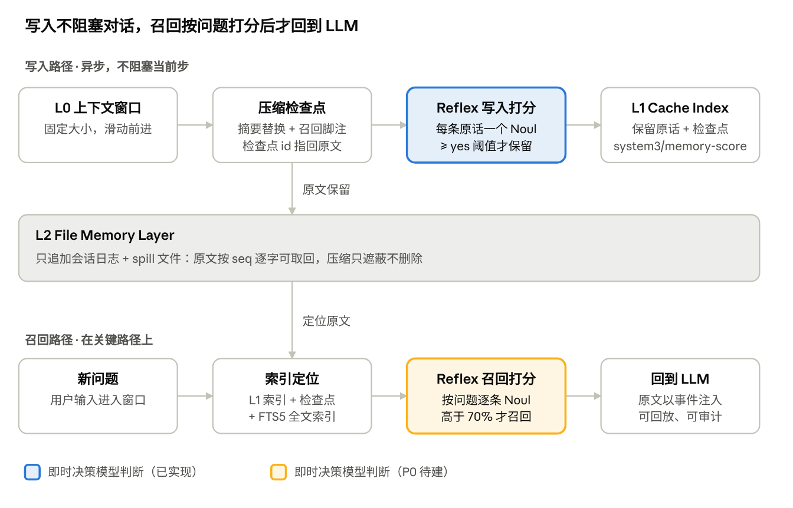

# APUS Reflex Agent 无限记忆架构：能力目标与验收

[English](architecture.md) | 中文

## 摘要

目标是让 APUS Reflex Agent 的上下文窗口恒定不清空、原文一条不丢、需要时精准召回：无限记忆架构（Infinity Memory Framework）由 APUS Reflex 即时决策模型驱动，写入时即时识别并分级落盘，召回时打分排序，把相关度超过 70%（可配置）的原文送回 LLM。

- **产品层级**：APUS Reflex Agent（产品）→ 无限记忆架构（核心模块）→ APUS Reflex 即时决策模型（驱动）。模型协议沿用仓库里的 System One 接口：Choice、Score、Noul。
- **三层存储**：L0 是 LLM 上下文的固定滑动窗口；L1 Cache Index 存放即时决策模型判定值得保留的原文（逐字保存，允许带少量噪音）及指向 L2 的指针；L2 File Memory Layer 无损保存全部原文。
- **本文用途**：对齐目标能力，标出每项能力在仓库里已有的基础、还要迭代的部分，以及验收时要拿出的证据。

## 目标能力

九项能力共同构成无限记忆架构：C1–C5 是主线，C6–C9 是保证主线可信的约束。

| 编号 | 能力 | 对用户的承诺 | 负责部件 |
| --- | --- | --- | --- |
| C1 | 固定上下文窗口 | 上下文大小恒定，滑动前进，从不整窗清空重来 | L0 窗口策略 |
| C2 | 毫秒级识别与保留 | 内容离开窗口前，即时决策模型判断哪些原文含关键信息，逐字保留进 L1；不改写、不提炼、不删减 | Reflex 写入判断 |
| C3 | 无损分级落盘 | 每条消息的原文都落到 L2，按 seq 可逐字取回；压缩只遮蔽不删除 | 会话日志 + 文件层 |
| C4 | 记忆索引树 | L1 Cache Index 组织成可快速定位的树：主题 → 条目 → 指向 L2 原文的指针 | 索引构建 |
| C5 | 逆向打分召回 | 每轮用户输入时，即时决策模型沿索引树定位，给每条记忆打相关度分并排序，超过阈值（默认 70%）的原文送回 LLM | Reflex 召回判断 + 上下文注入 |
| C6 | 关键事实保护 | 用户约束、数值、路径逐字保留；摘要漏掉任一项就不提交 | 规则 + 提交前校验 |
| C7 | 留痕可回放 | 每次即时决策模型的判断和召回都写成会话事件，没有 API key 也能逐字回放 | 会话事件 |
| C8 | 范围与可撤销 | 记忆有可见范围，用户可以排除或撤销某条记忆 | 宿主（Host） |
| C9 | 规则先行 | 规则能定的事不请求模型；即时决策模型只判断有歧义的候选，允许弃权 | 规则准入检查 |

## 端到端机制

写入和召回共用 L1 索引和 L2 原文，但只有召回路径在用户等待的关键路径上。

写入路径在压缩后异步运行；召回路径在每轮用户输入时由 `memoryRecall`（决策 `memory.recall`）完成，两者都在 `feat/recallable-memory` 实现。真实端点实测：一轮召回（最多 16 问）p50 约 0.7 秒，单个判断约 0.2 秒。

用户输入被领取后、请求组装时，即时决策模型逐条判断被压缩移出上下文的用户输入（L2）与当前输入是否相关（候选超过 `maxCandidates` 时先按字符对预筛，并优先 L1 保留的输入；首次压缩前没有候选，也不发请求）；概率不低于 `yes` 的原文替换本次请求的 `system3:memory` 运行时上下文，并写入 `system3/memory-recall` 事件。候选是本会话被压缩的用户输入；L2 中的工具结果和模型输出只能通过 `history_read` / `history_search` 取回，跨会话的索引树尚未实现。

## 架构基础对照

本地最新代码已经覆盖主线的大部分：可查回压缩、即时决策模型记忆打分、留痕和 Web 展示都在 `feat/recallable-memory` 上。远端 `main` 尚未核对（见「风险与开放问题」）。

| 能力 | 仓库里的现有基础 | 状态 | 差距或待确认 |
| --- | --- | --- | --- |
| C1 固定窗口 | `compaction-basic` 按 `thresholdRatio` / `retainRatio` / `headroomTokens` 把上下文压在窗口内；`small-window.patch.yml` 用 24K 窗口做压测 | 部分 | 目前靠「摘要替换」控制大小；「恒定大小的滑动窗口」策略尚未定义 |
| C2 识别与保留 | System3 `memoryScoring`（`memory.ts`）：压缩替换一段对话后，下一步异步发起一次即时决策模型请求，不阻塞当前步；每条用户原话一个 Noul 问题，概率 ≥ `yes` 即保留；另有 task-frame / handoff-pack 逐字保留要求 | 已实现（实验模块，模式 off / shadow / active） | 只覆盖用户的纯文本消息，不含工具结果和模型输出；在压缩时触发，不是每条消息离开窗口时触发 |
| C3 无损落盘 | 只追加的会话日志；`compaction/summary` 的 `shadowedRange` / `shadowedSeqs` 有运行时校验；`spill` / `spill-local` 把大段文本存出上下文并返回定位符 | 已实现 | L2「File Memory Layer」目前就是会话日志加 spill 文件；是否需要「一条记忆一个文件」的布局，待定 |
| C4 记忆索引树 | 每个检查点末尾的召回脚注（`recallFooter`，`c<seq>` → 被遮蔽范围）；`session-query-sqlite` 的 FTS5 全文索引 | 部分 | 现在是扁平的检查点目录 + 全文索引；分层的 Cache Index 树尚未定义 |
| C5 打分召回 | `memoryRecall`（`memory.ts`）：每轮按输入对被压缩的用户输入（L2）逐条 Noul 打分，≥ `yes` 的原文注入 `system3:memory` 并写入 `system3/memory-recall`；另有 `history_read` / `history_search` 供模型主动查回 | 已实现（会话级） | 候选只来自本会话被压缩的用户输入，每轮最多 16 条；跨会话索引树与分层 Cache Index 尚未实现；阈值尚未校准 |
| C6 关键事实保护 | task-frame、handoff-pack 逐字保留要求；`memory.score` 的问题明确指向约束、纠正、完成标准、数值、路径、命令；压缩结果不比原文小就拒绝提交 | 部分 | 压缩提交前的「必需事实齐全」确定性校验尚未实现 |
| C7 留痕可回放 | `system3/memory-score` 事件（检查点 id、扫描数、保留项及概率）；`system3/judgement` 记录完整请求与响应；持久化类型变更已登记 | 已实现 | 需要快照用例覆盖「压缩 → 打分 → 召回」全链路的无 key 回放 |
| C8 范围与可撤销 | System3 隐私策略（`privacyMode`、`approvedRemoteDataClasses`、`sessionDataClasses`）；子智能体不参与打分 | 部分 | 用户排除或撤销单条记忆的接口和界面尚未见到 |
| C9 规则先行 | 决策内核的 `yes` / `no` 阈值与 `unsure`；隐私准入；`maxMessageChars`、`maxCandidates`（≤ 16）等确定性过滤；失败和超时一律不保留 | 已实现 | — |

Web 端已经能标出可查回的压缩检查点，把 `history_read` / `history_search` 显示为详情卡片，并在 System3 侧栏显示记忆卡片。联调配置见 [tokenhub-jev-recall.patch.yml](tokenhub-jev-recall.patch.yml)（接入 `APUS-OpenJev-v1-9B`，`timeoutMs` 15000）。

## main 与 feat/recallable-memory 横向对比

`main` 上的记忆能力是「日志无损 + 压缩摘要 + 跨会话检索 + 即时决策模型保留任务要求」；被压缩的内容模型自己取不回来，也没有记忆打分。这两块都在 `feat/recallable-memory`，尚未合入 `main`。以下为本地视角，远端未核对。

| 层 / 能力 | main（已合入） | feat/recallable-memory（新增） | 目标方案 |
| --- | --- | --- | --- |
| L0 上下文窗口 | `compaction-basic` 按阈值把旧对话替换成摘要；`compaction-tool-result-pruner`、`compaction-image-offload` 削减工具结果和图片 | 检查点末尾带召回脚注 `c<seq>`（`recallFooter`，可选） | 恒定大小的滑动窗口，大小可度量 |
| L2 原文存储 | 只追加会话日志，`shadowedRange` / `shadowedSeqs` 运行时校验；`spill-local` 把超长输出存到本地文件（可选） | 同 main | File Memory Layer：记忆条目实体，支持跨会话 |
| 压缩后取回原文 | 无模型侧工具，原文只在日志里 | `history_read`（分页读原文）、`history_search`（字面检索全部检查点） | 再加索引树定位 |
| L1 Cache Index | 无 | `system3/memory-score` 记录 + 检查点目录（扁平） | 分层索引树 |
| 即时决策模型与记忆 | 即时决策模型用于入口路由、技能选择、任务框架、完成复核；不给记忆打分 | `memoryScoring` 压缩后逐条打分保留；`memoryRecall` 每轮按输入打分，≥ `yes` 召回 | 跨会话索引树上的召回，阈值校准后为 70% |
| 关键事实 | `taskFrame` 逐字保留要求并全程展示；`entryRouting.handoffPack` 委派时原样带上要求；`outputFolding` 无损折叠重复输出 | 同 main | 压缩提交前的必需事实校验 |
| 跨会话 | `tool-session-query`（5 个只读工具，按 `cwd` 授权，可选）；`session-reference` 把 @ 提及的会话做成只读快照；第三方 MCP 记忆服务参考配置（默认关闭） | 同 main | 按工作区或用户的跨会话记忆 |
| 界面 | 无专门展示 | 可查回检查点标签、召回详情卡片、System3 记忆卡片 | 加上排除 / 撤销入口 |

## 必须遵守的架构约束

下面六条来自仓库 CLAUDE.md 和 System3 设计文档，是无限记忆各项能力的实现前提，违反任何一条都不能合入。

1. **模型可见 ⇔ 有日志**：进入模型请求的内容都必须能从会话日志重建。召回注入的原文、即时决策模型的判断，都要写成会话事件。
2. **无 key 回放**：回放时读取已记录的判断，不重新调用模型。`history_read` / `history_search` 保持为会话日志的纯函数。
3. **插件，不改主循环**：新行为挂在已有扩展点上（`compaction/summary` 事件、`agent/pre-step`、运行时上下文）；如果必须改 agent-loop，要同步更新 [architecture.md](../architecture.zh.md)。
4. **参数可配置**：召回阈值（70%）、`yes` / `no`、`maxCandidates`、`deadlineMs`、窗口大小都是经校验的 `Config` 字段，不写死在代码里。
5. **持久化变更要登记**：新增的 `SessionEventMap` 事件要登记到 persistence-changes，并同步更新 TypeScript 和 Python SDK 的预期输出；结构性格式变化才提升 `SESSION_FORMAT_VERSION`。
6. **隐私先于建议**：即时决策模型只提供建议，不能绕过隐私策略；不自行写入永久事实，也不决定覆盖哪条旧事实。

## 需要优化迭代的部分

优先级最高的是阈值校准和召回质量评测：每轮召回和延迟实测已经完成，剩下的两项决定「> 70% 召回」这一对外说法能否被验收。

| 优先级 | 迭代项 | 现状（`feat/recallable-memory`） | 要做的事 |
| --- | --- | --- | --- |
| P0 | 每轮按问题打分 | 已实现：`memoryRecall` 每轮一次请求，最多 16 条候选，真实端点 e2e 通过 | 在 shadow 模式下积累命中与误召回数据，再决定默认启用 |
| P0 | 延迟实测与预算 | 真实端点实测（各 8 次）：单个 Noul p50 191 ms、p95 755 ms；1 个 Choice + 15 个 Noul p50 704 ms、p95 1100 ms；真实会话中召回判断 672 ms | 召回以 `deadlineMs`（实测配置 5000 ms）兜底；需要更低延迟时再评估本地部署 |
| P0 | 阈值校准 | 测试配置 `yes` 0.5、`no` 0.3；对外口径是 70% | 用标注样本集对真实端点校准 Noul 概率（做法同 completion review），确定「相关度 70%」对应哪个概率取值 |
| P1 | Cache Index 树 | 扁平的检查点脚注 + FTS5 全文索引 | 定义索引树的结构（主题 → 条目 → seq 指针），由保留项和检查点确定性地生成；已写好的索引不再改写，保证前缀缓存命中 |
| P1 | 覆盖范围 | 只对用户纯文本且 ≤ `maxMessageChars`（测试配置 400）的消息打分 | 规则先行，按需扩展到工具结果里的关键值和模型的决策结论 |
| P1 | 必需事实提交校验 | 只检查「摘要是否比原文小」 | 压缩提交前确定性地核对用户约束、数值、路径，缺一项就不提交 |
| P1 | 固定窗口策略 | 靠压缩阈值控制大小 | 明确窗口预算和压缩节奏，让「窗口恒定」可以度量 |
| P2 | File Memory Layer 与跨会话 | 会话日志 + spill 文件，限于当前会话 | 确定记忆条目实体（来源 seq、版本、范围），再扩展到跨会话 |
| P2 | 排除与撤销 | 只有隐私数据类别控制 | 宿主侧的排除 / 撤销接口、持久化，以及 Web 记忆卡片上的操作入口 |
| P2 | 默认启用 | `memoryScoring` 默认关闭，可选 shadow / active | 先在 shadow 模式下积累采纳率和收益证据，达标后再默认开启 active |

## 验收标准

核心验收必须接入真实端点跑通：生成用 DeepSeek 官方模型，判断用 APUS Reflex 即时决策模型（System One 接口 `/v1/systemone`，模型 `APUS-OpenJev-v1-9B-5949`）。无 key 的单元测试和快照只证明逻辑和回放正确，不能代替真实端点上的延迟和打分质量证据。

**三层测试环境**

1. **无 key**：单元测试（`tool-history-recall.spec.ts`、System3 memory 测试）和录制会话快照回放，CI 每次都跑。
2. **本地 System One 网关**：现有的 headless e2e 和 `apps/web/tests/history-memory.e2e.ts`，验证链路和界面。
3. **真实端点**：DeepSeek 官方生成端点 + APUS Reflex 决策端点。密钥只通过环境变量 `DEEPSEEK_API_KEY` 和 `APUS_JEV_API_KEY` 传入，不写进仓库和文档；缺 key 时 e2e 自动跳过。现有联调配置把生成模型指向 TokenHub，需要再加一份指向 DeepSeek 官方的配置覆盖文件。

| 验收项 | 通过条件 | 证据 | 环境 |
| --- | --- | --- | --- |
| 无损可取回（C3） | 长会话在 24K 小窗口配置下触发多次压缩后，每个检查点被遮蔽的原文都能用 `history_read` 逐字取回 | e2e 断言 + 压缩不变量校验 | 1、3 |
| 窗口恒定（C1） | 每次模型请求的上下文都不超过配置的窗口预算 | 按请求记录的 token 用量曲线 | 3 |
| 写入打分质量（C2） | 在标注样本集上，「应保留」原话的保留率和误保留率达到商定目标 | 标注集评测报告 | 3 |
| 召回命中（C5） | 询问已被压缩的事实时，答案正确率高于不带召回的 `compaction-basic` 基线；阈值以上的注入项都与问题相关 | 长程事实问答对照评测 | 3 |
| 延迟（C2、C5） | 写入路径不增加单步耗时；召回路径的 p95 在商定预算内；「毫秒级」只在实测达标后对外使用 | 真实端点的 p50 / p95 报告（含超时和失败率） | 3 |
| 关键事实（C6） | 压缩后让模型复述 K 条已知约束和数值，全部正确 | 交接保真度探针 | 3 |
| 留痕回放（C7） | 「压缩 → 打分 → 召回」场景无 key 回放逐字一致；TypeScript 和 Python SDK 预期输出已更新 | 录制会话快照 | 1 |
| 失败安全（C8、C9） | 即时决策模型超时、失败或被隐私策略拒绝时不保留任何条目，对话照常完成 | 单元测试 + 真实端点超时演练 | 1、3 |
| 界面（Web） | 可查回检查点、召回详情卡片、记忆卡片显示正确 | 浏览器 e2e + 仓库要求的 PR GIF | 2、3 |

## 风险与开放问题

最大的风险是对外口径跑在实测前面：「毫秒级」和「> 70% 召回」都要等真实端点验收通过后再作为确定性表述，在此之前标注为设计目标。

**风险**

- **远端代码未核对**：本机拉不到 GitHub（HTTPS 无凭据，只读部署密钥未授权）。授权后需要对照远端 `main` 和各分支，复核「架构基础对照」一节。
- **延迟**：即时决策模型经 RunPod 代理调用，冷启动和网络抖动会拉高 p95；召回路径在关键路径上。
- **阈值含义**：Noul 概率未校准前，「70%」与模型的真实相关性可能不一致。
- **密钥暴露**：DeepSeek 和 APUS Reflex 的密钥曾在对话里以明文出现，验收完成后建议轮换。

**待决定**

- [ ] 「相关度 70%」对应未校准的 Noul 概率 0.7，还是校准后的分值？
- [x] 每轮按问题打分的召回（C5）：已在 `feat/recallable-memory` 以 `memoryRecall` 实现。
- [ ] L2 是否采用「一条记忆一个文件」，还是继续以会话日志为唯一事实来源？
- [ ] 跨会话记忆的范围按工作区还是按用户？
