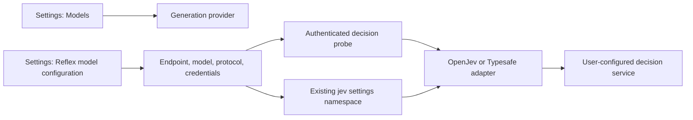

# Model and decision-service configuration

English | [中文](design.zh.md)

APUS Reflex Harness configures generation models and optional Reflex/Jev decisions separately. This change exposes the existing decision protocol in the native settings page. It does not select an official development endpoint; that address remains user-supplied and unconfirmed.

## Goal

A user can configure a general model, complete a small conversation task, and separately configure a decision service using OpenJev or Typesafe. A connection probe must use the protocol selected in the current draft; saving must preserve that selection for new decision requests. A successful probe does not enable routing, supervision or memory.

## Structure

## Files and API behavior

- `packages/experimental/client-ui-system3/src/client/reflex-settings-controller.ts`: stage, validate and save `protocol`; pass the selected protocol to the existing draft probe.
- `packages/experimental/client-ui-system3/src/client/ReflexSettings.tsx` and `reflex-settings-locales.ts`: expose a typed protocol selector with OpenJev and Typesafe labels and concise service-specific guidance.
- Existing controller, page and settings-pipeline tests: cover protocol selection, persistence and request propagation.
- `packages/experimental/apus-dsh-jev-plugin/`: retain the existing backend protocols and verify probe/runtime agreement; change backend behavior only if a focused test demonstrates a mismatch.
- Owning READMEs and `docs/feat-integrated-product/configuration.md` with Chinese counterparts: distinguish generation APIs from decision protocols and document first-task validation.

Persist protocol as the existing `openjev` or `typesafe` value in the `jev` settings namespace. Do not rename keys or add another credential store. Existing configurations retain their established default when protocol is absent. Editing protocol invalidates prior probe results; an in-flight result from an older draft must not become the current result. Testing does not save. Saved changes affect new requests; running requests retain their configuration. Preserve new-reference requirements for API key replacement and environment-credential read-only behavior.

## Validation

Run focused controller and rendered-page tests for both protocols, including invalid input, changed drafts and stale probe results. Use the real settings pipeline to save and reload each protocol. Verify the probe and runtime choose the same backend protocol with local fixtures. Do not infer support for an unconfirmed endpoint from a mocked response.

The root agent owns dependency installation, builds and platform packaging. First-run acceptance configures a generation provider, selects it in a new conversation, requests a short response, then checks a small file task and restart persistence. Real service access and model-task acceptance require the user's service configuration and remain separate from local protocol tests.
