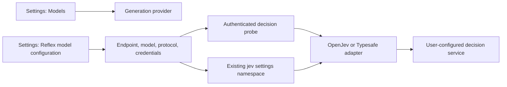

# 模型与决策服务配置

[English](design.md) | 中文

APUS Reflex Harness 分别配置生成模型与可选的 Reflex/Jev 决策。本次在原生设置页暴露已有决策协议，不指定官方开发端点；该地址仍由用户提供，目前尚未确认。

## 目标

用户能配置通用模型并完成一个小型对话任务，再独立配置使用 OpenJev 或 Typesafe 的决策服务。连接探测必须使用当前草稿选择的协议，保存后新的决策请求保留该选择。探测成功不启用路由、监督或记忆。

## 结构

## 文件与 API 行为

- `packages/experimental/client-ui-system3/src/client/reflex-settings-controller.ts`：暂存、验证并保存 `protocol`，将所选协议传给现有草稿探测。
- `packages/experimental/client-ui-system3/src/client/ReflexSettings.tsx` 与 `reflex-settings-locales.ts`：提供类型化协议选择器，使用 OpenJev 和 Typesafe 标签，并简要说明服务要求。
- 现有 controller、页面与设置流水线测试：覆盖协议选择、持久化及请求参数传递。
- `packages/experimental/apus-dsh-jev-plugin/`：保留后端已有协议，验证探测与运行请求一致；仅在定向测试证明不一致时修改后端行为。
- 所属 README 与 `docs/feat-integrated-product/configuration.md` 及中文配对：区分生成 API 与决策协议，说明首次任务验证。

协议以已有 `openjev` 或 `typesafe` 值保存到 `jev` 设置命名空间，不重命名键或新增凭证存储。旧配置未指定协议时保留已有默认行为。修改协议使旧探测结果失效，旧草稿的在途结果不能成为当前结果。测试不保存；保存影响新请求，正在执行的请求保留原配置。继续要求更换 API Key 使用新引用，并保持环境凭证只读。

## 验证

对两种协议运行 controller 与渲染页面定向测试，包括非法输入、修改草稿与过期探测结果。通过真实设置流水线保存、重新加载两种协议。用本地 fixture 验证探测和运行请求选择同一后端协议；不能根据模拟响应推断尚未确认的端点可用。

依赖安装、构建和平台打包由主 agent 负责。首次使用验收配置生成服务商，在新对话主动选择模型，获取短回复，再验证小文件任务及重启持久化。真实服务访问与模型任务验收需要用户的服务配置，与本地协议测试分别记录。
