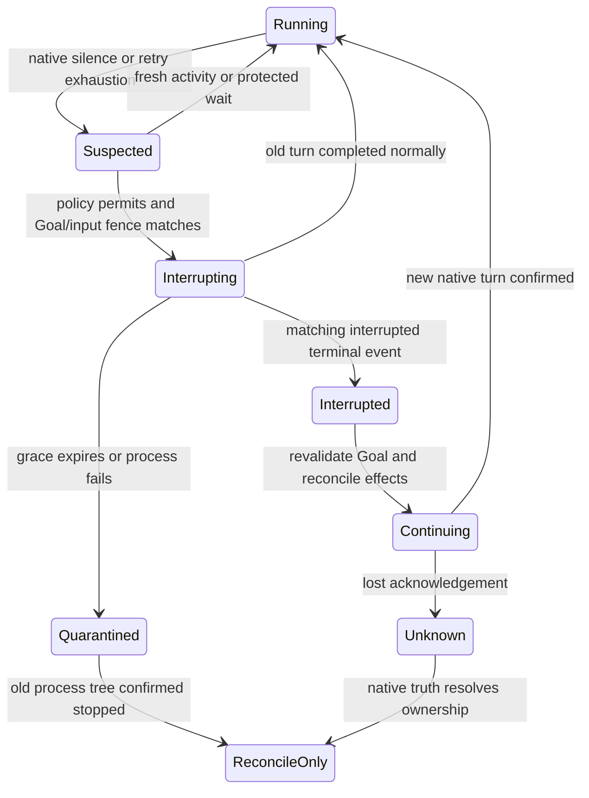

# Codex timeout recovery design reference

English | [中文](recovery-addendum.zh.md)

The same-thread recovery subset is implemented: a separate Host capability interrupts the observed native turn, waits for its matching interrupted terminal, and starts a continuation only while Goal and human-input authority remain current. Deterministic tests and a real local Codex 0.153.4 controlled-response test pass. Real Reflex plus remote-model task recovery remains a separate acceptance requirement. Process replacement and failover are not implemented.

## Observed behavior and code evidence

The [supervision acceptance report](supervision-validation.md) retains the failed real-provider attempts. In `/private/tmp/reflex-supervision-gpt6-final300.fault.json`, three failed commands complete at approximately 81.8, 87.8 and 93.3 seconds. A supervisor steer is acknowledged, but no native supervision input is observed before the 300-second cancellation; no repair completes. `providerTelemetry` is empty. These facts establish unconsumed advice and unsuccessful recovery, not the internal cause of the pending native request.

[Reflex supervision](../../packages/experimental/system3/src/reflex-supervision.ts) requires repeated failure or matching operation/result evidence before delivering advice. Successful verification refreshes progress; ordinary elapsed time alone remains inconclusive. Its feedback cannot progress without new evidence. It calls `steerFromSupervisor`, not a recovery operation. [The subagent service](../../packages/subagent/subagent/src/index.ts) records attributed `subagent/supervision-steer` after transport acceptance; this is not proof that Codex consumed it.

[Codex wire](../../packages/subagent/subagent-codex/src/wire.ts) observes streaming activity, retry notifications, waiting flags and in-flight side effects. Its separate recovery path keeps the logical run and ephemeral thread alive across a confirmed interrupted terminal. [Run ownership](../../packages/subagent/subagent-codex/src/run.ts) keeps public cancellation terminal and stops the process to quiescence after unknown recovery outcomes. Cancellation is never presented as resume.

## Verified local protocol

The installed official `codex-cli 0.161.0` generated its own definitions with `codex app-server generate-ts --out /private/tmp/reflex-recovery-protocol-0161`. No network specification was substituted. Relevant generated files are `v2/TurnInterruptParams.ts`, `TurnInterruptResponse.ts`, `TurnStartParams.ts`, `ThreadResumeParams.ts`, `ThreadReadParams.ts`, `ThreadStatus.ts`, and `ErrorNotification.ts`.

- `turn/interrupt` takes `threadId` and `turnId`; its response is an empty object. Wait for the matching `turn/completed` terminal event before starting replacement work.
- A surviving thread can receive another `turn/start`. `thread/resume` concerns loading/rejoining a thread, not restarting an active model request. Its documented durable paths do not establish persistence of this adapter’s ephemeral thread after process death.
- `turn/start` supports `turnTrigger` and `clientUserMessageId`; the generated definitions do not promise duplicate-request suppression. A lost start acknowledgement must not cause a blind resend.
- `error` includes `willRetry`, thread and turn IDs. Thread status distinguishes idle, active, systemError and notLoaded; active flags identify approval/user-input waits. No inspected field proves that an external model HTTP request is hung.

The package-pinned Codex 0.153.4 was independently checked with its own `app-server generate-ts`; the required interrupt, status, retry and turn-trigger fields are present. The real local test in `subagent-codex/tests/real-product.spec.ts` holds a Responses request, confirms interruption, continues the same thread and independently reads the file written by the continuation. This verifies native mechanics, not remote-model semantic recovery.

## Recovery policy and ownership

Add a separate optional provider capability for recovery; keep public cancellation terminal. The Codex provider owns native IDs, interruption, native terminal acknowledgement, sequential turns and process teardown. The subagent service owns parent authority and durable recovery receipts. Reflex chooses bounded recovery only from provider observations; it does not directly send app-server requests or forge a human message.

Keep three clocks: last native activity, last successful verification, and duration of the current operation. Semantic non-progress uses existing advice. Native silence uses a separately configured deadline plus observation of native retry/error state, awaiting input, and in-flight side effects. A healthy reasoning/text delta or command output resets the native-activity clock, not the verification clock. Repeated retries consume a bounded retry budget rather than extending silence forever. Approval/user-input waits do not trigger recovery. An actively running command/file change uses its own configured policy and is never classified as a hung model request merely because verification is old.

Native silence alone cannot distinguish slow reasoning from a broken remote request. Default handling of ambiguous silence is observation. An explicitly enabled maximum native-request budget may interrupt it as a bounded execution policy, with that reason recorded; do not describe the interruption as proven fault detection. Goal and overall task duration never alone justify interruption.

## Proposed state transition

Persist a unique recovery intent before dispatch, with parent/run/native turn identities, Goal ID/revision, latest accepted user-input sequence, trigger observations and budget reservation. Serialize steering and recovery for that run. On matching `interrupted` completion, retain the process and native thread, clear turn-local response buffers, and start one continuation turn. A late normal completion wins over interruption and needs no continuation. Keep one logical delegated result pending until success, terminal failure or user cancellation; interim interrupted turns must not falsely settle the parent tool.

Immediately before interruption and continuation, reread active/armed Goal status, objective revision, current task-frame constraints and admitted human updates. A changed fence invalidates the old recovery proposal. Rebuild the continuation from durable current values, verified completed work, uncertain effects and unconsumed input; label it `reflex-supervision`, retain original permissions, and state that it grants no new authority. The original user Goal must remain open until independent completion verification.

If interruption does not confirm terminal state within `interruptGraceMs`, stop the owned process tree and await quiescence. Do not launch a second worker while the first may still write. Ephemeral process death requires a new thread/run, explicitly linked to its predecessor; it is not same-thread resume. A new run first reconciles workspace state and external effects without mutation. Unknown non-idempotent side effects block automatic repetition until their actual outcome is established. File checksums and passing tests can establish local state; they cannot prove whether a remote send/payment/deployment happened. Never blindly replay the original task or failed command.

Recovery budgets and minimum intervals are deployment settings, reserved before dispatch and retained across restarts. Unknown interruption/start acknowledgements remain unknown until native state is reconciled. Host restart must not resend recorded intent automatically. Provider failover is outside the minimal change and cannot silently switch permissions, privacy route or model cost policy.

## Proposed files and acceptance

Extend subagent capability/run/control types and service authority checks; Codex `wire.ts`/`run.ts` for correlated observations and multi-turn recovery; Reflex supervision state/config for bounded recovery intents and outcomes; UI, persistence declarations and both SDK projections for the new receipts. Keep agent-loop unchanged. Update package READMEs and model-facing tool documentation if any model-accessible control is added; the initial capability is Host-only.

Acceptance requires deterministic tests for stale Goal/user input, unload/cancellation, healthy slow reasoning, approval waits, running side effects, late normal completion, duplicate/missing acknowledgements, process quiescence and restart reconciliation. A real local app-server test with a controlled stalled model response must demonstrate interrupt → matching terminal → same-thread continuation → independent output verification, while preserving a new user constraint inserted during the stall. Record native input consumption separately from acceptance. Add shipped-profile TypeScript/Python snapshots and a real Reflex plus real Codex financial-file scenario. Healthy long-running control cases must finish without interruption. Deterministic authority, activity, cancellation, unknown-acknowledgement and budget-replay cases pass, as does the controlled real local app-server case. Real Reflex/remote-model recovery, shipped-profile projections and healthy long-running acceptance must be reported independently.
