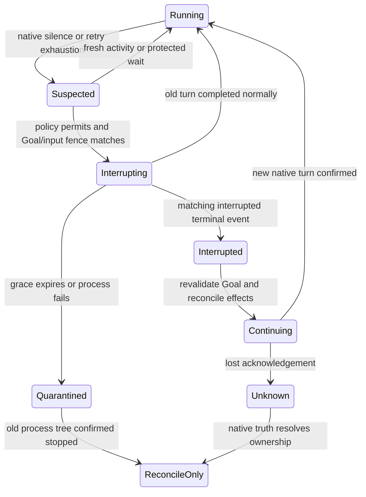

# Codex 超时恢复设计参考

[English](recovery-addendum.md) | 中文

同线程恢复子集已经实现：独立 Host 能力中断观察到的原生轮次，等待对应中断终态，仅在 Goal 和人工输入权限仍有效时继续。确定性测试和真实本地 Codex 0.153.4 可控响应测试已通过。真实 Reflex 加远程模型任务恢复仍需单独验收；尚未实现进程替换与提供方切换。

## 实际行为与代码证据

[监督验收报告](supervision-validation.zh.md) 保留了真实提供方失败尝试。`/private/tmp/reflex-supervision-gpt6-final300.fault.json` 中，三个失败命令约在 81.8、87.8 和 93.3 秒完成。监督插入已确认接收，但到 300 秒取消前，没有观察到原生监督输入，也没有完成修复。`providerTelemetry` 为空。这些事实证明建议未被观察到消费、恢复未成功，不能证明原生请求内部挂起的具体原因。

[Reflex 监督](../../packages/experimental/system3/src/reflex-supervision.ts) 要求重复失败或相同操作及结果证据才发送建议。成功验证更新进展时间；仅时间经过仍记录为无法判断。没有新证据时，反馈无法继续评估。它调用 `steerFromSupervisor`，不是恢复操作。[子 Agent 服务](../../packages/subagent/subagent/src/index.ts) 在传输接收后记录有明确来源的 `subagent/supervision-steer`；这不证明 Codex 已消费建议。

[Codex 协议适配器](../../packages/subagent/subagent-codex/src/wire.ts) 观察流式活动、重试通知、等待标记和在途副作用。独立恢复路径在确认中断终态后保留逻辑运行与临时线程。[运行生命周期](../../packages/subagent/subagent-codex/src/run.ts) 仍将公开取消作为终止操作；恢复结果不明时停止进程并等待完全退出，不把取消冒充为恢复。

## 已核对的本地协议

已安装的官方 `codex-cli 0.161.0` 通过 `codex app-server generate-ts --out /private/tmp/reflex-recovery-protocol-0161` 导出了自身类型，没有用网络规范替代本地版本。相关生成文件包括 `v2/TurnInterruptParams.ts`、`TurnInterruptResponse.ts`、`TurnStartParams.ts`、`ThreadResumeParams.ts`、`ThreadReadParams.ts`、`ThreadStatus.ts` 和 `ErrorNotification.ts`。

- `turn/interrupt` 接收 `threadId` 和 `turnId`，响应为空对象。开始替代工作前必须等待对应的 `turn/completed` 终态事件。
- 存活线程可接收下一次 `turn/start`。`thread/resume` 用于加载或重新连接线程，不是重启正在进行的模型请求。其持久化恢复说明不能证明本适配器的临时线程在进程死亡后仍存在。
- `turn/start` 支持 `turnTrigger` 和 `clientUserMessageId`，但生成定义没有承诺重复请求去重。启动回执丢失后不可盲目重发。
- `error` 包含 `willRetry`、线程和轮次 ID。线程状态区分 idle、active、systemError 和 notLoaded；active 标记可识别等待批准或用户输入。已检查字段均不能证明外部模型 HTTP 请求挂死。

同时独立运行了包内 Codex 0.153.4 的 `app-server generate-ts`，核对其中断、状态、重试和 turn-trigger 字段。`subagent-codex/tests/real-product.spec.ts` 真实本地测试暂停 Responses 响应、确认中断、继续同一线程，并独立读取继续轮次写出的文件。这证明原生机制，不代表远程模型语义恢复验收。

## 恢复策略与职责

新增独立、可选的提供方恢复能力，保留公开取消操作的终止语义。Codex 提供方负责原生 ID、中断、原生终态确认、顺序轮次和进程释放。子 Agent 服务负责父会话权限与持久化恢复记录。Reflex 根据提供方观测选择有界恢复，不直接发送 app-server 请求，不伪造人工消息。

分别维护三个时钟：最后原生活动、最后成功验证、当前操作持续时间。语义上的无进展沿用纠偏建议；原生静默使用单独配置的期限，并结合重试或错误状态、等待输入状态及在途副作用。健康的推理或文本增量、命令输出更新原生活动时钟，不更新验证时钟。重复重试消耗有限重试额度，不无限延长等待。等待批准或用户输入不触发恢复。正在运行的命令或文件改动使用自身配置策略，不能因为验证较久未更新就认定模型请求挂死。

仅凭原生静默无法区分慢推理和损坏的远程请求。不明确的静默默认只观察。明确启用的原生请求最大执行预算可以触发中断，但必须记录为执行预算策略，不声称已经证明故障。Goal 和任务整体持续时间都不能单独作为中断理由。

## 拟议状态转换

发送前持久化唯一恢复意图，记录父会话、运行与原生轮次身份、Goal ID 和修订、最新已接收用户输入序号、触发观测和预留额度。同一运行的插入消息和恢复必须串行。收到对应 `interrupted` 完成后，保留进程和原生线程，清空轮次级响应缓存，启动一次继续轮次。若原轮次先正常完成，则不继续。逻辑委派结果在成功、终止失败或用户取消前保持等待；中间轮次中断不得错误结算父工具。

中断前和继续前都重新读取 Goal 的 active/armed 状态、目标修订、当前任务卡约束及已接收人工更新。任何变化都使旧恢复提案失效。根据当前持久化事实、已验证工作、结果不明的副作用和未消费输入重建继续内容，明确标记 `reflex-supervision`，保持原权限并声明不授予新权限。独立完成验证前，用户原始 Goal 保持未完成。

若在 `interruptGraceMs` 内未确认终态，停止拥有的进程树并等待其完全停止。旧执行者仍可能写入时，不启动第二个执行者。临时线程所在进程死亡后只能创建新线程或运行，并明确关联前驱；这不是同线程恢复。新运行先只读核对工作区和外部副作用。结果不明且非幂等的操作，在确认真实结果前禁止自动重复。文件校验和与测试通过能确认本地状态，不能证明远程发送、付款或部署是否已经发生。不得盲目重放原任务或失败命令。

恢复额度和最短间隔由部署配置控制，发送前预留，并跨重启保留。中断或启动回执不明时，在核对原生状态前一直保持不明。Host 重启不得自动重发已记录意图。提供方切换不在最小方案内，不得暗中改变权限、隐私路由或模型费用策略。

## 拟议文件与验收

扩展子 Agent 的能力、运行、控制类型及服务权限检查；Codex 的 `wire.ts`、`run.ts` 增加关联观测与多轮恢复；Reflex 监督状态和配置增加有界恢复意图及结果；UI、持久化声明和两种 SDK 投影支持新记录。保持 agent-loop 不变。更新包 README；若增加模型可访问控制，再更新模型工具说明。首版能力只供 Host 使用。

确定性验收覆盖 Goal 或用户输入变化、卸载与取消、健康慢推理、等待批准、在途副作用、迟到的正常完成、重复或缺失回执、进程完全停止及重启核对。真实本地 app-server 配合可控的停滞模型响应，必须证明“中断 → 对应终态 → 同线程继续 → 独立结果验证”，并保留停滞期间插入的新用户约束。输入消费与接收确认分别记录。补齐发布配置的 TypeScript/Python 快照，以及真实 Reflex 和真实 Codex 财务文件场景。健康长时对照必须不被中断而完成。确定性的权限、活动、取消、未知回执和预算重放用例，以及可控真实本地 app-server 用例已通过。真实 Reflex/远程模型恢复、发布配置投影和健康长时任务验收必须分别报告。
