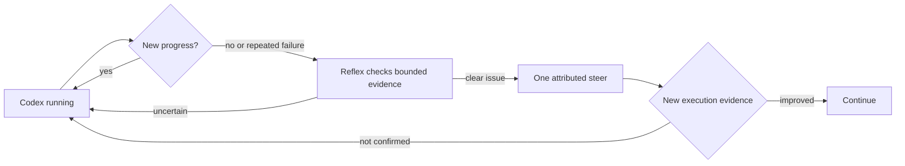

# Minimal Codex process supervision

English | [中文](supervision-minimal-scope.zh.md)

APUS Reflex keeps Codex process supervision small: observe bounded activity evidence, identify a clear stall or repeated failure, send one attributed adjustment when the run accepts input, and wait for new evidence before judging the result.

## User-visible flow

The running card shows elapsed time, the latest progress note, and a simple stalled or overtime alert; a user can keep waiting, add guidance, or stop the run.

Reflex supervision adds only the decision and outcome states that a user needs: observing, guidance accepted, improvement observed, delivery unknown, or stale because the Goal changed.

## What the monitor checks

The monitor uses activity timestamps, completed-step categories, repeated failure evidence, Goal-relevant verification, and the provider's ability to accept a steer.

The monitor does not profile the operating system, inspect every token, rewrite Codex's private context, replay uncertain side effects, or edit the cache prefix.

The supervisor receives bounded evidence metadata and admitted Goal requirements; raw commands, raw output, reasoning, and private cache contents stay outside the decision request.

## Adjustment contract

An adjustment is attributed to `reflex-supervision`, preserves the current Goal and permissions, and is recorded separately from delivery acknowledgement and observed improvement.

An accepted adjustment is not success. Reflex waits for a later execution signal and sends no duplicate adjustment while the same evidence remains unchanged.

If the run has ended, the provider cannot accept input, or the Goal changed, the pending adjustment becomes stale or unknown and is not replayed.

## Acceptance

The focused regression suite covers the running, stalled, repeated-failure, accepted-steer, unconfirmed-delivery, improved, stale, and cache-protection states.

The real E2E acceptance only needs one representative path: a Codex run makes a bounded repeated failure or clear Goal detour, Reflex sends one adjustment, Codex consumes it, a relevant verification succeeds, and the independent artifact check passes.

The healthy-long-task comparison remains a separate gate: elapsed time alone must not trigger an adjustment. A pending comparison does not require a more complex monitor; it requires one real run with meaningful progress evidence.

## Further exploration

See [reflex supervision](../../packages/experimental/system3/README.md) for configuration and [the acceptance checklist](acceptance-checklist.md) for current evidence and open gates.
