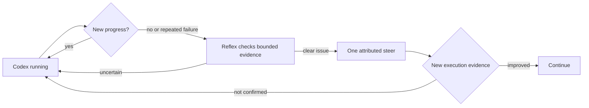

# Codex 过程监督的最小范围

[English](supervision-minimal-scope.md) | 中文

APUS Reflex Harness 将 Codex 过程监督保持在小闭环：观察有界执行证据，识别明确的停滞或重复失败，在运行可接收输入时发送一次有来源的调整，然后等待新的执行证据再判断结果。

## 用户可见流程

运行卡显示耗时、最近进展说明和简单的停滞或超时提示；用户可以继续等待、补充说明或停止任务。

Reflex 监督只增加用户需要的判断状态：正在观察、已接收调整、已观察到改善、送达未知，或因 Goal 改变而过期。

## 监控检查什么

监控使用活动时间、已完成步骤类别、重复失败证据、与 Goal 相关的验证，以及 provider 是否能够接收插话。

监控不做操作系统 profiler、不逐 token 检查、不改写 Codex 私有上下文、不重放结果不确定的副作用，也不编辑 cache 前缀。

监督请求只接收有界证据元数据和已准入的 Goal 要求；原始命令、原始输出、推理和私有 cache 内容不会进入判断请求。

## 调整约定

调整消息带有 `reflex-supervision` 来源，保留当前 Goal 和权限，并把判断、送达确认与后续改善分别记录。

Codex 接收调整不等于任务成功；Reflex 等待后续执行信号，在证据没有变化时不重复发送同一调整。

如果任务已经结束、provider 不能接收输入或 Goal 已改变，待处理调整会标记为过期或未知，不会重放。

## 验收

定向回归覆盖运行中、停滞、重复失败、已接收调整、送达未确认、已改善、过期和 cache 保护状态。

真实 E2E 只需要一条代表性路径：Codex 出现有界重复失败或明确 Goal 偏航，Reflex 发送一次调整，Codex 消费调整，相关验证通过，独立产物检查通过。

健康长任务对照仍是独立门禁：仅仅耗时不能触发调整。对照尚待完成时不需要更复杂的监控，只需要一条能产生真实进展证据的长任务。

## 延伸阅读

配置和语义见 [Reflex 监督](../../packages/experimental/system3/README.zh.md)，当前证据和缺口见[验收清单](acceptance-checklist.zh.md)。
