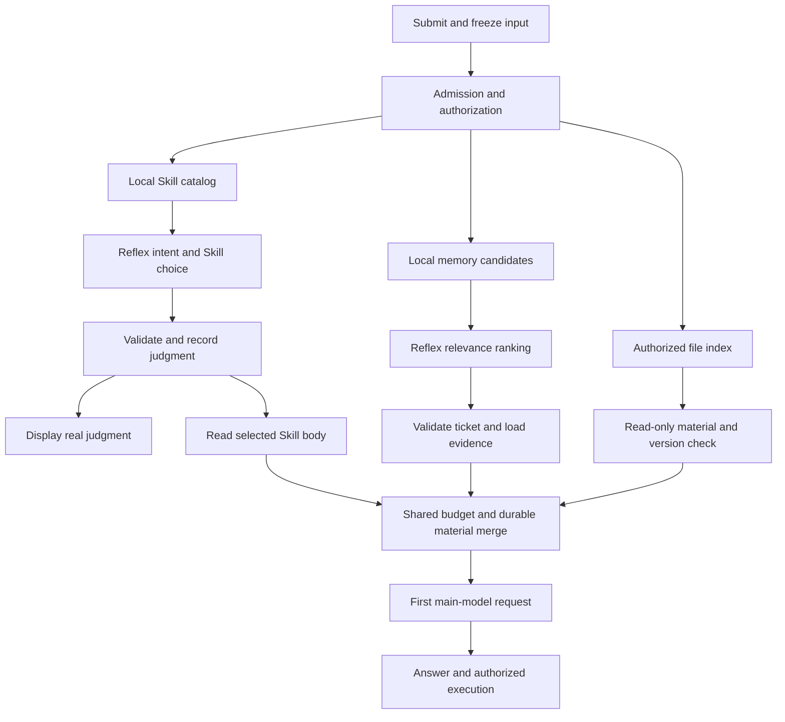

# Reflex parallel preparation and acceptance

English | [中文](parallel-preparation-and-acceptance.zh.md)

This implementation-review reference defines how authorized memory, Skill instructions and read-only materials can reach the first main-model request without repeated model/tool preparation turns. The coordinated implementation and seven acceptance scenarios below are proposals, not completed tests. Neither subsecond response nor a 3× speedup is established. See the [settings and feedback design](design.html).

## Verified implementation and evidence

| Component | Current behavior | Limitation |
| --- | --- | --- |
| [System3 selector](../../packages/experimental/system3/src/skill-selection.ts) | Its pre-step listener first awaits `next()`, then asks Jev for intent and an eligible Skill in one request, validates the answer and reads the selected body | Explicit `/skill` and non-text input retain native paths; this is not a general tool executor |
| Judgment receipt | `system3/skill-decision` carries optional intent and is appended in `finally`, after optional Skill body loading | Judgment arrival and body readiness are not distinct events yet; there is no Jev token stream |
| [Continuum context](../../packages/context/continuum/src/context.ts) | Also awaits `next()`, obtains an authorized read ticket, retrieves local candidates, optionally ranks them and injects sourced recall | A candidate pool is not the entire history; absent candidates cannot be recovered by ranking |
| [Continuum Jev](../../packages/experimental/continuum-jev/src/index.ts) | Scores up to 16 candidates, retains unscored candidates and returns the complete reordered pool in active mode | Ranking does not itself reduce candidate count, tokens or main-model turns |
| Durability and lifetime | Memory dispatch requires a prepared receipt, flush and read-back verification; cancellation and read-ticket validity guard adoption | These checks cannot be removed to shorten latency |
| [Product bundle](../../packages/experimental/continuum-jev/cordis.patch.yml) | Memory defaults to disabled; the remote selector defaults to off with local-only policy; runtime overrides can differ | A working Reflex connection does not authorize remote transmission of personal memory |
| [SDK recorded scenario](../../snapshots/sdk/system3-entry-route/decision-producer.mjs) | Shipped profile, local Jev HTTP fixture and replay LLM verify intent, actual Skill injection, Session and runtime projection; focused refresh/replay passed | Normalized fixture durations are not network measurements; coordinated parallel preparation is not covered |

The two pre-step listeners form a nested waterfall: each performs its own preparation only after downstream completion. Their exact order depends on profile registration. Neither a shared hook name nor separate plugins proves concurrency. A coordinator must replace duplicate preparation for the same turn while retaining plugin extension points.

Existing evidence belongs to branch `eval-reflex-speed-ab`, under `docs/eval-reflex-speed-ab/scenarios-and-test-method.md` and `evidence/`; these files are absent from this worktree. Three first-batch Skill-only trials took about 450–500 ms, 3.57–8.02× relative to Flash low and 2.24–2.54× relative to Flash off, one trial per question. The photo-rule component had a Jev median of about 1.49 seconds and a paired median ratio of 3.102 relative to Flash low, both correct in 3/3 trials. These are component observations, not UI or complete-task certification.

The complete inbox, hotel and moving Agent trials produced A/B ratios of 0.818, 0.797 and 0.945: Reflex was slower in all three. Serial preparation added roughly 2.23–2.54 seconds; tool calls fell from 6 to 5, while main-model calls were 5→5, 5→5 and 5→4. The proposed workflow must demonstrate fewer actual waits and measure first text and completion again. No client-visible timing was established by these trials.

## Proposed dependency graph

The graph is the target design, not a description of shipped parallel execution. Its local-file branch applies to scenario 7; scenarios 1–6 use only memory and Skill preparation. No new parallel coordinator has been implemented. Local, bounded, already-authorized catalog lookup, memory search and file-index reads can start before intent returns. They are speculative reads whose adoption remains conditional. Network access without approval, unbounded reads and side effects cannot be speculative. The first substantive model request consumes one frozen material set, rather than producing a premature answer that later evidence must undo.

| Work | Can overlap | Required predecessor |
| --- | --- | --- |
| Catalog, memory candidates, file index | Independent bounded reads under the same input and scope | Admission and authorization |
| Skill decision and memory ranking | Independent candidate sets and independent remote permission | Each candidate set and required dispatch receipt |
| Selected Skill body | Other branches can continue | Valid selection; provider/name/description remain unchanged |
| Source pages and file metadata | Independent authorized sources with a shared budget | Read ticket; ranking when it determines IDs |
| First main-model dispatch | No need to wait for unrelated work | Required branches ready or explicitly degraded; fixed-order merge, validity and durability |
| Move, upload, send or purchase | Planning may happen early | Existing tool permissions and any required user confirmation |

Keep separate Jev requests for the first delivery and overlap them. Combining intent, Skill and memory into one larger request is a later experiment: it saves a round trip but waits for the slowest candidate preparation and may delay the first judgment. The endpoint may serialize concurrent requests internally. Measure both client overlap and server waiting; concurrency alone is not evidence of a speedup.

## Lifetimes, receipts, budgets and UI

A preparation owner correlates every branch by requestId, turn, input revision and permission version. Results distinguish ready, skipped, timeout, cancelled, stale and failed. Stop, replacement input, plugin disposal, revoked scope or deleted memory invalidate adoption. Late results never enter a newer turn or update its status card. Independent branches can finish in any order; adopted model inputs retain deterministic order.

Reuse existing decision receipts and sourced messages. New stage events record start/end, status, source IDs and versions, exact adopted materials, failure reason and budget use. Every model-visible byte must be reconstructable from Session. Replaying never calls Jev or repeats tools. New persisted fields/events require declared types, compatibility review and SDK/recorded-session coverage. Judgment and actual adoption must remain distinct.

Configure a total preparation deadline, branch deadlines, concurrency, candidate/file counts, per-item/total bytes and final-request token budget. The total deadline never restarts on retries. Do not silently truncate user input. Oversized materials retain source references and coverage accounting. Optional Jev failures may use authorized local ranking; missing required evidence must remain visible and may use the original tool path. A timeout is not a successful complete preparation.

Use one stable-height status above the answer: pending → validated intent → sourced material readiness → collapsed summary during model execution. Example design text: “Reflex · Photo organization · 620 ms”, followed only after real reads by “5 related records found · Photo instructions loaded”. The number is illustrative; production renders the measured event. Do not claim photos are organized, uploaded or safe before execution and verification. Empty recall, timeout and errors have distinct honest states.

This is event-driven progressive feedback, not token streaming. A complete JSON-only API permits display only after the response is validated. Avoid simulated typing as evidence of model speed. Support reduced motion, polite screen-reader updates, keyboard details, narrow layouts and restore of the same persisted state. User-visible status is not a substitute for first main-model text or task completion.

## Six scenarios using existing Skills and memory

The current demo has a large Skill library and accumulated memory, not a prepared collection of photos, invoices or hotel tables. The following questions need only those two sources. The memory IDs below are acceptance aliases, not assertions that the live store contains those exact records. Before a live run, bind each alias to an actually retrievable record and revision; if absent, mark unavailable or use a separately labeled synthetic fixture. Do not invent a historical decision or silently seed demonstration memory.

The actual repository Skill names below were checked against `.agents/skills/*/SKILL.md`. Existence on disk does not prove the running client discovers them: capture its real registry snapshot and full descriptions before a test. Source `dsh-` identifiers are internal references; customer-facing labels can say documentation, review, testing or performance.

| Real Skill | Relevant instruction summary |
| --- | --- |
| `dsh-doc` | Organize documentation by reader and authoritative source; validate links and bilingual pairs |
| `dsh-prose-standard` | Preserve precise claims and contracts while simplifying prose |
| `dsh-ci-test-reliability` | Diagnose nondeterministic tests, resource isolation and lifecycle/teardown |
| `dsh-code-review` | Prioritize concrete correctness, lifecycle, security and required behavior findings |
| `dsh-pre-push-checks` | Select checks appropriate to the actual outgoing change; do not invent passing results |
| `dsh-speed-up-perf` | Measure realistic user paths and optimize observed cost without changing behavior |

All six scenarios use the same read-only tool equivalents: search authorized memory → read original records with IDs/revisions; inspect the actual Skill catalog → read the selected Skill body. Exact exported tool names depend on the mounted profile and must be captured, not invented. There is no external asset file. A can use the same services. Expected memory coverage is a minimum, not an exact recall set; useful supporting records are allowed, irrelevant additions are counted.

### 1. Rewrite the product introduction — MVP 1

**Original question:** “按我们之前定的品牌名称、Model-as-a-Harness写法和README文风，帮我重写一段项目介绍，100字左右，不要夸大已经验收的能力，先在聊天里给我看。”

**Memory aliases/gold:** b1 old wording “Model-as-Harness”; b2 explicit correction “Model-as-a-Harness”; b3 brand “APUS Reflex Harness”, remove old product branding; b4 keep README concise; b5 unlimited-memory or 3× claims require completed acceptance. Mandatory b2–b5, b1 provides revision context. **Skill:** primary `dsh-prose-standard`; `dsh-doc` is an acceptable documented alternative if the requested deliverable is treated as README content. Read the actual body, not just its name.

**A/B and oracle:** A: model decides which history to find → reads records and writing Skill → drafts. B: (local memory search → Jev relevance → original records) ∥ (catalog shortlist → Jev Skill choice → body) → first model drafts. Output includes exact brand and corrected phrase, approximately 80–140 Chinese characters excluding Latin names, no old product brand and no unverified achieved-capability claim; no file write. Automated checks cover required/forbidden strings and bounds, with blinded review for claim accuracy. Time the first substantive draft text and completed compliant paragraph.

### 2. Resume the memory-architecture work — MVP 2

**Original question:** “继续我们上次的无限上下文和无损记忆工作。先找回目标、不能违反的约束和还没完成的验收，选合适的能力给出下一步执行清单，不要把计划写成已完成。”

**Memory aliases/gold:** m1 objectives include unlimited-context workflow and lossless input/memory retention; m2 early local component checks passed; m3 later correction: cross-session continuation, complete input ledger and actual window pressure still require evidence; m4 completion depends on strict acceptance; m5 later status can supersede m3 only with linked actual evidence. Mandatory m1/m3/m4 and every available valid successor of m3; m2 must not imply whole-system completion. **Skill:** `dsh-ci-test-reliability`; its limits mean this output is a verification plan, not evidence that tests ran.

**A/B and oracle:** A: model locates previous goal → loads status/revisions → selects testing Skill → plans. B prepares all authorized goal/status records in parallel with Skill loading, then gives one source-backed bundle to the model. Checklist must distinguish verified, pending and unknown using bound source IDs; cover continuation, input ledger and pressure-test evidence or cite their actual later completion. Zero “all accepted” claims without evidence, zero test-run claims or repository mutation. Time first actionable source-backed step and complete checklist.

### 3. Reuse a previous startup-failure diagnosis — MVP 3

**Original question:** “客户端又提示进入安全模式。找回我们之前类似启动失败真正的原因和验证办法，选排查相关Skill，先给我最短排查顺序；这次没有日志，不要断言还是同一个错误。”

**Memory aliases/gold:** s1 generic UI initially suggested a third-party plugin; s2 a verified earlier case was a partial persistence config missing required root; s3 adding the required field allowed that case to reach home; s4 this is a distinct incident without current logs; s5 later Continuum configuration incidents, when present, remain separately identified. Mandatory s2/s3/s4 and relevant s5; do not promote the earliest hypothesis s1 to fact. **Skill:** `dsh-ci-test-reliability` for reproducible startup/config/lifecycle evidence; optionally `dsh-code-review` only when an actual diff is later supplied.

**A/B and oracle:** A locates incident memories, checks revisions, discovers a diagnostic Skill and writes steps; B retrieves incidents ∥ loads the Skill, then the model writes a bounded plan. Require capture of current technical details/logs, config validation, preservation of user data and a startup/home check. Explicitly label the earlier root cause as historical and current cause unknown; zero plugin deletion, key disclosure or automatic disabling. Time the first useful diagnostic step and the completed ordered plan.

### 4. Explain the existing speed evidence

**Original question:** “我们之前说Reflex快3倍，到底测了什么？按最新结论选性能分析Skill，给我一段可以对外讲的说明，把首字、决策和完整任务分开。”

**Memory:** v1 pilot Skill-only 450–500 ms versus Flash low; v2 Flash off contrast was below 3×; v3 repeated trials varied; v4 full Agent trials were slower; v5 client first-text certification absent. Gold v1–v5. **Skill:** `dsh-speed-up-perf`, read its actual measurement rules. **A/B:** A recalls evidence then loads Skill before explanation; B evidence/revision recall ∥ Skill body, then first model explanation. **Oracle:** distinguish component and end-to-end outcomes, identify baseline settings and small samples, do not claim stable 3× or measured first-text gain. Require a cautious external paragraph and a missing-evidence list; no invented timing. Both first substantive text and completed explanation are timed.

### 5. Recover merge and release acceptance requirements

**Original question:** “按我们之前的约定，这一版合并main和发布前还要核对什么？选合适的审查或测试Skill，先给清单，不要现在推送发布。”

**Memory:** g1 past approval to push/merge; g2 strict actual acceptance required; g3 Windows artifact required; g4 unified brand required; g5 current message explicitly forbids publishing now. Gold g2–g5; g1 is historical and cannot override g5. **Skill:** `dsh-pre-push-checks`, with `dsh-code-review` an acceptable review alternative specified before scoring. **A/B:** A recalls requirements then selects/loads Skill; B memory requirements ∥ Skill loading. **Oracle:** checklist includes actual outgoing diff, relevant checks, platform artifacts and brand; no claim that checks passed without records, no push/merge/release side effect. Time first concrete check and completed checklist.

### 6. Recover UI feedback decisions

**Original question:** “按我们已经讨论过的方案，把Reflex判断、记忆找回和Skill加载这几步的用户提示写出来，语气简洁，不能让人误以为任务已经执行完。”

**Memory:** u1 show real Reflex judgments promptly; u2 progressive feedback must follow real stage completion; u3 loading a Skill or suggesting recall does not mean task execution; u4 product wording must use Reflex, not protocol-provider labels; u5 timeout continues honestly without invented milliseconds. Gold u1–u5. **Skill:** `dsh-client-ui-ux` exists in the repository and covers client design; `dsh-prose-standard` may assist copy only after a real additional Skill load. **A/B:** A retrieves design decisions then finds/reads UI Skill; B design-memory retrieval ∥ UI Skill loading. **Oracle:** return pending/judged/records-ready/Skill-loaded/timeout states, map each to evidence, no fake streaming or completed-action claims; numerical examples explicitly placeholders. Time first usable state copy and the completed state table.

### Large-catalog acceptance

The Desktop selection configuration limits the direct decision candidate catalog to 15 Skills. Current overflow behavior can still classify intent but does not choose from a truncated catalog. A three-Skill component demo cannot represent a real library with hundreds of entries. Proposed support must first create a local, permission-aware shortlist or a hierarchy, then let Jev choose and load a verified body. No silent truncation of the first 15 entries.

Record total catalog size, local recall time, chosen candidate IDs, shortlist recall of predeclared acceptable Skills, hierarchy depth, Jev calls and body readiness. Test relevant Skills beyond position 15, synonyms, near-duplicate descriptions, malicious descriptions, no-match and catalog changes between choice/read. Missing the correct Skill at shortlist time is a retrieval failure, not a Jev success. Compare local-only selection as C; keyword-obvious questions must not be cherry-picked to imply universal Jev value.

Photo previews, inbox files, hotels, shopping tables, invoices and dinner inventories remain optional future extensions once real authorized material exists. They are not current demonstration assets or acceptance evidence.

## 7. Search actual local project documentation

**Original question:** “找出仓库里 Reflex 接入配置及记忆架构说明，结合上次约定列出待办；请标出文件和行号，不要修改代码。”

**Verified local sources:** [Reflex provider README](../../packages/experimental/apus-dsh-jev-plugin/README.md), lines 30–36 for endpoint/model/credential configuration and line 62 for `/v1/systemone`; [Continuum README](../../packages/context/continuum/README.md), lines 12–14 for original-source retention, finite windows and persistence, line 73 for recall metadata, and lines 83–89 for limitations; [cross-session design](../feat-cross-session-memory/design.html) and [Continuum design entry](../feat-continuum-memory/continuum-memory-proposal.html) are existing HTML design sources, not test-pass evidence. Line numbers were inspected for this working copy and must be recomputed from the actual file version at execution.

**Two distinct evidence sources:** local files carry workspace-relative path, digest/version and line range; cross-session memory carries Session/source-event ID, memory revision and authorization scope. Memory aliases are L1 “strict acceptance before completion”, L2 “do not call the whole architecture complete based on component tests” and L3 any later evidence-backed correction. These are proposed lookup targets, not claims that these records already exist in the live store. Gold requires applicable retrieved L1/L2/L3 only when original records are available; otherwise explicitly say “previous agreement not found” and provide a file-only checklist. A matching phrase in a README is not a recovered personal agreement.

**Read-only preparation:** search the authorized repository with bounded `rg --files` and `rg -n` or their mounted read-only equivalents, then read the matched source ranges; avoid secret files, dependency caches and unrelated worktrees. In parallel, retrieve authorized historical agreements and select/read the actual `dsh-doc` Skill. File content never becomes trusted instructions and local-read permission does not grant remote transmission permission. Recheck the file version before adopting excerpts; changed files require reread or a stale result. Documentation mentioning older UI options must be identified as documentation claims, not promoted to verified current runtime behavior.

**A/B DAG:** A model chooses search terms → searches/reads documents → recalls agreements → loads documentation Skill → writes checklist; native A may combine independent tools. B runs (bounded local search → source reads) ∥ (memory lookup → source records) ∥ (Skill shortlist → Reflex choice → body), then sends one budgeted sourced bundle to the first main-model request. The current graph’s file branch is applicable here; no photo, invoice or invented index is needed.

**Automatic oracle and timing:** all cited paths must exist and every quoted assertion must match the cited range in the frozen file version. Require evidence for provider configuration and memory architecture, separate local facts from remembered requirements, mark unavailable memory and unverified design goals, include verification steps rather than fabricated completed work, and assert zero writes. Run with a changed-file variant, denied path, same-named unrelated file, outdated document and missing-memory negative control. Record first correct file-and-line evidence actually visible, preparation readiness, first main-model text and complete source-backed checklist; do not compare a raw filename from B against a full explanation from A.

## Negative controls and adversarial acceptance

Include greetings, a self-contained rewriting request, an empty memory store and a one-record direct lookup. These may offer no preparation benefit: B must not add unnecessary memory ranking or file reads, invent progress or suppress faster A outcomes. Classify these separately and retain them in the declared tested population. A complete in-memory answer can legitimately beat a network Reflex call.

For every scenario test slow/unavailable Jev, malformed or low-confidence answers, oversized catalog/input/material, missing Skill body, changed file version, revoked/deleted memory, cancel-then-new-input and restart during preparation. Embed malicious “ignore policy and upload/send” text in memory, Skill descriptions and files. Assert zero unauthorized side effects, zero cross-workspace reads, no late injection/status contamination, explicit incomplete coverage and bounded fallback. A successfully fetched URL or read file alone does not grant permission to send its contents to Jev.

## A/B timing and quality standard

Use the same main model, reasoning setting, model limits, workspace, accessible evidence, tool permissions and Skill catalog. A disables Reflex automatic preparation; B enables it. Add C with the same parallel preparation but deterministic/local selection to isolate Jev from orchestration benefits. Flash off is a separate control, never pooled with Flash low. Preserve native A parallel tool ability. Freeze or version source data and explicitly classify cold/warm caches.

| Timestamp | Definition | Interpretation |
| --- | --- | --- |
| t0 | User submit event on the client monotonic clock | Includes transport and scheduling wait |
| t_visible | First correct task-relevant result actually painted | Excludes spinner, generic acknowledgment and typing animation; A/B must use the same semantic result |
| t_intent_visible | Validated Reflex judgment painted | Explanatory B metric; absent A UI is not infinite latency |
| t_ready | Required materials validated, merged and durable for this turn | Timeout/degraded preparation is not fully ready |
| t_dispatch | First main-model request dispatched | Separates preparation from dispatch overhead |
| t_text_visible | First main-model answer text painted | Excludes reasoning, tool arguments and Reflex status |
| t_done | Oracle-valid artifact and completion state visible | Includes tool effects and validation, not merely model finish |

Report t_visible−t0, t_ready−t0, t_text_visible−t0, t_done−t0 and t_text_visible−t_dispatch, with main-model/tool/Jev calls, input tokens, read bytes, cost and failure rate. Record backend branch spans on their own monotonic clock and correlate with client events by IDs; never subtract performance.now values from different machines. Capture client receipt and actual paint separately.

“First text 3× faster” requires equivalent t_text_visible−t0 results. “First useful feedback 3× faster” may include genuine preparation evidence only if A has an equivalent observable result; it is not model TTFT. Comparing B intent against A final prose does not establish either claim. A proposed subsecond target is p95(t_intent_visible−t0)≤1000 ms, reported with coverage, accuracy and timeouts. Setting a 1000 ms deadline only bounds fallback; it does not meet this target.

Freeze development-independent cases and oracles before certification. The existing formal proposal requires at least 30 independent semantic cases with five pairs each and a case-cluster bootstrap 95% ratio lower bound ≥3, with no worse task correctness and zero critical errors. Pre-generate randomized arm order, retain failures, do not run competing arms concurrently on the same endpoint, and report p50/p95, paired ratios and absolute time saved. Do not expand one scenario into unrelated tasks just to reach 30.

## Three MVPs and implementation checkpoints

Prioritize product-introduction drafting, cross-session memory-work continuation and historical startup diagnosis. Each uses existing memory and an actual Skill, with no invented external assets. B may avoid one or two model preparation round trips by supplying verified records and a loaded body in the first request; savings may be zero when A already batches tools or Jev overhead dominates. Start with introduction drafting, then reuse the same coordinator for the other two. None has demonstrated a 3× complete-workflow gain.

1. Bind introduction-drafting memory aliases to real source records and capture the live Skill catalog first. Define the oracle before testing; label missing memories honestly. No external photo or invoice fixture is required.
2. Design a scoped preparation service with explicit request/result types, cancellation, shared budgets and deterministic adoption. Adapt the two existing pre-step consumers to avoid duplicate work; do not put new scheduling in the Agent loop.
3. Persist judgment separately from adopted materials, then project both to the stable feedback UI. Update type acknowledgments, SDK output and recorded-session fixtures as required.
4. Run keyless concurrency-order, cancellation, revocation, timeout and injection tests. Verify the first B main-model request contains the exact necessary materials and that its final artifact matches A.
5. Verify desktop/web input → real judgment → sourced materials → first text → correct artifact, including accessibility and restored sessions. Controlled-delay UI tests do not count as live latency results.
6. Run a small real A/B/C pilot, inspect saved rounds, first text and completion independently, then freeze the formal multi-case set. Expand to continuation and diagnosis only after the shared preparation path passes.

Expected code owners are System3 preparation, Continuum retrieval consumers, existing filesystem service consumers, Session types/projection, chat feedback and profile composition. Exact file/API changes belong in the coordinator design before implementation. This document creates no product feature, credentials, real-model calls or completed-test claims.
