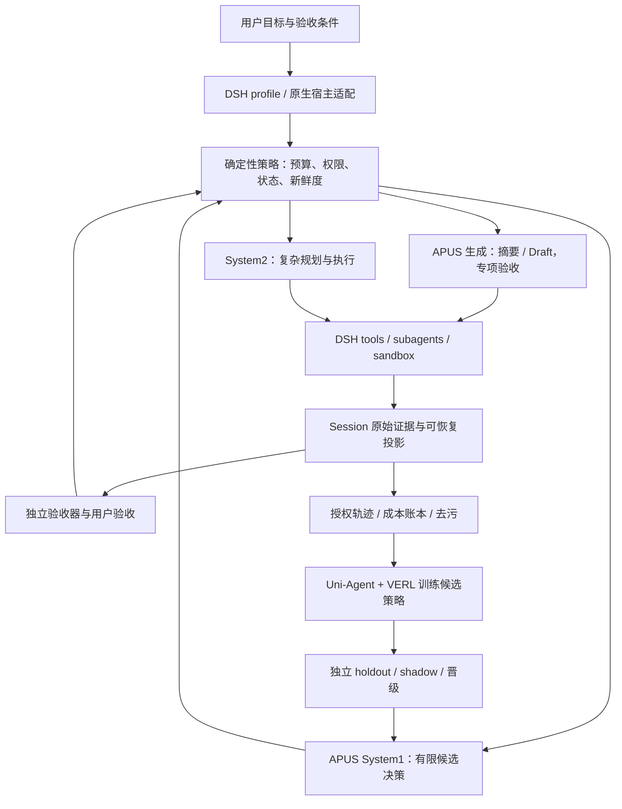

# APUS Reflex Harness · Harness：四条工作线与首发设计

English | [中文](design.zh.md)

状态：设计已批准；基础实现已交付，完整运行时接线仍在实施。调研日期：2026-09-24。读者：产品负责人、模型训练与 Harness 工程团队。

## 1. 产品目标与 System3 定义

System1 是 APUS/OpenJev 的高频候选判断与经专项验证的轻量工作；System2 是强模型承担复杂推理、规划与工程执行；System3 是把两者连接到工具、环境反馈、验收与成本账本的系统。1+2 表达职责组合，并不意味着模型参数相加。

北极星指标：在相同任务分布和质量要求下，每次成功完成任务的总成本下降。同时报告任务成功率、端到端耗时、用户干预次数、错误结束率。少调用强模型本身不是成功。

首发人群假设：高频使用 AI 编程助手的独立开发者、小团队及需要处理长日志的技术用户。普通办公用户作为第二批验证群体；本轮没有访谈或付费转化数据，不把痛点假设写成已确认市场需求。

## 2. 当前已执行与仓库状态

官方上游为 https://github.com/deepseek-ai/deepseek-harness ，源码审阅日期为 2026-09-24，审阅来源为当时的 upstream/master；原默认分支 master，许可证 MIT。

This repository maintains the Harness implementation for APUS Reflex Harness; see the [project entry point](../../README.md) for source and contribution guidance. Historical checkout locations and remote-management records are privately archived.

已完成原始上游的 Ruff 修复与格式化；main 保留官方基线，feat-system3-foundation 已推送到自有私有仓库。基础 System3 包、统一 Cordis 服务和真实 AgentLoop smoke 已交付；真实模型、训练与部署仍未启动。

The product name is APUS Reflex Harness; actual `@deepseek-ai/*` package names, the `dsh` command, upstream attribution and MIT notices retain their meaning. Branding changes do not rename dependencies or alter license obligations.

## 3. 四条工作线

| 工作线 | 交付对象 | 首个可验证结果 | 与其他线关系 |
| --- | --- | --- | --- |
| A 模型–Harness 一体化强化学习 | 固定环境中的可训练控制策略、数据与评测链 | 同预算独立任务中相对冻结基线有收益 | 复用 Uni-Agent/VERL；不先重写 trainer |
| B Harness 招牌能力定制 | 可安装、可关闭、可回退的产品模块 | 用户少等待、少返工、每成功任务成本更低 | 产出真实轨迹与反馈供 A 使用 |
| C Jev/System1 深层融合 | DSH 原生插件、决策与生成双路径 | 在关键扩展点替代有价值的强模型工作 | 为 B 提供能力，为 A 提供动作空间 |
| D 产品与生态对照 | Jev Skills/文章分析、ToC验证、发布路线 | 找到最短接入路径和真实付费价值 | 防止以论文指标替代产品收益 |

推进顺序：B/C 的可测闭环先行，A 的数据与训练基础同步准备；先证明哪一种决策值得训练，再扩大联合训练。D 全程校验需求和对照。

## 4. DSH 架构与融合原则

DSH 是 Cordis 全插件架构：profile/bundle 决定装载组合；agent-loop 驱动步骤；Session 保存模型可见事实；LLM adapter、tools、subagent、compaction、goals 都有已有职责。新增策略通过事件与 provider 接入，不复制第二套 loop。

上图是拟议产品组合，不表示所有接线已实现。运行时已经存在的预算和权限机制继续由代码执行；模型只能给候选建议，不改权限、不自批验收、不修改奖励器。

缓存与成本约束：尽量只处理新增工具输出，避免每步重判完整历史；按任务阶段触发而非固定每 N 步调用。历史投影修改可能破坏 provider 缓存前缀，必须计入重填充成本。缓存键至少含模型/权重版本、候选与顺序、prompt版本、上下文摘要哈希、目标revision；不能缓存过期的完成或权限判断。

## 4.1 最新源码中的八个结合点

以下路径相对于仓库根目录；行号对应2026-09-24的源码审阅快照。所有收益都是待实验假设，源码审计不等于运行验证。

| 优先级 | 能力 | 已有机制与源码位置 | System1增量与边界 |
| --- | --- | --- | --- |
| P0 | 证据筛选 | packages/spill/spill-policy/src/index.ts:90,114,133,152；packages/core/tools/src/index.ts:616 | 从头尾裁剪升级为任务相关片段选择；read排除与PTC日志分流需分别覆盖，保留完整原文 |
| P0 | 完成验收 | packages/core/agent/src/runtime-types.ts:365；packages/core/agent-loop/src/agent.ts:341 | turn-stopping可接监督并steer继续；模型只提出candidate_done，独立检查决定完成 |
| P0 | 语义无进展 | packages/guard/repeat-tool-reminder/src/index.ts:196,220,236 | 现有检测仅同工具同参数连续重复；新增语义检测只在异常时调用，正常polling作负例 |
| P1 | 专职轻量子代理 | packages/subagent/tool-subagent/src/index.ts:106,156；model-selection.ts:99,139,176 | 已支持模型与工具范围选择；优先fresh spawn加限定文件，避免继承全部父历史 |
| P1 | 阶段路由 | packages/core/agent/src/runtime-types.ts:322；agent-loop/src/agent.ts:558,569,602,631 | agent/request可换调用配置但不能直接改messages；路由变更记request/header，计入缓存失效 |
| P1 | 廉价上下文摘要 | packages/compaction/compaction-basic/src/summarizer.ts:128,145,162；region.ts:418,430 | 已能配置独立摘要模型，先做配置实验；摘要须更短且surface未变，不用模型替代事务检查 |
| P2 | 输入充分性 | packages/core/agent/src/runtime-types.ts:310；agent-loop/src/agent.ts:315,321 | pre-step可拒绝/重写；reject不等于给用户展示澄清问题，必须设计可见交互 |
| P2 | 质量异常预警 | packages/core/agent/src/runtime-types.ts:355；agent-loop/src/agent.ts:355 | 瞬态stream仅供展示；用durable attempt/message/tool-result验收，区分工具与模型故障 |

现有 compaction-tool-result-pruner/src/config.ts:10 已有8192字符阈值、4096头部与1024尾部保留，compaction-basic/src/index.ts:321先规则裁剪再摘要。必须把此能力纳入基线。token-meter/src/route-pricing.ts:39文本计量含启发式估算，商业收益要以provider实际usage与费用核算。

现有 goal-round-driver/src/index.ts:155附近在持久化checkpoint之后检查目标与轮数，再排下一轮；goal/src/index.ts:391的complete是状态转换，不等于业务成果验证。保留其并发、新鲜度、用户输入优先与停止语义。

不模型化：tools/src/index.ts:723单调拒绝、1135同步guard、allowlist、最大递归、权限、取消、预算硬停止、tool配对、日志顺序、摘要事务锁、错误码退避。规则可准确完成的检查不应新增一次推理。

## 5. Jev 双路径与当前证据

APUS 9B 的 decision 是有限候选评分；generate 是逐 token 生成文字、代码或参数。二者可以共享主干，但要分别验收。候选集合由宿主根据合法操作生成，必须含 unknown/escalate；测候选召回，否则正确动作未入候选时模型再准也无用。

模型卡与本地评测的 9B 高深度最佳为冻结80题68/80（85%）；这是开发面板结果。当前材料含不同 checkpoint/服务路径，不能把最佳准确率与另一版本最佳时延拼成同一个实测配置。5949训练数据中158条TYPE、5791条决策，尚不足证明代码、摘要、工具参数能力。

9B high 的25.58ms是特定96GB GPU决策HTTP记录，不是本地笔记本、长上下文、生成或端到端任务速度。候选归一化概率并非校准置信度。固定low/high出口先各自建基线，动态出口、共享KV/循环状态作为后续研究；已有本地材料记录BF16共享数值门尚未通过。

## 6. 招牌能力与 ToC 验证

| 用户痛点假设 | 拟议能力 | 最短对照实验 | 发布时展示 |
| --- | --- | --- | --- |
| 看不懂长日志，额度消耗快 | 证据保真日志筛选与按需原文展开 | DSH现有头尾裁剪 vs 规则错误抽取 vs Jev片段筛选 | 全链成本、关键证据召回、原文入口 |
| 一直重试，换说法也没进展 | 语义无进展检测与升级建议 | 现有精确重复检测 vs 增量状态判断 | 原因、已试路径、下一建议 |
| 说做完了但实际没交付 | 完成证据检查与有界续跑 | 用户目标+真实测试/产物验收 | 通过项、缺失项、剩余预算 |
| 不知道该用哪个模型 | 按任务阶段选择模型与深度 | 固定强模型 vs 规则路由 vs Jev路由 | 质量优先/均衡/节省及实际账本 |
| 需求没说全导致返工 | 仅对阻塞信息澄清 | 原流程 vs 选择性澄清 | 只问影响执行的一问 |
| 想本地用但部署难 | 本地/云端共用接口和能力自检 | 实际目标硬件冷启动与工作流 | 内存、延迟、可运行能力和数据去向 |

首发选前三项中的日志筛选和影子监督，完成验收随后接入。Draft、泛用工具执行、多模型自动并行以及普通办公场景暂不与第一版捆绑。

外部宿主有三类路线：原生hooks适合观察和受支持的反馈；MCP/工具wrapper可掌握自己工具的输出；代理只能覆盖实际经过它的流量。skill适合安装、说明与显式调用，不保证每步调度。先做一个宿主的真实最小接入验收，再承诺保持原有使用习惯。

DSH 的 hooks-codex/hooks-claude-code 是在 DSH 中执行相应hook配置；subagent-codex 是 DSH 启动 Codex app-server。它们不能证明外部原生宿主内部所有调用都可截获、替换或节省Token。任何仅追加摘要而未减少原始模型可见输出的方案，不得宣传为压缩节省。

## 7. 联合训练设计

训练对象是受约束策略参数，不是让模型随意改Harness核心。状态包括目标revision、最近增量证据、合法候选、剩余预算、模型能力与环境状态。决策动作包括是否澄清、路由、保留证据、continue/retry/escalate/candidate_done；生成动作单独学习摘要、Draft与工具参数。

阶段A0：冻结原生DSH与模型，收集可复算轨迹并建立规则基线。A1：任务特定决策SFT与生成保留训练，独立验证遗忘。A2：固定生成模型，仅训练决策/路由策略。A3：固定控制策略，训练生成能力。A4：前面均有收益才交替优化，逐次固定另一侧；不要一开始同时更新所有组件，导致归因与回滚失效。

奖励先满足约束再优化成本：主指标为独立verifier确认的任务成功；错误完成、关键证据丢失、权限越界分别统计并限制；在质量合格的候选中优化真实总费用、墙钟时间与干预次数。不能给少用token却未完成的轨迹高奖励，也不能把模型自己的评分直接当真值。

总费用 = 强模型调用 + APUS推理/部署摊销 + 回退/重试 + 缓存失效重填充 + 工具/环境费用。API计费与订阅额度体验分别报告，不承诺减少Token自动增加厂商订阅配额。

轨迹键关联 episode/task/session/step/model_revision/policy_revision/runtime_SHA/verifier_revision/seed；记录候选及顺序、选中动作、日志引用、token usage来源和实际费用。训练、校准、封存测试按repo/任务家族/父组隔离，哈希与近重复检查；最终测试标签不进入提示、teacher或调参。teacher摘要不能冒称logit蒸馏。

在线训练仅消费获授权且资格完备的真实环境轨迹。先做离线shadow与可重放对照，再有限canary；checkpoint含优化器、数据版本、权重hash、策略配置，晋级失败恢复上一版本。用户真实项目数据默认不用于训练，云端调用与训练收集分开授权。

## 7.1 现有 Uni-Agent 成果与需要补齐的链路

训练仓库当前根目录是旧文档分支；最新相关主线为 .Codex/worktrees/verl-uni-agent-harbor-opd-rl，分支performance-9b，HEAD4c0e1c6；MOPD专项HEAD25c4433。以下证据为本地报告审阅，未重新连接服务器验证。

- 9月24日27B→9B文本OPD完成16步及step4/8/12/16独立导出加载；7版本×30题共210输出。只验证thinking-off文本链路，14道可评分题只改善一道数学题，非封存泛化测试。来源：docs/performance-9b/overnight/final-analysis.json。
- tokenizer兼容审计记录2 microbatch/8样本/4455 token、248个文本LoRA非零更新与导出reload一致；工具parser/mask有测试，但传输仍mock，thinking1024失败。来源：docs/performance-9b/tokenizer-opd-compatibility/full-verdict.md。
- 已有78题×4样本工具对照：base64.10%，OPD12为43.27%（差−20.83pp，95%CI[−28.53,−13.14]），RL20为50.96%（差−13.14pp，CI[−18.59,−7.37]）。这是特定旧checkpoint实验，不能归因新16步文本run；它说明晋级必须看独立任务质量。来源：docs/performance-9b/checkpoint-full-eval/evidence-20260921/下两份supplemented-pair.json。
- MOPD专项有557项不同CPU测试，但尚无该专项GPU更新/恢复/业务收益验收，不能作为System3联合RL已完成。

复用：uni_agent/agents/dsh/agent.py与runner.py的黑盒SDK/Gateway；tasks/harbor_dsh/protocol.py的身份/预算/版本协议；ledger.py取消ACK；trajectory_audit.py的trace/reward/receipt一致性；framework/framework.py的teacher/mask/VERL消费；tasks/dsh/rsi_candidates.py的登记、配对晋级与回滚原语。去污复用data-decontam-gate专项，新增办公与长任务数据适配。

2026-09-24审阅的 Python SDK仍提供DeepSeekHarnessConfig、run(input, session_id)、events/final_response/finish_reason，外观相容；旧发布清单绑定历史Exp发布版本、Session v2及0.1.3a2，运行语义尚未认证。需要重新构建SDK/runtime/image，固定完整profile及patch digest，真实验收tool/trace/receipt/stop/restart/cancel。sdk-minimal缺少压缩、文件工具、workspace指令、skills、jobs、subagents，不用它代表完整System3。

逐请求max_tokens不等于多模型episode硬预算。跨模型成本、deadline、重试、子代理都要合并账本并执行硬停止；字段存在不作为预算已生效的证明。

## 8. 拟议接口与失败行为

以下是设计接口，不是现有DSH公开API，也不要求MVP另建HTTP服务。

DecisionRequest: schema_version, decision_kind, task_id, goal_revision, state_digest, evidence_refs, candidates[{id,description}], model_revision, effort, budget_remaining, deadline_ms。

DecisionResult: request_id, selected_id, scores[], calibration_version|null, evidence_refs[], model_revision, executed_depth, latency_ms, usage, status(ok/unknown/timeout/error)。校验候选归属、证据存在与新鲜度，超时或未知回到已有规则/强模型；不能因为service异常丢掉原始输出。

SummaryRequest: artifact_ref, digest, task_context_ref, max_output_tokens, required_evidence。SummaryResult: retained_spans[{start,end}], optional_summary, omitted_ranges, original_ref, model_revision, usage。MVP优先抽取式保留片段，独立记录原文；不让decision端点生成伪概率或伪引用。

SupervisorAdvice: continue/retry/escalate/candidate_done/unknown, evidence_refs, missing_checks, goal_revision。candidate_done只是建议；verifier与目标验收决定是否可标完成。外部宿主权限不由该建议提升。

CostRecord: 每请求input/output/cache_read/cache_write/reasoning计量口径、provider报告或估算标记、模型及价格版本、端到端耗时、重试关联。reasoning不重复加到已含它的output中；没有实际usage不填成零费用。

接LLM前对照项目API参考与当前provider实测：OpenRouter reasoning、LiteLLM reasoning_content、Anthropic thinking分别解析；SSE终止与thinking/text混合block分别测试。决策端点无须暴露长思维链；长生成的token预算独立配置。

## 9. 文件变更计划

| 阶段 | 拟新增/修改路径 | 目的 |
| --- | --- | --- |
| 本轮 | docs/feat-system3-foundation/design.md、index.html、evidence.json | 方案、阅读版和固定来源 |
| 本轮 | Internal plans and handoffs (privately archived) | 计划与跨session恢复 |
| M0批准后 | 上游4处lint与28个Python格式文件；README品牌入口 | 可推送基线与产品入口，保留历史与许可证 |
| M1批准后 | packages/experimental/system3-policy/ | 决策接口、校验、预算与回退，包名待约束检查 |
| M1批准后 | packages/experimental/system3-evidence/ | 原文索引、片段筛选、可恢复模型投影 |
| M1批准后 | packages/experimental/system3-supervisor/ | 影子监督、目标证据与决策记录 |
| M1批准后 | apps/cli/config/examples/ 的System3 overlay及对应测试 | 复用现有profile启用，不改默认loop |
| M2批准后 | 独立宿主适配目录，按验证宿主确定 | hooks/MCP实际能力验证与安装卸载 |
| A线 | Uni-Agent现有adapter/trace/verifier/训练配置 | 复用训练所有权，不把trainer复制进DSH |

这些目录是拟议名称；落地前遵循上游包schema、依赖、generated catalog与Session格式要求。新增model-visible内容必须落盘可重放；不未经类型迁移规划写入不可识别的必读Session事件。

## 10. 实验、验收与发布次序

E0 原生DSH；E1 DSH+确定性日志/路由规则；E2 E1+Jev决策；E3 E2+小模型生成；E4 经训练策略；另加同尺寸普通9B控制器，隔离Jev专门训练的贡献。每次只引入一个因素，配对相同任务/模型/预算/环境并随机运行顺序，防止缓存或上游服务波动混淆。

先以50个独立任务做可行性pilot（代码修复、长日志定位、仓库问答、结构化文档、长任务各10）；开发集与封存集分离，重复次数不冒充独立样本。根据pilot方差规划正式样本量。建议待审批门槛：质量非劣界限2个百分点、每成功任务成本降低至少20%、端到端P95不恶化超过10%；小样本置信区间不支持时结论必须为未证明。错误完成和关键证据遗漏单列置信区间，不以小样本零错误声称可靠。

测试包括未知候选、证据过期、错误目标revision、服务超时、重复请求、并发取消、原文恢复、提示注入日志、缓存重算、goal停止竞态、故障回退和成本账本核对。单测/快照→真实DSH process→外部宿主真实接入→配对任务评测，各阶段证据不得互相代替。

遵循build→lint→相关unit/regression/snapshot；发布路径做built smoke。新核心模块遵循上游更严格的受影响文件覆盖要求。每次push必须ruff check .及ruff format --check .通过，再跑按变更面选择的DSH检查；不跳过失败的检查。

M0：审批设计、修复上游推送门禁、发布私有基线。M1：DSH原生日志筛选+影子监督+费用账本。M2：一个原生宿主可卸载模块+配对用户任务。M3：可验证完成与有界续跑。M4：小模型Draft/工具子任务。训练按A0—A4并行，不在未证明收益时绑定产品发布。

## 11. 文章与生态对照

微信文章《给Agent装一套判断技能》适合启发分发方式与场景，不是我们的效果证据；其模拟模式仍使用宿主大模型，不能证明减少调用成本。文章描述的是早期9个skill形态，2026-09-24仓库README已经列5个skill/108场景，说明安装与能力声明必须固定revision。

更值得吸收的是该项目公开负结果：2026-09-20四个合成任务、每个三次的12对pilot，固定检查点接入后完成数12/12→10/12，成本与耗时均增加。这不证明Jev无效，但直接反对“多加判断就一定更省”的假设。新README另有3/4→4/4的小pilot，同样不足证明普遍收益。System3需要事件触发、强规则基线与完整账本。

“降智检测”首版定义为任务质量异常提示：固定探针+失败类型+上下文/模型配置变化记录。单次差答案不能定位供应商降级；9B自身会错，不能做唯一裁判。可对用户展示观察到的质量变化与证据，不做原因未证实的归因。

## 12. 审批范围与未完成事项

本阶段完成仓库创建、克隆、源码调研、专项设计、System3策略包、统一Cordis服务和真实AgentLoop smoke。尚未接入真实APUS 9B、Jev模型决策、Claude/Codex专家委派、训练GPU或成本收益评测；下一步是Session证据接线、真实provider和可回放决策闭环。

依据用户提供的AGENTS.md Development Preflight第2条：设计需呈现并获得明确“开始/approved/confirmed”后实施。此次等待不是工具审批拒绝，而是用户要求的设计审批步骤。

## 13. 来源与复核入口

- [DSH维护源码](https://github.com/deepseek-ai/deepseek-harness/tree/master)
- [APUS模型卡](https://huggingface.co/apus-ailab/APUS-OpenJev-v1)
- [用户提供的微信文章](https://mp.weixin.qq.com/s/QJOjAdIuw9PjsY-QiKZfdw?scene=1)
- [Jev Skills固定revision](https://github.com/wuyoscar/jev-skill/tree/259a798ab8df70a3566f1cb7f8226e533782d847)
- [Jev Skills原始负结果](https://github.com/wuyoscar/jev-skill/blob/259a798ab8df70a3566f1cb7f8226e533782d847/evals/RESULTS.md)

Historical local reference inventories are privately archived. Repository package documentation owns current implementation and configuration; historical experiment endpoints are not current deployment instructions.
