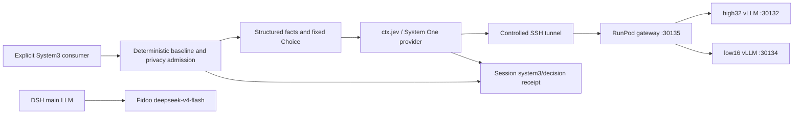

# Jev integration and model chain

English | [中文](jev-9b-integration-design.zh.md)

## Summary

System3 executes explicit Jev shadow supervision and persists its complete structured input, validated answer, and deterministic baseline in the owning Session. The main LLM generates through Fidoo; Jev uses the independent System One gateway on RunPod. `apus` is a name, and compatible providers can replace the built-in provider. This integration changes no automatic AgentLoop routing, evidence selection, permissions, or completion authority.

## Table of Contents

- [Architecture](#architecture)
- [Requests and receipts](#requests-and-receipts)
- [Deployment](#deployment)
- [Verification and limits](#verification-and-limits)
- [Dev Note](#dev-note)

-----

## Architecture

The [Jev plugin](../../packages/experimental/apus-dsh-jev-plugin/README.md) defines `ctx.jev` and typed Choice, Score, and Noul questions. Its System One provider validates requests and responses, resolves a credential reference, and calls `/v1/systemone`. The [System3 consumer](../../packages/experimental/system3/README.md) constructs fixed supervision candidates, admits the declared route, and appends a Session receipt. The main generation adapter uses `llm-pi-ai` with OpenAI Chat Completions; the decision gateway is a separate protocol.

## Requests and receipts

Generic `ctx.jev` accepts host-supplied state and typed questions; its caller owns privacy admission and logging. System3 accepts only `supervisor`, `dataClasses`, and optional `turn`/`step`. It builds state from goal revisions, evidence references, check results, and remaining budget. Its fixed Choice candidates are `continue`, `retry`, `escalate`, `candidate_done`, and `unknown`. Hosts must supply opaque identifiers and structured facts rather than business text or credentials.

`shadowDecision(session, request, signal)` preserves the deterministic supervisor result. A `system3/decision` receipt retains the complete structured Jev request, digest, evidence references, route/execution domain, selected provider/model, effort, answer or safe failure code, elapsed time, baseline, and comparison. `lastDecision(session)` reads the latest receipt through a replayable projection. The full model input is recorded; a digest does not replace it.

Privacy denial and provider unavailability record an unknown outcome without sending a request. Transport, timeout, credential, HTTP, and response-validation failures preserve deterministic authority. Caller cancellation records a cancelled receipt before rejecting. Jev advice cannot authorize tools, increase budgets, or declare completion.

## Deployment

The [profile guide](model-chain.md) and tracked overlays own executable configuration. The Jev plugin uses `endpoint`, `model`, `effort`, `timeoutMs`, and `apiKeyEnv`. System3 uses `privacyMode`, `approvedRemoteIds`, `approvedRemoteDataClasses`, `observeAgentLoop`, `jevRouteId`, `jevExecutionDomain`, and `jevEffort`.

The main route is `https://proxy.fidoo.ai/v1` using the existing `system3-dsh` virtual key through `SYSTEM3_LITELLM_API_KEY`. The verified model is `deepseek-v4-flash`; `deepseek-v4.1-flash` is not registered. The overlay sets an explicit 8192-token output cap and low reasoning effort. RunPod serves the authenticated gateway at `127.0.0.1:30135`, backed by high32 at `30132` and low16 at `30134`; replies identify `APUS-OpenJev-v1-9B-5949`. Its key stays at `/root/.config/openjev/gateway.key` and is referenced as `APUS_JEV_API_KEY`.

The approved [launcher](run-system3.py) captures both existing keys through SSH and injects them only into the dsh child environment. It owns a temporary loopback tunnel and overlay, and joins its processes on exit. A developer-machine tunnel is `jevExecutionDomain: network` even with a loopback endpoint. The overlay uses `controlled` admission and permits route `jev` with `public` facts. The [same-host override](system3-fidoo-runpod-local.patch.yml) permits local Jev execution; the main Fidoo generation remains remote. Keys never enter tracked configuration, argv, or receipts.

## Verification and limits

The source dsh profile passed composition and schema validation. A live source launch returned main-model text `READY` plus a successful Jev receipt: model `APUS-OpenJev-v1-9B-5949`, advice `continue`, baseline `continue`, and replayable input. It exited 0 and cleaned up its SSH tunnel. Separate same-Pod API probes returned HTTP 200 with model and usage fields for Choice, Score, and Noul.

The current Pod has no Node runtime, so no built dsh application smoke ran there. Same-Pod Python API probes and local source dsh smoke establish different facts. The first consumer covers explicit shadow supervision; automatic routing, evidence selection, expert delegation, and training require separate consumers and verification. The host declares data classes and execution location; these checks do not enforce OS isolation or process egress. Connectivity and receipt reconstruction do not establish decision quality, probability calibration, or cost savings.

### Dev Note

Use the tracked explicit probe overlay to reproduce the source chain. The worktree handoff owns command results and branch state; package READMEs own service behavior.
