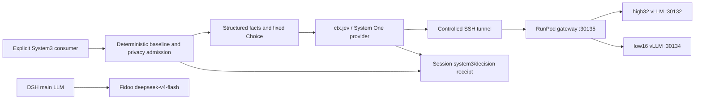

# Jev 接入与模型链路

[English](jev-9b-integration-design.md) | 中文

## 概述

System3 执行显式 Jev 影子监督，并把完整结构化输入、校验后的回答与确定性 baseline 持久化到所属 Session。主 LLM 通过 Fidoo 生成；Jev 使用 RunPod 上独立的 System One gateway。`apus` 只是名称，兼容 provider 可以替换内置 provider。本次接入不修改 AgentLoop 自动路由、证据筛选、权限或完成判定权。

## 目录

- [架构](#architecture)
- [请求与 receipt](#requests-and-receipts)
- [部署](#deployment)
- [验证与限制](#verification-and-limits)
- [开发备注](#dev-note)

-----

## 架构

[Jev 插件](../../packages/experimental/apus-dsh-jev-plugin/README.zh.md) 定义 `ctx.jev` 与类型化 Choice、Score、Noul 问题。System One provider 校验请求和响应、解析凭据引用，并调用 `/v1/systemone`。[System3 consumer](../../packages/experimental/system3/README.zh.md) 构建固定监督候选项，对声明的 route 做准入检查，再追加 Session receipt。主生成适配器使用 `llm-pi-ai` 与 OpenAI Chat Completions；决策 gateway 使用独立协议。

## 请求与 receipt

通用 `ctx.jev` 接收宿主提供的 state 与类型化问题；调用方负责隐私准入与日志。System3 只接收 `supervisor`、`dataClasses` 与可选的 `turn`/`step`。它根据目标 revision、证据引用、检查结果与剩余预算构建 state，固定 Choice 候选项为 `continue`、`retry`、`escalate`、`candidate_done`、`unknown`。宿主必须提供不透明标识与结构化事实，不能放业务原文或凭据。

`shadowDecision(session, request, signal)` 保留确定性监督结果。`system3/decision` receipt 保存完整结构化 Jev 请求、digest、证据引用、route/execution domain、选中的 provider/model、effort、回答或安全错误码、耗时、baseline 与 comparison。`lastDecision(session)` 通过可重放 projection 读取最新 receipt。完整模型输入会被记录，digest 不替代输入本身。

隐私拒绝与 provider 不可用会记录 unknown outcome，不发送请求。Transport、timeout、credential、HTTP 与响应校验错误保留确定性判定权。调用方取消时，先记录 cancelled receipt 再拒绝请求。Jev 建议不能授权 tool、增加预算或宣告完成。

## 部署

[Profile 指南](model-chain.zh.md) 与已跟踪 overlay 保存可执行配置。Jev 插件使用 `endpoint`、`model`、`effort`、`timeoutMs`、`apiKeyEnv`。System3 使用 `privacyMode`、`approvedRemoteIds`、`approvedRemoteDataClasses`、`observeAgentLoop`、`jevRouteId`、`jevExecutionDomain`、`jevEffort`。

公开部署使用用户配置的生成 provider 与可选 Jev provider。通过[部署配置](../dev-continuum-reflex-integration/public-provider-configuration.zh.md)明确指定 endpoint、model 和凭据引用；不分发内部服务地址或凭据文件位置。

原维护者专用 SSH 启动器已私有归档。通过进程环境或用户自己的 profile 提供凭据，不复制维护者的凭据文件布局。经 loopback tunnel 访问远端 Jev 仍需要网络数据许可；[同机覆盖层](system3-fidoo-runpod-local.patch.yml)仅适合真正的本地执行域。

## 验证与限制

源码 dsh profile 已通过拼接与 schema 校验。真实源码启动返回主模型正文 `READY` 与成功的 Jev receipt：模型为 `APUS-OpenJev-v1-9B-5949`、advice 为 `continue`、baseline 为 `continue`，输入可重放。进程以 0 退出，并清理 SSH tunnel。独立的同 Pod API probe 对 Choice、Score、Noul 均返回 HTTP 200 与 model、usage 字段。

当前 Pod 没有 Node runtime，因此未在该宿主运行 built dsh 应用 smoke。同 Pod Python API probe 与本地源码 dsh smoke 各自证明不同事实。首个 consumer 覆盖显式 shadow supervision；自动路由、证据筛选、专家委派与训练需要独立 consumer 和验证。宿主声明数据类别与执行位置；这些检查不负责操作系统隔离或进程出网控制。连通性与 receipt 重构不能证明决策质量、概率校准或成本节省。

### 开发备注

使用已跟踪的显式 probe overlay 重现源码链路。Worktree handoff 保存命令结果与分支状态；包 README 定义服务行为。
