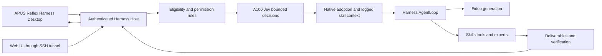

# System3 implementation and deployment

English | [中文](implementation.zh.md)

Reference: [approved interaction and architecture design](../feat-system3-desktop/system3-intelligence-design.html). The user approved implementation and deployment on 2026-10-01.

## Goal

Connect the real Frontend, native Harness execution, bounded Jev decisions, Fidoo generation, tools, deliverables and user controls. Preserve one execution owner and durable Session history.

## Changes

- Merge dsh-v0.1.7-rc.2 source, reconciling Session admission and the fork's System3 events without overwriting historical generations.
- Backend: System3 and Jev providers, native request admission and Skill context; focused tests and existing SDK/session snapshots.
- Frontend: runtime source resolution, profile overlays, branding and native Conversation extensions.
- Deployment: independent non-root systemd service on server loopback 18731, reproducible Linux artifacts built in Docker, dedicated persistent data, authenticated access through SSH tunneling, release and rollback scripts. The native workspace sandbox remains enabled. Existing LiteLLM/Caddy services retain their configuration.

## API and controls

Use existing Host RPC, Session follow events, selection and cancellation APIs. UI feedback distinguishes local submission, admission, adopted selection, actual model requests, tool results and settled output. Credentials stay server-side. Only validated candidates may be adopted; cancelled or expired decisions never dispatch work. Any additional event or projection must update its native readers and tests.

## Verification

Run focused behavior tests, build/type checks, lint, recorded Session replay, actual Jev/Fidoo requests with synthetic public inputs, browser submission and cancellation, persistent reload and server restart. Desktop and server launch evidence are separate. Record command, revision and results; do not equate endpoint health or static UI with a successful task.
