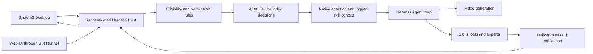

# System3 实施与部署

[English](implementation.md) | 中文

参考：[已批准的交互与架构设计](../feat-system3-desktop/system3-intelligence-design.html)。用户于 2026-10-01 批准实施和部署。

## 目标

连接真实 Frontend、原生 Harness 执行、有截止期限的 Jev 决策、Fidoo 生成、工具、交付物与用户控制。保持唯一执行所有者与持久 Session 历史。

## 改动

- 合并 dsh-v0.1.7-rc.2 源码，整合 Session 准入与自有 System3 事件，不覆盖历史代际。
- 后端：System3 与 Jev provider、原生请求准入和 Skill 上下文；专项测试与现有 SDK/Session 快照。
- 前端：runtime 源码解析、profile overlay、品牌和原生 Conversation 扩展。
- 部署：服务器回环端口 18731 上独立的非 root systemd 服务、Docker 构建的可复现 Linux 产物、独立持久数据、SSH 隧道中的鉴权访问、发布与回滚脚本。保留原生工作区 sandbox。现有 LiteLLM/Caddy 服务保留原配置。

## API 与控制

使用现有 Host RPC、Session follow 事件、选择和取消 API。UI 区分本地提交、准入、采用的选择、实际模型请求、工具结果与最终输出。凭据保留在服务端。仅允许采用已验证候选；取消或过期的决策不能发起工作。新增事件或投影必须同步更新原生读取方和测试。

## 验证

运行专项行为测试、构建与类型检查、lint、录制 Session 回放，使用合成公共输入调用真实 Jev/Fidoo，验证浏览器提交和取消、持久恢复与服务重启。桌面与服务器启动证据分别记录。记录命令、版本和结果；接口健康或静态 UI 不等于任务成功。
