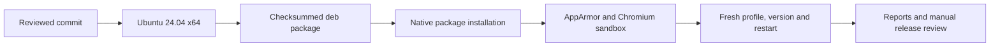

# Linux desktop release

English | [中文](design.zh.md)

Reference for an independent Ubuntu 24.04 x64 desktop preview. This batch adds a Debian package to the same APUS Reflex Harness 0.1.0 candidate as macOS, Windows and Web. Every published artifact must name the same reviewed source commit. Linux ARM64, other distributions, AppImage and Web deployment remain separate qualifications.

## Packaging

The native workflow uses `ubuntu-24.04`, builds the locked runtime and desktop, and collects `apus-reflex-harness-linux-x64.deb`. The package and executable name are `apus-reflex-harness`; the visible product name remains APUS Reflex Harness. Linux metadata uses the `-linux-x64` suffix. Existing macOS and Windows artifact names remain unchanged. The installer includes Node and all required runtime packages; users need neither Git nor Node to start the application.

The pinned electron-builder Debian installer owns the application-specific AppArmor profile, user-namespace allowance and setuid helper installation. Its default installation and removal scripts remain intact. No product launcher disables Chromium sandboxing. See the [upstream Linux configuration](https://github.com/electron-userland/electron-builder/blob/master/website/docs/linux.md); implementation follows the pinned version rather than newer launcher behavior.

## Installation acceptance

`scripts/product-linux-smoke.mjs --installer <absolute deb> --report-dir <absolute directory>` runs as an ordinary user on native Linux x64. It refuses an existing installation, checks package identity and the collected checksum, installs with the system package manager, and verifies the installed runtime against the source revision. A private profile and a controlled PATH exclude inherited credentials, Git and external Node. The runner supplies Xvfb and a session bus; ordinary users use their desktop session.

Only the disposable GitHub runner enables `kernel.apparmor_restrict_unprivileged_userns=1` for acceptance. The script requires that restriction and the application's installed AppArmor profile. Playwright uses `chromiumSandbox: true`; the application must not carry a `no-sandbox` switch. The active window's real renderer PID comes from Electron, and `/proc/<pid>/status` must report Seccomp filtering and no-new-privileges. Reports record observed values, never substitute assumed sandbox success.

The installed application must reach home, display its product version, exit without owned processes, restart, and exit again. The package is then uninstalled; its executable, AppArmor policy file and loaded kernel profile must disappear. The temporary user data directory is removed after shutdown. Screenshots and a bounded redacted JSON report remain available even when acceptance fails. Cleanup targets only the acquired installation and processes. This check does not exercise a real model request or qualify every Linux desktop environment.

The installed Landlock launcher must report kernel enforcement and run both a shell and the bundled Node. Both must write inside an explicit allowed directory; a write to a separate file must fail with EACCES or EPERM and leave its bytes unchanged. The parent first writes that file successfully, ruling out an ordinary permission failure. The installed native package must include the launcher and both declared flock addons.

## Files and verification

Changes are limited to release/manifest.json, frontend/package.json, scripts/product.mjs and its declarations/tests, scripts/product-release.mjs and its tests, the manual product-release workflow, a Linux installation smoke script and tests, and this design pair. Linux setup and packaging build the complete native system payload and verify its binary formats before runtime assembly; other platforms and model providers are unchanged. No new JavaScript dependency or product API is required.

Focused checks cover platform flag selection, Linux asset naming, cross-platform metadata preservation, invalid installed identities, credential-free environments and rejected sandbox observations. Native CI builds the actual Debian package, checks its installed user-facing behavior, and uploads artifacts for review with read-only repository permissions. Only reviewed artifacts are published separately. Maintainer validation and public installation instructions precede the Linux release claim.
