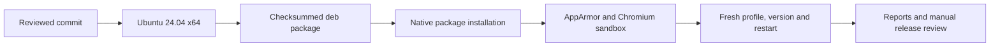

# Linux 桌面发布

[English](design.md) | 中文

本文说明独立的 Ubuntu 24.04 x64 桌面预览版。本批为 APUS Reflex Harness 增加 Debian 安装包，与 macOS、Windows 和 Web 使用同一个 0.1.0 候选版本。所有已发布产物必须指向同一已审查源码提交。Linux ARM64、其他发行版、AppImage 和 Web 部署分别验收。

## 打包

原生工作流使用 `ubuntu-24.04`，构建锁定的运行时和桌面，并收集 `apus-reflex-harness-linux-x64.deb`。Debian 目标显式固定该文件名，因为构建器会将架构宏展开为 `amd64`。软件包及可执行文件名为 `apus-reflex-harness`，产品展示名称仍为 APUS Reflex Harness。Linux 元数据使用 `-linux-x64` 后缀。现有 macOS 和 Windows 产物名称保持不变。安装包携带 Node 和全部必要运行时依赖；用户启动应用无需安装 Git 或 Node。

锁定的 electron-builder Debian 安装器负责应用专属 AppArmor 配置、用户命名空间许可和 setuid 辅助程序安装，保留其默认安装和卸载脚本。产品启动器不会关闭 Chromium sandbox。配置参考[上游 Linux 文档](https://github.com/electron-userland/electron-builder/blob/master/website/docs/linux.md)，实现遵循锁定版本而非更新版本的启动器行为。

## 安装验收

`scripts/product-linux-smoke.mjs --installer <absolute deb> --report-dir <absolute directory>` 在原生 Linux x64 上以普通用户运行。它拒绝已有安装，检查包身份和收集的校验和，通过系统包管理器安装，然后核对安装后运行时与源码提交。私有配置目录和受控 PATH 排除继承的凭据、Git 和外部 Node。runner 提供 Xvfb 和会话总线；普通用户使用自己的桌面会话。

仅临时 GitHub runner 为验收开启 `kernel.apparmor_restrict_unprivileged_userns=1`。脚本要求此限制已开启且应用 AppArmor 配置已安装。Playwright 使用 `chromiumSandbox: true`，应用不得携带 `no-sandbox` 开关。活动窗口的真实渲染进程 PID 由 Electron 提供，`/proc/<pid>/status` 必须显示 Seccomp 过滤和 no-new-privileges。报告记录观测值，不以假定值代替沙箱成功证据。

已安装应用必须进入主页、显示产品版本、退出且不残留自有进程、重启并再次退出，随后卸载软件包，确认可执行文件、AppArmor 配置文件及内核中已加载的配置均已移除，退出后删除临时用户数据目录。即使验收失败，也保留截图和长度受限的脱敏 JSON 报告。清理仅处理本次安装及其自有进程。此检查不调用真实模型，也不代表所有 Linux 桌面环境均已验收。

安装后的 Landlock 启动器必须报告内核执行限制，并运行 shell 和包内 Node。两者均须能写入明确授权的目录；写入另一个文件必须返回 EACCES 或 EPERM，且该文件内容保持不变。父进程先成功写入该文件，以排除普通文件权限造成的拒绝。安装后的 native 包必须包含启动器及两个已声明的 flock addon。

## 文件与验证

修改限定为 release/manifest.json、frontend/package.json、scripts/product.mjs 及其声明和测试、scripts/product-release.mjs 及其测试、手动 product-release 工作流、Linux 安装验收脚本及测试和本设计双语文档。Linux setup 和打包会在运行时装配前构建完整 native system 产物并验证二进制格式；其他平台和模型提供商保持不变，无需新增 JavaScript 依赖或产品 API。

定向检查覆盖平台参数选择、Linux 产物命名、跨平台元数据保留、错误安装身份、无凭据环境和不满足沙箱要求的观测结果。原生 CI 构建真实 Debian 安装包，检查安装后的用户流程，并以仓库只读权限上传产物供审查；审查通过后另行发布。维护者验证和公开安装说明先于 Linux 已发布的声明。
