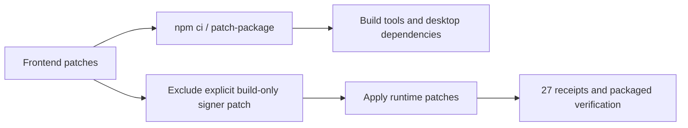

# Desktop runtime patch scope

English | [中文](runtime-patch-scope.zh.md)

## Goal and design

Desktop preparation applies runtime compatibility patches to the deployed production dependencies. The `@electron+osx-sign+1.3.3.patch` file belongs to the build tools: frontend `npm ci` applies it through `patch-package`, while runtime preparation excludes that exact file. Missing targets in any runtime patch remain fatal. Packaged verification continues to require 27 runtime patch receipts and strict macOS signature verification.

## Files and API

`frontend/scripts/patch-system3-runtime.mjs` owns the explicit exclusion; its `patchSystem3Runtime(stage, appRoot)` API and receipt format stay unchanged. `frontend/test/system3-runtime-patch-scope.test.mjs` owns regression coverage. This document and its translation describe the packaging constraint. No product configuration, signing policy, dependency version or UI changes are required.

## Validation

Focused filesystem tests exercise the real patch applicator: an absent build-only signer is excluded, an ordinary runtime patch applies and records its receipt, and an absent runtime target rejects preparation. Formal packaging and native installation qualification remain separate acceptance steps; unit results do not establish an installer is ready.
