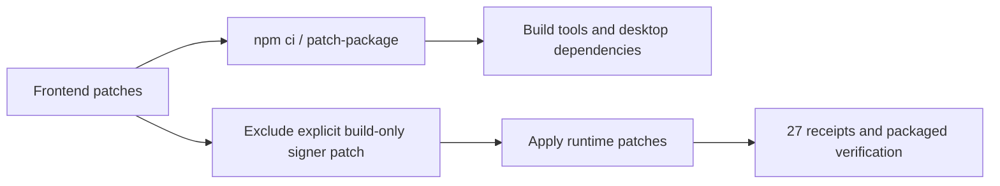

# 桌面运行时补丁范围

[English](runtime-patch-scope.md) | 中文

## 目标与设计

桌面准备流程将运行时兼容补丁应用到部署后的生产依赖。`@electron+osx-sign+1.3.3.patch` 属于构建工具：前端 `npm ci` 通过 `patch-package` 应用它，运行时准备则排除这个精确文件。任何运行时补丁的目标缺失仍会导致失败。包内验证继续要求 27 条运行时补丁收据及严格的 macOS 签名验证。

## 文件与 API

`frontend/scripts/patch-system3-runtime.mjs` 负责明确排除规则；`patchSystem3Runtime(stage, appRoot)` API 和收据格式保持不变。`frontend/test/system3-runtime-patch-scope.test.mjs` 负责回归覆盖。本文及其译文说明打包约束。无需修改产品配置、签名策略、依赖版本或 UI。

## 验证

定向文件系统测试执行真实补丁应用器：缺少构建专用签名工具时排除其补丁，普通运行时补丁正常应用并记录收据，运行时目标缺失则拒绝准备。正式打包和原生安装验收仍是独立步骤；单元测试通过不代表安装包已经可交付。
