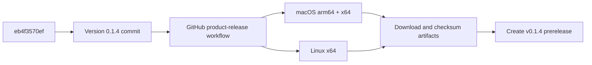

# v0.1.4 macOS/Linux preview release

## Goal

Publish a new APUS Reflex Agent preview from `feat/reflex-page-lifecycle` while Windows qualification is still blocked. The release will contain Full and Lite installers for macOS arm64, macOS x64, and Linux x64. Windows remains explicitly unavailable for this preview.

## Release flow

The workflow runs separately for each native target and edition. It does not publish a GitHub Release itself; release creation and artifact upload remain a deliberate final step after all selected targets pass.

## File changes

- `release/manifest.json`: bump product version to `0.1.4`.
- `frontend/package.json`: keep the desktop package version aligned.
- `frontend/package-lock.json`: keep the lockfile root version aligned.
- `docs/release-v014-mac-linux/design.md`: record the selected platform scope and release flow.

## Checks

- Validate the three version owners with `scripts/product-release.mjs check`.
- Run the focused product release tests where available.
- Dispatch `APUS preview installers` with `target=mac`, `target=mac-intel`, and `target=linux`, `edition=both`.
- Create the `v0.1.4` prerelease only after all six selected artifacts and their support files are available.
- State clearly in the release notes that Windows is pending qualification.
