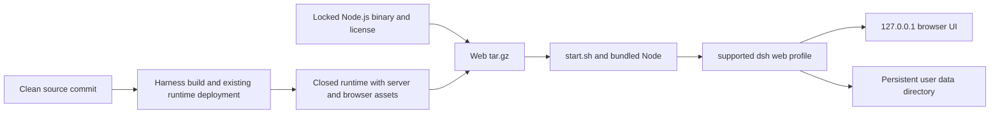

# Web runtime archive design

English | [中文](design.zh.md)

## Goal

Provide one Linux x64 archive that starts the complete APUS Reflex Harness Web application without a checkout, Git, pnpm, an external Node.js installation, or Electron. Native Linux CI qualifies the extracted archive before release publication. Model calls still require a user-configured provider and network access.

## Architecture

The Linux workflow builds all native system binaries with `native/system`’s `build:native` before deployment and verifies their ELF formats. The root Harness build alone emits only the host Node-API addon; it does not supply the Landlock launcher. The collector requires the Landlock executable and both declared Linux x64 libc addons.

The package reuses `frontend/.build/system3-runtime`, including the own CLI, Web bundle, browser distribution, native modules and dependency inventory. It does not apply `desktop.patch.yml` or launch Electron. A first-run initializer uses the existing app-boot profile functions to add the Jev, System3, and Continuum bundles, which own the editable defaults. The Web overlay renders the native Reflex page and disables optional session upload. Empty credentials remain valid at startup.

The launcher selects bundled Node by an absolute package-relative path, keeps data outside the extracted installation, and invokes the supported CLI `web` profile. It accepts a port and a data-directory override; the listener remains on `127.0.0.1`. Existing profiles are preserved. Replacing an extracted installation does not remove user data. Advanced plugin installation may require separate development tools and is outside the no-tools startup guarantee.

## Files and interfaces

- `scripts/product-web-package.mjs` collects a clean, same-commit deployed runtime, checks native Linux x64 identity and the pinned Node version, writes file hashes, creates the archive, and emits independent Web build metadata and checksums.
- `scripts/product-web-launch.mjs` is copied into the archive; it initializes only a missing profile and hands application startup to the supported CLI. `start.sh` uses the bundled executable.
- `scripts/product-web-smoke.mjs` extracts the actual archive into a private temporary directory, removes external tool lookup and credentials, starts with port zero, verifies HTTP and browser configuration pages, then restarts with the same data and awaits process exit.
- Focused Node tests cover archive identity rejection, external links, launch arguments, data paths, and sanitized qualification environments.
- `.github/workflows/product-web-release.yml` builds natively on Ubuntu, deploys the existing runtime, collects the archive, runs qualification, and uploads review artifacts. Pushes to `release-web-runtime` and the shared `release-windows-product` candidate run qualification before merge; manual dispatch remains available after workflow registration. It does not publish automatically.

The collector fails on dirty source, mismatched revision or target, missing server/browser/native assets, dependency inventory drift, an unexpected Node version, or a link that escapes the package. Build metadata records source revision, source archive hash, lockfile hashes, bundled Node hash, and the final archive hash. Licenses remain with packages; root notices and the full Node license also ship in `licenses/`.

## Product version

Complete builds read the optional `release/manifest.json` product version into `DSH_CLIENT_PRODUCT_VERSION`, replacing any inherited value. An absent manifest preserves generic Harness builds; an existing invalid manifest fails. `DSH_CLIENT_VERSION` remains the Harness package version. Default and official builds carry both values. Settings and the sidebar prefer the Desktop carrier’s product version, then the product build value, then the Harness version. Collection verifies the product value, commit and clean state through the existing artifact-bound client build record. Native qualification checks the General Settings version and home badge against the release receipt.

## Verification

Unit tests run without generated Harness artifacts. Native qualification executes the shipped launcher with a fresh profile from an extracted archive outside the checkout. Its process environment contains no inherited API keys and its PATH contains no Node, Git, or pnpm. Readiness comes from the CLI's authenticated loopback URL, not a fixed sleep. The extracted bundled Node must match the version and target recorded in the build receipt. The bundled Landlock launcher must report enforcement, run a shell and Node with writes allowed in a private directory, and deny a write outside that directory. Browser checks exercise the actual Models and Reflex pages. A persistent profile survives restart. Screenshots and a redacted report accompany each candidate; authenticated URLs and tokens never enter those reports. Qualification does not claim a successful external model task without provider credentials.
