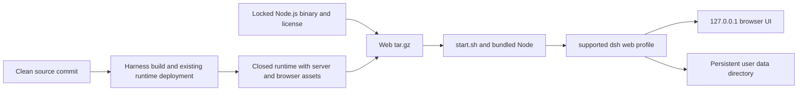

# Web 运行包设计

[English](design.md) | 中文

## 目标

提供一个 Linux x64 压缩包，无需代码仓库、Git、pnpm、外部 Node.js 或 Electron 即可启动完整 APUS Reflex Harness Web 应用。发布前由原生 Linux CI 验收解压后的压缩包。模型调用仍需用户配置服务商并具备网络访问能力。

## 架构

Linux 工作流在部署前执行 `native/system` 的 `build:native`，构建全部原生系统二进制并验证 ELF 格式。根 Harness 构建仅生成宿主 Node-API addon，不包含 Landlock 启动器。收集器要求 Landlock 可执行文件与 Linux x64 声明的两种 libc addon 均存在。

压缩包复用 `frontend/.build/system3-runtime`，包含自有 CLI、Web bundle、浏览器构建产物、原生模块及依赖清单。它不应用 `desktop.patch.yml`，也不启动 Electron。首次初始化使用现有 app-boot profile 函数加入 Jev、System3 与 Continuum bundle，可编辑的默认配置由它们提供。Web overlay 加载原生 Reflex 页面并禁用可选的会话上传。启动时允许凭据为空。

启动器通过相对压缩包解析的绝对路径选择内置 Node，将数据保存在解压目录之外，并调用受支持的 CLI `web` profile。它接受端口和数据目录参数；监听地址固定为 `127.0.0.1`。已有 profile 保持不变。替换解压目录不会删除用户数据。高级插件安装可能需要另行安装开发工具，不属于无需工具即可启动的保证范围。

## 文件和接口

- `scripts/product-web-package.mjs` 收集同一干净提交的部署运行时，检查原生 Linux x64 身份与锁定的 Node 版本，记录文件哈希，生成压缩包及独立 Web 构建信息和校验和。
- `scripts/product-web-launch.mjs` 被复制到压缩包中，仅初始化缺失的 profile，并通过受支持的 CLI 启动应用。`start.sh` 使用内置可执行文件。
- `scripts/product-web-smoke.mjs` 将实际压缩包解压到私有临时目录，排除外部工具和凭据，使用端口零启动，验证 HTTP 和浏览器配置页面，再复用数据重启并等待进程退出。
- 定向 Node 测试覆盖压缩包身份拒绝、外部链接、启动参数、数据路径和验收环境清理。
- `.github/workflows/product-web-release.yml` 在 Ubuntu 原生构建并部署现有运行时，收集压缩包，运行验收，上传审查产物。推送到 `release-web-runtime` 或共用候选分支 `release-windows-product` 时可在合并前触发验收；工作流注册后仍可手动触发。它不会自动发布。

源码不干净、提交或平台不一致、服务端或浏览器或原生资源缺失、依赖清单漂移、Node 版本异常、链接逃出包目录时，收集器均会失败。构建信息记录源码提交、源码压缩流哈希、锁文件哈希、内置 Node 哈希和最终压缩包哈希。许可证保留在各包中；根目录声明和完整 Node 许可也随 `licenses/` 分发。

## 产品版本

完整构建从可选的 `release/manifest.json` 读取产品版本并写入 `DSH_CLIENT_PRODUCT_VERSION`，覆盖任何继承值。缺少 manifest 时保留通用 Harness 构建；存在但无效时构建失败。`DSH_CLIENT_VERSION` 仍为 Harness 包版本。默认及 official 构建均携带这两个值。设置和侧栏优先使用桌面宿主的产品版本，其次为产品构建值，最后为 Harness 版本。收集器通过绑定实际客户端产物的既有构建记录验证产品值、提交和干净状态。原生验收根据发布构建信息检查通用设置版本及主页徽标。

## 验证

单元测试不依赖 Harness 生成产物。原生验收从仓库之外的解压目录执行实际启动器，使用新 profile。进程环境不继承 API 密钥，PATH 中没有 Node、Git 或 pnpm。就绪状态来自 CLI 输出的经过认证的本地 URL，不使用固定等待时间。解压后的内置 Node 必须与构建信息中的版本和平台一致。内置 Landlock 启动器必须确认沙箱已启用，允许 shell 和 Node 写入私有目录，并拒绝写入该目录之外。浏览器检查实际 Models 和 Reflex 页面。持久化 profile 在重启后仍可读取。每个候选包附带截图和脱敏报告；认证 URL 和令牌不会进入报告。未配置服务商凭据时，验收不会声称已完成外部模型任务。
