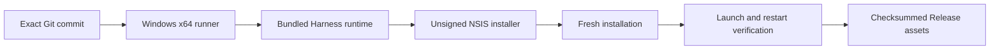

# Windows 0.1.0 release

English | [中文](design.zh.md)

Reference for the native Windows preview distribution. The integrated product is already on main; this change qualifies Windows x64 and adds it to the same 0.1.0 release.

The manual workflow checks out its dispatch commit, validates product version 0.1.0, builds native dependencies and the desktop, then installs the actual NSIS artifact into a temporary directory. The installed application must start its bundled backend with no external Node on PATH. It must show the product UI on first launch and after restart. Reports omit credentials and token URLs. Unsigned preview limitations are stated in the release.

Changed files are release/manifest.json, .github/workflows/product-release.yml, scripts/product-release.mjs, a Windows installer smoke script and their focused tests. Product README, installation instructions and release notes describe Windows downloads. No product API changes are required. Windows metadata filenames include the target to coexist with existing macOS artifacts. Every platform records its exact source revision and asset hashes.

Verification covers collector rejection paths, workflow configuration, native Windows compilation, installed application launch/restart, artifact hashes and release download availability. Local checks include relevant tests, lint, documentation gates and both Ruff checks before push. Publication precedes merging this Windows followup into remote main, as authorized by the user.
