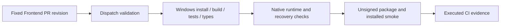

# System3 Desktop PR verification

## Goal

Obtain executed CI evidence for the existing Frontend PR before merge. The last run for this branch failed before any job step because of an Actions budget restriction. A successful local Desktop acceptance remains separate evidence.

## Workflow and authority

The existing `release.yml` admits pull requests to `validate-dispatch` and `windows-x64`. The Windows job installs dependencies, builds, runs tests and type checking, checks native startup, and builds and smokes an unsigned development package. macOS jobs require a tag or explicit dispatch. Signing, publication, mirroring, and release notifications require tag or dispatch conditions that this PR run does not satisfy.

## Change scope

First rerun the existing failed PR run without changing source or workflow behavior. Inspect the first actual failure before selecting a repair. The workflow has no explicit own-Harness preparation step; whether the clean runner reaches this packaging prerequisite must be established from its execution. A follow-up workflow repair must document the pinned Harness input, its read access, target-specific preparation, and resulting runtime manifest. Do not replace package or native evidence with a source-only check.

The initial files are this plan, `tasks/todo.md`, and the worktree handoff. Application interfaces, installed resources, credentials, and deployment settings are outside this verification step. Do not change budget limits, expose a development token to a workflow, publish a release, or merge on unexecuted checks.

## Validation

- Verify the run is `pull_request`, belongs to the intended repository and fixed PR head, and cannot enter publication jobs.
- Rerun the previously unstarted check once; inspect job steps and annotations, not only the workflow conclusion.
- If a test executes and fails, preserve its log and implement a focused regression-backed repair.
- If infrastructure still prevents execution, report the exact blocker and continue independent design work.
- Match eventual CI evidence to the remote PR head; retain the separate Desktop and server acceptance limits.

## Executed findings and repair

The second PR attempt started successfully, installed dependencies and built the app. Its Windows test step reported 1548 passed, two failed and four skipped. The release-document assertion still expected upstream download channels in all six fork READMEs; those documents already point to own-runtime packaging. The identity fixture expected POSIX separators even on Windows. Update the two owning test files: assert the fork's actual download policy across all six translations, and construct identity fixture paths with the platform path API. No product source behavior changes are needed for these failures. The focused local run reproduced the stale README assertion; Windows execution is still required to close the path regression.

## Windows 自有 Runtime 装配修复

CI 在 Windows runner 上以固定 reviewed Harness revision 构建，使用只读单仓库 Deploy Key；checkout 不持久保存凭据。Frontend 默认 GITHUB_TOKEN 不具备私有 Harness 跨仓读取能力，未配置凭据时明确失败。现有模型凭据不进入工作流。

打包前准备 deployed 闭包并验证 manifest、目标平台、sourceRevision、7 个自有包与 27 个兼容补丁；Electron Node 探针启动闭包内的 dsh。保留独立目录下的真实安装包 smoke。修正 Windows 产品 exe、userData 与产物上传名称。pnpm 子进程用 Node 执行固定 CLI，Windows 显式配置 Git for Windows 的 GNU patch。

范围为已有 Windows PR 验证链修复，不发布版本、不启用签名、不改服务器或已安装 Desktop。macOS 发布链继续单独验收，不用 Windows 结果替代。回归覆盖现有全量 Frontend 测试、类型检查、构建，以及 Windows 原生 CI 的闭包/打包/启动。

## Windows CSS region failure

[The first repaired Windows run](https://github.com/cryptoSUN2049/xDAN-System3-Frontend/actions/runs/36865555120) passed Frontend tests/types, private pinned checkout, the full Harness build and dependency deployment. The conversation compatibility patch then rejected hunks 1 and 6. The adapter only recognized POSIX `/packages/` source-region paths; Harness's virtual CSS IDs retain Windows path separators.

A local probe using the actual unpatched conversation bundle reproduces two rejected hunks when only source-region separators change. Normalize separators solely while matching the package-relative stylesheet path, retain the target's exact comment, and reject ambiguous origins. The full 27-patch / 37-target simulation passes with Windows region paths; changed executable context remains rejected. Six focused regression cases and the full 174-file / 1565-test suite pass locally. Native Windows packaging still requires another executed run.

## GNU patch context failure

[The Windows CSS repair run](https://github.com/cryptoSUN2049/xDAN-System3-Frontend/actions/runs/36868256274) passed the CSS patches and rejected the final undici hunk. Local GNU patch reproduced the same failure; BSD patch accepted the same input. GNU treats a hunk with more leading than trailing context as an end-of-file match. The maintained last hunk had three leading and two trailing context lines, but more methods follow it. Add unchanged surrounding context to balance four lines on each side; dependency versions and executable changes stay the same. Both GNU and BSD now apply all 27 patches / 37 targets, and changed business context still fails. Native CI supplies GNU patch before the regression tests.

## Windows tool selection

[The GNU regression run](https://github.com/cryptoSUN2049/xDAN-System3-Frontend/actions/runs/36871021141) passed both new native patch tests. One existing build-approval integration test failed because adding Git's entire usr/bin directory to PATH selected GNU tar, which interpreted the Windows drive prefix as a remote archive. Select only patch.exe through `SYSTEM3_PATCH_COMMAND`; preserve the runner's original tar and other tools. Patch subprocess tests use an explicit timeout.
