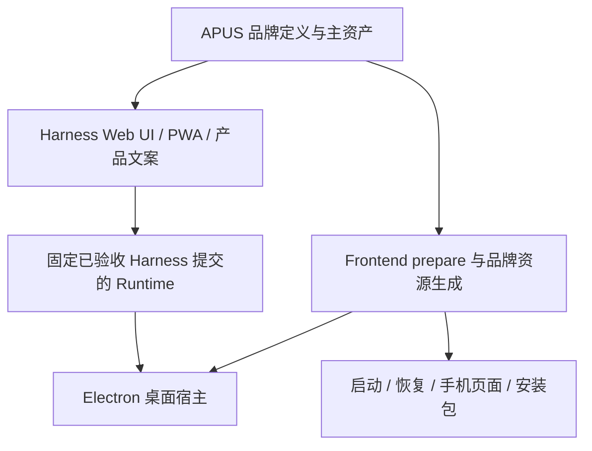

# APUS Reflex Harness 全品牌统一设计

状态：待设计批准，未实施。范围：APUS-Reflex-Harness 与 APUS-Reflex-Frontend 的自有产品品牌。依据：用户指定的 report-ceo-onepage.html，以及本轮两仓静态核查。

## 品牌定义

| 项目 | 统一值 |
| --- | --- |
| 产品与 Harness 英文全称 | APUS Reflex Harness |
| 中文名 | 瞬策 |
| 品牌字标 | APUS / REFLEX |
| Slogan | 瞬时执行，深度思考 |
| 产品定位 | Model as Harness · 大小脑混合模型架构 |

窗口标题、应用名称、安装包产品名和关于页面使用完整英文名称；中文介绍补充“瞬策”。Slogan 用于欢迎页和关于页。窄空间字标采用报告的 APUS / REFLEX，辅助访问名称保留全称。报告没有独立图形 logo，首版以该字标生成一致的图标资产，不引入未经确认的动物标志。战略目标不写成已验收功能。

## 联动架构

Frontend 是 Electron 宿主，装配 Harness Runtime 和共享 Web UI，并覆盖部分品牌 slot。共享品牌定义和矢量主资产由 Harness 产品层持有，Frontend 在 runtime prepare 阶段读取并生成自己的原生资源；构建时校验两端名称一致，无需运行时请求品牌接口。

## 文件范围

以下是已确认的入口；实施时先沿各入口追踪消费者，补全同类产品文案。生成资源从原始定义生成。

| 仓库 | 文件或目录 | 调整 |
| --- | --- | --- |
| Harness | README.md、README.zh.md | 产品定义、APUS 仓库路径，保留上游事实 |
| Harness | apps/web/index.html、apps/web/public/manifest.webmanifest、favicon 与图标 | 完整名称、PWA 与浏览器资产 |
| Harness | packages/client/ 的品牌组件、共享 primitives 与用户可见 locale | sidebar、hero、欢迎、设置、预览与提示文案；按实际产品装配区分上游服务名称 |
| Harness | packages/experimental/client-ui-system3/src/client/locales.ts | 产品可见 System3 标识统一 |
| Harness | apps/desktop/ 与 apps/cli/ 的自有产品展示入口 | 与实际发布入口一致；内部 dsh 命令不改 |
| Harness | deploy/system3/ 与当前维护的自有产品文档 | 装配品牌插件、产品说明；旧验收记录不改写 |
| Frontend | package.json、electron-builder.dev.cjs、src/main/system3-identity.ts | 产品名称、开发版后缀与安装产物 |
| Frontend | packages/dsh-desktop-client-ui/client.js、build/dsh-desktop.patch.yml | 消费共享品牌，替换鲸鱼覆盖 |
| Frontend | src/main/index.ts、windows-menu.ts、version-info.ts | 菜单、托盘、关于、窗口与手机资产 |
| Frontend | src/preload/index.ts、update-view.ts | 关于和更新视图 |
| Frontend | build/splash.html、web-import.html、safe-mode.html、plugin-recovery.html、src/main/safe-mode.ts | 启动、导入、安全模式、恢复与失败提示 |
| Frontend | src/main/mobile/lan-mobile-pages.ts、src/main/repair-agent.ts | 手机页面与修复助手身份文案 |
| Frontend | build/brand-mark.svg 及原生图标、scripts/install-brand-assets.mjs | 从统一主资产生成全套图标 |
| Frontend | src/main/desktop-service/index.ts、src/main/update/update-manager.ts | 消除 app.name.startsWith('xDAN System3') 对策略的控制 |
| Frontend | scripts/prepare-system3-runtime.mjs、.github/workflows/release.yml | 品牌校验、已验收 Harness SHA 与发布装配 |
| Frontend | README.md、README.zh.md、对应测试 | 当前产品描述和回归证据 |

## API 与兼容要求

品牌是展示与构建输入，不改 HTTP/WebSocket 路由、SDK 字段、Session 事件、插件 ID、包作用域或模型 ID。保留 dsh CLI、SYSTEM3_* 配置和已有数据目录。appId、系统协议及内部 runtime product 标识保留兼容，显示名独立更新。DeepSeek 模型名、真实上游账户服务、许可证和第三方署名保持准确。

Frontend 停用上游自动更新和诊断服务的策略必须由明确产品配置控制，不能再从显示名称推断。保留当前停用行为，并验证改名后仍成立。

共享品牌输入至少包含完整产品名、中文名、字标、Slogan 和主资产引用；prepare 校验必需字段与产物一致性，缺失时明确失败。具体导出位置在批准后遵循现有包依赖与资源生成机制选择，避免新增仅供品牌使用的运行时服务。

## 工作树与发布顺序

两仓 main 在核查开始时干净。Harness 的 feat-reflex-experience 已有大量未提交功能改动，其中 Web/PWA 标题已部分改为 Reflex Harness；不能覆盖或整批收进品牌提交。实施使用独立 feat-apus-brand 工作树，并记录与体验分支相同文件的集成点。Frontend 对应工作树在写入前重新核查状态。

Frontend release 当前固定旧 Harness 提交，改 Harness main 不会自动改变安装包。先完成 Harness 品牌验收与提交，再更新 Frontend 的固定版本并重新 prepare、打包、验证。发布、替换用户安装版与向远端推送不作为本次默认动作。

## 验收计划

- 静态扫描自有产品中的 xDAN System3、DSH Desktop、DeepSeek Harness、Reflex Harness；逐项判定展示文案、兼容标识或真实上游事实，不做盲目全局替换。
- Harness：相关品牌/locale/浏览器测试、客户端文案校验、受影响类型与构建；模型可见身份文案若变更，更新对应 keyless session snapshot。
- Frontend：system3-identity、branding-patch、更新与诊断策略回归，runtime prepare 与实际打包验证；检查旧 profile 和历史会话可读取。
- 真实界面：Web 和 Electron 的侧栏、hero、欢迎、菜单、关于、更新、启动失败、安全模式、恢复、手机页；明暗主题与窄屏下名称、图标及可访问名称一致。
- 文档执行相关 gate 和 git diff --check；推送前按仓库要求执行 lint、format 和 pre-push 检查。

本轮仅完成静态核查与设计，未运行产品构建或功能测试，未声称现有模型服务或体验功能通过验收。
