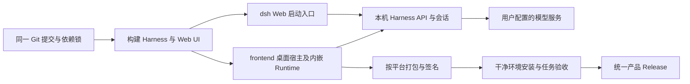

# APUS 前后端合仓、上手与 Release 方案

2026-10-12 · 用户已批准实施，并授权审查后公开现有仓库与 Release。本文记录拟议结构和验收标准，不是现有安装教程。延续 [README 价值提案](readme-value-proposal.html) 的 Model-as-a-Harness 定位，补齐用户获取、配置和发行路径。

## 结论

推荐以现有 `APUS-Reflex-Harness` 为统一产品仓库，将独立桌面宿主导入 `frontend/`，保留已有后端、Web UI 和包目录；通过根脚本统一安装、构建、启动和发行。普通用户优先下载安装包，开发者只 clone 一个仓库。第一阶段保留两套经过验证的依赖锁，由脚本管理，不要求用户协调两个仓库。

不额外创建仓库，也不整体搬动 Harness 到 `backend/`。沿用现有历史、CI、Issues 与产品名称；前端旧仓库在迁移验收后再决定归档，不能提前删除。统一仓库是产品入口，目录仍分别承担桌面宿主、Web UI 和运行时职责。

用户明确的一站式目标：源码用户 clone 后按根 README 的统一准备、启动步骤即可使用，不需另取前端源码、手动指定后端路径或拼接环境变量；安装版用户只下载安装并在界面完成必要配置。两条路径都必须用全新环境验证。首次依赖下载/构建耗时与用户提供模型凭证属于明确前提，不能把它们包装成零配置或离线即用。

## 已核实的现状

| 项目 | 证据与结果 | 对本次设计的影响 |
| --- | --- | --- |
| 仓库访问与发行 | 本轮 GitHub API 读取两仓 `private=true`，两个 Release 列表均为空 | 当前没有可供普通用户点击下载的 APUS Release；仓库公开与下载公开应单独决定 |
| Harness 已含 UI | [apps/web/package.json](../../apps/web/package.json)、[workspace](../../pnpm-workspace.yaml) 和 [架构](../architecture.md) 包含 Web、客户端插件及原生 Desktop | 独立 Frontend 是另一个桌面宿主，不是缺失的业务 Web 前端 |
| 桌面上手 | Frontend `docs/development.md` 要求双仓、两种依赖安装、Harness build、手动 `runtime:prepare --source` | 合仓重点是自动完成这条装配链 |
| 已验证平台 | Frontend README 与品牌交接记录 macOS arm64 未签名目录包；其他平台尚无已验证的 APUS 安装包 | 逐平台验收发布，不能沿用上游徽章宣布全平台支持 |
| 模型配置 | Frontend 开发文档要求 `JEV_API_KEY`、`SYSTEM3_LITELLM_API_KEY`，并说明远程推理 | 桌面打包完成不等于双模型能力已配置；首次启动必须覆盖所需凭证和连接验证 |
| 发布脚本 | Frontend `.github/workflows/release.yml` 存在多平台签名/发布流程和 `APUS_RELEASE_AUTOMATION` 条件；Windows 有独立 Harness checkout 与固定 revision | 不能原样复制上游发行流程并直接开启；各平台必须改成同一源码装配 |
| 许可原文 | 根 [LICENSE](../../LICENSE) 为 DeepSeek MIT；Frontend LICENSE 为 DataElement MIT；两仓另有第三方说明 | README 可缩短，许可原文和产物内通知需独立保留 |

Frontend 证据以本机 `APUS-Reflex-Frontend` main 的 README、开发指南、package.json 和工作流为准。当前没有重新执行安装、签名、构建或真实模型任务；既有验收记录不等于本轮复验。

独立审计还确认两项发行阻碍：Frontend `release.yml:162–163` 的 macOS job 安装后直接 build，没有准备自有 Runtime；Windows `:329` 先 build，`:344–359` 才准备 Harness。前端 build 调用 `verify-brand.mjs`，它要求尚未生成的 `.build/brand/brand.json`。这是源码推导的顺序缺口，尚未通过实际 CI 重现；实施时应先完成 Runtime/品牌准备，再构建与打包。固定 pin 落后 main 的近期提交属于文档、CI 和测试，不能仅据提交差认定产品行为过期。

## 推荐目录与职责

```text
APUS-Reflex-Harness/
├── README.md / README.zh.md       产品定位、下载、快速开始、配置入口、致谢
├── frontend/                     导入现有 Electron 桌面宿主
│   ├── src/main/                 窗口、进程生命周期、系统集成
│   ├── src/preload/              受限桌面 IPC
│   ├── packages/                 桌面 UI 扩展、onboarding、PPT 等
│   ├── scripts/                  桌面构建与打包
│   ├── package.json
│   ├── package-lock.json         初期保留，根脚本负责 npm ci
│   └── LICENSE                   保留 DataElement 原始 MIT
├── apps/web/                     现有 Web 应用入口
├── apps/cli/                     现有 dsh 启动入口
├── apps/desktop/                 保留原 Harness 宿主，非 APUS 发行入口
├── packages/                     现有 Harness 能力与共享 Web UI
│   ├── client/                   两个入口复用的业务 UI
│   ├── api/                      原生 API / 事件
│   └── experimental/system3/     大小脑协同扩展
├── deploy/system3/               产品配置与运行时装配
├── scripts/                      新增统一 setup / dev / package 编排
├── release/manifest.json         拟新增：产品版本、渠道、发行平台清单
├── .github/workflows/            单仓检查与产品发行
├── docs/feat-integrated-product/  本轮实施的教程与设计产出
├── tasks/feat-integrated-product/ 计划与交接
├── pnpm-workspace.yaml / pnpm-lock.yaml
├── LICENSE                       保留 DeepSeek 原始 MIT
└── THIRD_PARTY_NOTICES.md         全产品通知入口，保留生成规则
```

`frontend/` 名称便于理解，但它的职责是桌面宿主；业务 UI 仍由 `apps/web` 与 `packages/client` 维护。不要复制两份页面。暂不加入 `apps/*` workspace，避免 Electron、TypeScript、pnpm 版本与原 npm 补丁流程在第一次迁移时同时变化。今后是否统一锁文件由实际维护收益决定。

现有根 `dev:desktop` 已指向 `apps/desktop`，实施必须明确改接 APUS 宿主，并给维护原宿主的命令另设名称、更新消费者；不能让用户启动错误产品。原生 `appId`、数据目录和 Session 格式不随新仓库名改变。



图中两种入口各自使用其启动的 Runtime，不要求 Desktop 和 Web 共用一个运行进程。模型服务是外部配置依赖；“本机运行”不表示推理离线。

## 两条用户路径

### 普通用户：下载 → 配置 → 首个任务

README 第一入口是经过验收的安装包。安装包应自带桌面宿主、Node 运行时、Harness、Web 静态资源及首次启动所需插件；用户无需安装 Git、Node、pnpm 或单独启动后端。开发工具、浏览器扩展及高级插件等可选依赖应在使用相应功能时说明。

首次启动提供两种明确模式：普通模型任务配置 Provider、Base URL、API Key、Model；APUS 协同模式进一步配置 Jev 与推理模型。允许普通模式先完成真实任务，但界面明确当前未启用协同功能；用户主动启用协同模式时，缺配置或连接失败必须展示错误及恢复动作，不能伪装成已经启用。

配置教程覆盖：下载与安装、选择工作目录、填写模型信息、连接测试、发送一次真实任务、重启后恢复、常见错误。连接测试必须验证实际响应，不能只凭端口通或 HTTP 200 判断可用。凭证通过本地凭证机制保存，不写入仓库、安装包、示例或日志。具体字段以实现后的设置界面为准。

现有 Frontend onboarding 的 `packages/dsh-desktop-onboarding/client.js:65–86` 主要是内测声明，`:261–263` 仅跳转模型设置。可将其简化为配置与首个任务引导，但这是产品 UI 改动，需要同步本地化与用户流程测试。现有生产 System3 patch 含特定服务地址、候选模型和数据类别，不能直接作为每个新用户的默认配置；协同模式需要明确远程传输范围。

### 开发者：一次 clone → 一个准备入口 → 启动

拟议根脚本命令为 `pnpm run setup`、`pnpm run dev:desktop`、`pnpm run dev:web`；其中 setup 脚本尚不存在，现有 dev 脚本也尚未改接新的装配流程，不能作为当前教程执行。

setup 负责校验 Node 和包管理版本、从锁文件安装两端依赖、顺序构建 Harness、准备品牌及桌面 Runtime；自动从仓库根定位源码，不再要求 `--source ../另一个仓库` 或私有跨仓凭证。重复运行必须可恢复，阶段失败明确报告原因；不在依赖安装钩子里暗中做完整产品构建。

正式 README 只在干净 clone 验证通过后写入可执行步骤。开发依赖不因合仓消失；下载 GitHub 的 Source code ZIP 也不等于下载客户端。首版可先承诺 Git clone 路径，源码 ZIP 支持单独验证，不把依赖 `.git` 的脚本说成 ZIP 可用。

当前 Harness 要求 Node `^22.19.0 || >=24.0.0` 与 pnpm `11.7.0`，构建还会执行原生编译；`native/system/scripts/build.ts` 检查 Node headers 并调用 C 编译器。setup 需检查这些条件并给出平台对应修复说明，不能宣称开发者只安装 Node 就必然能运行。

## Release：一个产品版本，一套可核查产物

建议先采用预览渠道，例如 `v0.1.0-beta.1`，具体首版号需对照已有应用版本及升级比较后确定。产品版本独立于上游 DSH `0.1.7-rc.2` 和 Session 格式版本；不得为了外观统一批量改写所有 `@deepseek-ai/dsh-*` 包版本。

`release/manifest.json` 作为产品版本和目标平台的唯一声明；发行脚本同步桌面版本并校验 tag 一致。构建产物另生成 `build-info.json`，记录产品版本、完整 Git 提交、Harness 基线、平台、架构及两份依赖锁摘要。避免把当前提交 hash 写回同一提交而形成自引用；本地开发可标 dirty，发行必须干净。

| 内容 | 首版方案 |
| --- | --- |
| 渠道 | beta / rc 明确标 Pre-release；达到稳定标准后才发布 stable |
| macOS arm64 | 优先验收；面向普通用户的 DMG 应完成签名、公证与全新安装测试 |
| Windows x64 | EXE/NSIS；独立验证自有 Runtime、签名、安装、升级与卸载 |
| macOS Intel | 取得对应平台安装验收后加入同一产品版本 |
| Linux / Windows ARM64 | 暂不显示下载按钮，不以脚本或上游支持代替验收 |
| 每个版本附件 | 安装包、SHA256SUMS、build-info、变更说明、完整许可/通知材料 |
| 发布步骤 | tag 对应提交 → 构建 → 测试/签名/安装验收 → Draft Release → 发布 |
| 失败处理 | 必需平台失败则不发布；可选平台可不进入该版本清单，不制造空下载链接 |
| 更新策略 | 首版可手动更新并保留数据；自有更新 feed 验证后再启用自动更新 |
| 回退 | 能下载旧包不等于能读取新版数据；依据 Session / SQLite 迁移能力说明限制 |

首版只发 macOS arm64 是可接受的前提是 Release 和 README 明确支持范围。发布工作流必须从同一个产品提交构建所有平台；移除第二仓 checkout 与过时固定后端 revision。装配后检查关键 APUS/System3 模块和配置存在，不允许回退到 npm 上游 Runtime。

当前两仓私有。若面向无仓库权限的用户，可以公开经过审查的统一产品仓库，或者保持源码私有并使用公开下载站/专用发行仓库。私有仓库里的 Release 不能充当匿名下载入口；源码保持私有时，clone 路径仍只面向获授权开发者。具体公开策略是实施前的产品决策，本轮不修改可见性。

## README 与声明如何精简

根 README 控制在一个产品入口：产品名和原 Slogan、一句话价值、三个可验证能力、客户端下载、源码启动、配置教程、开发入口、许可与致谢。详细架构沿用已审阅图并折叠或链接；PPT 模板数、手机隧道、Safe Mode、插件开发等专题进入指南。保留必要的预览状态和配置条件，不用大段迁移史占据首页。

Frontend README 改为简短的桌面开发说明，链接回根产品页，不再维持第二套完整下载和产品介绍。中文/英文同步；其他继承语言页应同步更新或明确引导到维护中的页面，不能留下失效下载或上游支持承诺。上游社区、Friends、Citation 可移到致谢/开发页面；APUS 的 Issues 应成为默认反馈入口。

Frontend `test/release.test.ts:456–464` 当前对六种语言 README 的旧路径及下载链接存在断言；正式精简须同步更新这些行为约束并检查所有入口，不能删除测试来掩盖失效链接。

可采用的根 README 许可段落草案：

> APUS Reflex Harness 基于 DeepSeek Harness、DataElement DSH Desktop 和 Cordis 构建，感谢原作者与社区贡献。项目采用 MIT 许可证；原始版权与许可文本予以保留，第三方组件遵循各自许可证。详见 LICENSE、frontend/LICENSE 与 THIRD_PARTY_NOTICES。

这段话只压缩首页表达。现有两份 MIT 原文、vendor/package 许可、安装包内 About → Open-source licenses 的全文入口继续保留。根第三方文件由生成器维护，合仓时更新生成输入与测试，不能手工删生成表。Frontend 打包器当前排除 README 文件，对“许可证正文放在 README”的依赖需检查实际产物并显式收集；不能以一段感谢替代全文。

## 接口与文件改动范围

| 层次 | 拟议改动与约束 |
| --- | --- |
| Runtime 启动 | 继续使用 `dsh` profile 与 patch；不新增绕过原生权限/记录的后端启动器 |
| UI / API | 复用现有 Harness RPC、事件及 Session 投影；合仓本身不改业务 API |
| 桌面 IPC | 维持受限 preload、loopback 鉴权、端口生命周期和退出清理 |
| 凭证/配置 | 优先复用现有 Settings 与凭证服务；若需新字段，先补类型、验证、迁移和 UI 文案，再写教程 |
| Runtime 装配 | 修改 `frontend/scripts/prepare-system3-runtime.mjs` 为单仓定位，发行检查同提交产物；检查 frontend 消费的协议是否覆盖新 Runtime |
| 根 package / scripts | 统一 setup、APUS desktop dev/package、Web 产品 profile；保留维护原宿主的明确入口 |
| 桌面 package / build | 调整相对路径、独立 npm 安装环境、版本、品牌和许可资源；保留 appId 与用户数据路径 |
| CI / release | 新产品发行工作流，删跨仓取源码依赖，校验版本/产物/许可证，使用自有下载与更新地址 |
| 文档 | 根双语 README 与配对、frontend 开发 README、本轮目录内安装/配置/开发/发行指南 |
| 许可维护 | 两仓许可全文、第三方生成器及实际分发许可清单一起更新 |

不在合仓时顺便重写 AgentLoop、Session 格式或全部前端样式。已有 Frontend patches 逐项归类：仍需要的桌面扩展保留；针对同仓源码的修复以后单独移回 owner，不能把全部补丁直接叠加到根源码造成重复行为。

## 迁移与验收计划

1. 确认本设计与访问范围；检查并保留现有未提交文件。创建 `feat-integrated-product` 隔离工作树，所有产品代码变更在其中完成。
2. 从 Harness main 建立统一基线，导入 Frontend main 并保留可追溯导入记录/历史；沿用现有远端，不导入前端历史评估分支、不删除旧仓库。
3. 完成根脚本和 Runtime 装配，在干净 clone 验证无需另一仓库或个人绝对路径；覆盖带空格/中文路径、依赖失败恢复和两套 package manager 的调用。
4. 验证安装版无需系统 Node 或源码；桌面启动/退出、重启数据恢复、错误密钥、模型连接失败、普通任务与协同模式真实任务各有证据。
5. 运行相关构建、类型/lint、单元及回归；产品可见改动补 keyless Session snapshot；许可收集验收检查安装包中的全文，不只检查源码目录。
6. 对发行平台分别安装验收，验证旧配置保留、干净卸载策略和不连接上游更新源。只有通过的平台进入对应 Release 清单。
7. 同步 README 实际命令与配置截图，跑相关文档检查；提交前自审与交接，push 前执行项目 pre-push 检查及 Ruff 双检查。

完成标准：新用户只需一个下载入口和配置教程；开发者只需一个仓库；安装包由同一源码版本构建；README 的每个承诺都有可复现验证。是否先发布 arm64 预览版与何时扩展 Windows 分别记录，不能把源码迁入完成当作发行完成。

## 本轮验证与待确认

本轮完成两仓源码/README/许可/工作流审计和 GitHub 只读状态核查；交付为设计，没有创建新仓库、改变可见性、迁移代码、运行发行或修改正式 README。普通用户无开发环境安装、双模型配置界面、跨平台签名和干净 clone 均为后续验收项目。

建议采用“现有 Harness 主仓 + frontend 桌面宿主 + 同提交 Runtime + 先 arm64 预览发行”的方向。首页同时提供源码运行和安装包下载，配置教程与发行版本对应。用户已明确批准，实施在 feat-integrated-product 隔离工作树完成。
